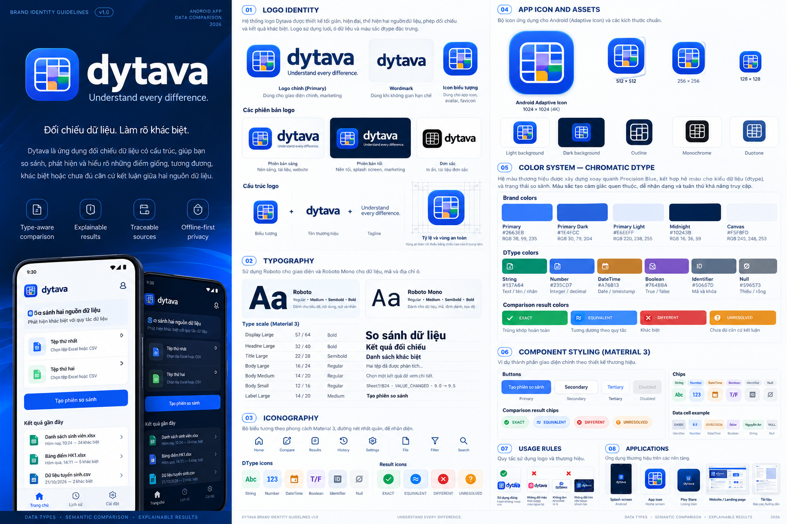
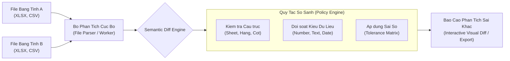

<p align="center">
  <picture>
    <source media="(prefers-color-scheme: dark)" srcset="web/assets/dytava-reversed-horizontal.svg">
    <source media="(prefers-color-scheme: light)" srcset="web/assets/dytava-primary-horizontal.svg">
    
  </picture>
</p>

<p align="center">
  <strong>Understand every difference.</strong><br>
  Privacy-first, multi-platform spreadsheet comparison and semantic difference engine.
</p>

<p align="center">
  <a href="https://github.com/nmtrucworking/dytava/actions"></a>
  <a href="https://flutter.dev"></a>
  <a href="https://nodejs.org"></a>
  <a href="#privacy-first-architecture"></a>
  <a href="LICENSE"></a>
</p>

---

## Tài liệu thiết kế hiện hành

**Bộ tài liệu có owner riêng:** [PRD](docs-dytava/product/PRD.md) · [SRS](docs-dytava/requirements/SRS.md) · [NFR](docs-dytava/requirements/NFR.md) · [Architecture](docs-dytava/architecture/ARCHITECTURE.md) · [Traceability](docs-dytava/requirements/TRACEABILITY_MATRIX.md) · [Document Control](docs-dytava/governance/DOCUMENT_CONTROL.md). Nội dung 01/02/03/07/09/10 của Master 2.2 là snapshot lịch sử, không là nơi sửa đồng thời với các nguồn này.

**Mở rộng phạm vi 12/11/2026:** [quyết định 1 GB và PDF](docs-dytava/decisions/ADR_SCOPE_EXPANSION_2026-11-12.md) yêu cầu tối đa **1 GB/tệp nguồn**, **một PDF diff hợp nhất A/B có format theo trạng thái** và **PDF báo cáo theo template Dytava**. [Report spec](docs-dytava/specs/report/README.md) và [kế hoạch nghiệm thu](docs-dytava/testing/EXPANDED_SCOPE_ACCEPTANCE.md) phân biệt yêu cầu với capability hiện có: web vẫn giới hạn 10 MiB (UI ghi “10 MB”), có CSV/JSON và [template PDF preview/CLI](docs-dytava/specs/report/RENDERER.md); mobile vẫn là PoC, chưa nhập tệp/xuất report. Merged diff PDF và pipeline 1 GB chưa triển khai.

**Quyết định phạm vi kỹ thuật 11/11/2026:** [9 ADR Android P0](docs-dytava/decisions/ADR_REGISTER_P0_2026-11-11.md) đã chốt OCR ảnh PNG/JPEG có review vào P0; XLSX/CSV/TSV là nguồn bảng tính P0; JSON và iOS chuyển P1. Đây là mục tiêu triển khai; Flutter app hiện là PoC, chưa đạt release/device gates.

Bắt đầu tại [Input Specification 0.1.0 — DRAFT](docs-dytava/specs/input/README.md): nguồn A/B, định dạng, raw types/provenance, cấu hình, validation, state machine, schemas và fixtures. Baseline thiết kế mobile là Flutter/Dart — Android P0, iOS P1; danh sách định dạng dự kiến không là bằng chứng adapter đã hỗ trợ.

[Chỉ mục tài liệu](docs-dytava/README.md) phân định Input/Core và phiên bản tham chiếu; [Project Description](docs-dytava/project/Project%20Description.md) giữ rõ yêu cầu học phần đọc ảnh và quyết định ưu tiên còn mở.

## Tong quan (Overview)

**Dytava** (con duoc biet den qua bo giai phap **ExcelCompare**) la nen tang so sanh bang tinh va phan tich sai khac ngu nghia (semantic diff) da nen tang hien dai. Du an duoc thiet ke theo mo hinh **Monorepo** bao gom ung dung di dong Flutter, ung dung Web bao mat cao va API dich vu quan tri.

Khac voi cac cong cu diff theo dong truyen thong, **Dytava** hoat dong o **cap o (cell) va kieu du lieu ngu nghia (data-type level)**:
- Hieu cau truc dong/cot, bang tinh nhieu sheet (XLSX, XLS, CSV, TSV).
- Phan biet gia tri tinh toan (*calculated value*) va cong thuc (*formula*).
- Sai so so hoc (*numeric tolerance*), lam tron ngay gio va chuan hoa van ban.
- **100% Client-Side Privacy**: Toan bo du lieu bang tinh duoc xu ly truc tiep tren thiet bi va trinh duyet nguoi dung qua Web Workers va bo nho cuc bo, **khong tai noi dung bang tinh len may chu**.

---

## Giao dien & Visual Concept

<p align="center">
  
</p>

---

## Cac tinh nang noi bat (Key Features)

| Tinh Nang | Mo Ta Chi Tiet |
| :--- | :--- |
| **100% Client-Side Privacy** | Khong gui file du lieu qua Internet. Tan dung Web Worker va Engine noi bo de phan tich hoan toan tren may khach. |
| **Semantic Diff Engine** | So sanh ngu nghia: Phat hien them/xoa dong, sua o, doi kieu du lieu (String sang Number/Date), va chenh lech cong thuc. |
| **Numeric & Precision Tolerance** | Thiet lap nguong sai so cho phep ($10^{-2}$, $10^{-6}$, hoac theo phan tram %) de tranh canh bao sai do sai so dau phay dong. |
| **Flutter Mobile App** | Ung dung di dong (`mobile/`) da nen tang (Android & iOS) gon nhe, tra cuu va so sanh nhanh bang tinh ngoai tuyen. |
| **Web App & Admin Portal** | Giao dien web hoan chinh (`web/`), tich hop cong cu so sanh truc quan, quan tri phat hanh, KPI metrics va kiem thu chap nhan. |
| **Da Dinh Dang & Xuat Bao Cao** | Doc ghi XLSX, XLS, CSV, TSV. Xuat bao cao sai khac dang bang truc quan, CSV hoac file Excel co danh dau mau. |

---

## Cau truc Monorepo (Workspace Architecture)

```text
excelcompare/
├── branding/                # Kho tai nguyen nhan dien thuong hieu chinh thuc v2.0
│   ├── index.html           # Trang Brand Showcase & UI Design System tuong tac
│   ├── README_VI.md         # Huong dan tich hop assets va phien ban branding
│   ├── catalog/             # Thu vien tra cuu 116+ icons va 18 dinh dang file
│   ├── documentation/       # Quy chuan Brand version va ngu nghia trang thai so sanh
│   └── mobile/              # Flutter Design System Dart code & assets (brand, icons, formats)
│
├── mobile/                  # Ung dung di dong da nen tang Flutter (Android & iOS)
│   ├── assets/dytava/       # Kho assets branding tich hop truc tiep trong Flutter
│   ├── lib/design_system/   # Thu vien Dart Design System (colors, icons, theme, widgets)
│   ├── lib/main.dart        # Entrypoint ung dung Flutter
│   └── pubspec.yaml         # Khai bao dependencies va assets Flutter
│
├── web/                     # Giao dien Web Client & Admin Portal
│   ├── assets/              # Logo SVG, PNG, Design tokens va App icons v2.0
│   ├── css/                 # Modern Responsive UI stylesheet
│   ├── js/                  # Compare Engine, File Parser va Web Worker
│   └── index.html           # Trang chu ung dung so sanh bang tinh
│
├── server/                  # Backend Express va Quan tri dich vu
│   ├── app.js               # Khoi tao Express app va middleware bao mat
│   ├── index.js             # Entrypoint server (Watch / Production)
│   └── migrations/          # SQLite database migrations
│
├── docs-dytava/             # Toan bo tai lieu ky thuat va Branding Obsidian vault
│   ├── branding.md          # Tai lieu nhan dien thuong hieu Dytava v2.0
│   └── attachments/         # File dinh kem truc quan va so do
│
├── tests/                   # Bo kiem thu tu dong (26 acceptance test cases)
├── .github/workflows/ci.yml # GitHub Actions CI tu dong kiem tra Web & Flutter
└── package.json             # Quan ly scripts Node.js va dependencies
```

---

## Huong dan cai dat & khoi chay (Getting Started)

**Mobile Android (macOS Apple Silicon, chỉ VS Code, không Android Studio hay điện thoại):** đọc [RUN_PROJECT.md](docs-dytava/guides/RUN_PROJECT.md). Cài Android SDK Command-line Tools và tạo AVD trước khi chạy `flutter run`. Bản mobile hiện là Semantic Comparison PoC, chưa nhập Excel/CSV/OCR/xuất báo cáo.

### Yeu cau moi truong (Prerequisites)
- **Node.js**: v24+ (yeu cau tu `package.json`)
- **Flutter SDK**: ban bao gom Dart SDK tuong thich `mobile/pubspec.yaml` (`^3.13.7`)
- **Trinh duyet**: Chrome, Firefox, Safari hoac Edge phien ban moi

---

### 1. Phan He Web & Server

```bash
# Cai dat dependencies Node.js
npm install

# Khoi chay server development (tu dong build web assets va watch backend)
npm run dev

# Mo trinh duyet tai:
# -> Web so sanh: http://localhost:3000
# -> Admin Portal: http://localhost:3000/admin (neu kich hoat)
```

**Chay kiem thu tu dong Web Engine:**
```bash
npm test
# Chay 26 kich ban kiem thu ngu nghia golden fixtures
```

---

### 2. Phan He Di Dong Flutter (`mobile/`)

```bash
# Di chuyen vao thu muc mobile
cd mobile

# Cai dat cac goi phu thuoc Flutter
flutter pub get

# Kiem tra code & chay smoke tests
flutter test

# Khoi chay tren thiet bi gia lap hoac may that ket noi
flutter run
```

---

## Kien truc so sanh ngu nghia (Diff Engine)



---

## Bo nhan dien thuong hieu chinh thuc (Official Brand Identity v2.0)

Du an ap dung quy chuan **Dytava Brand Identity v2.0 (Official Approved)**:

### 1. Bang mau chuan (Official Color Palette)
- **Primary Royal Blue**: `#2563EB` (Nut so sanh chinh, trang thai EQUIVALENT)
- **Sky Blue**: `#3B82F6` (Diem sang gradient, icon dieu huong)
- **Purple Accent**: `#8B5CF6` (Xuat bao cao, anh xa cot, hoc tap)
- **Cyan Accent**: `#06B6D4` (Lop bang tinh goc, trich xuat OCR)
- **Emerald Green**: `#10B981` (Nhap tep, Excel, trang thai EXACT)
- **Amber Warning**: `#F59E0B` (Canh bao doi soat, trang thai UNRESOLVED)
- **Crimson Danger**: `#EF4444` (Xoa du lieu, bao loi, trang thai DIFFERENT)
- **Neutral Background**: `#F3F4F6` (Mau nen ung dung)
- **Border / Divider**: `#E5E7EB` (Duong vien the, phan cach bang)
- **Pure White**: `#FFFFFF` (Nen the be mat)

### 2. Quy chuan 4 trang thai so sanh (Comparison Semantics)
- **EXACT (`#10B981`)**: Hai o trung khop chinh xac 100%.
- **EQUIVALENT (`#2563EB`)**: Hai o khac bieu dien chu nhung tuong duong gia tri theo quy tac chuan hoa.
- **DIFFERENT (`#EF4444`)**: Hai o khac biet ro ret ve du lieu.
- **UNRESOLVED (`#F59E0B`)**: Chua du co so ket luan (can kiem tra thu cong).

### 3. Tai nguyen truc quan & Design System
- **Brand Showcase truc quan:** [`branding/index.html`](branding/index.html)
- **Thu vien Icon Vault 4K (116+ icons):** [`branding/catalog/index.html`](branding/catalog/index.html)
- **Flutter Design System Package:** [`branding/mobile/lib/design_system/`](branding/mobile/lib/design_system/)

---

## Ban quyen & Tac gia (License & Author)

Du an duoc phan phoi duoi giay phep **[MIT License](LICENSE)**.

Duoc phat trien va duy tri boi **[nmtrucworking](https://github.com/nmtrucworking)**.
Moi dong gop (Pull Request, Issue) deu duoc hoan nghenh!
