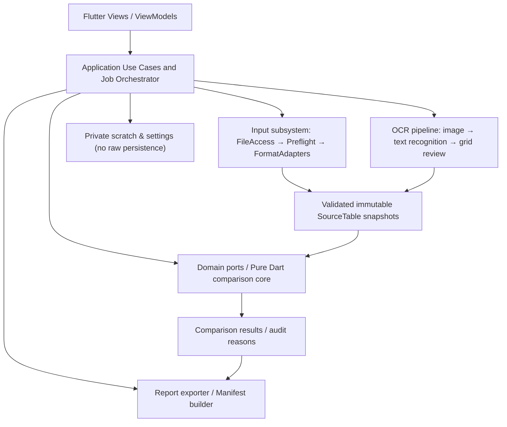
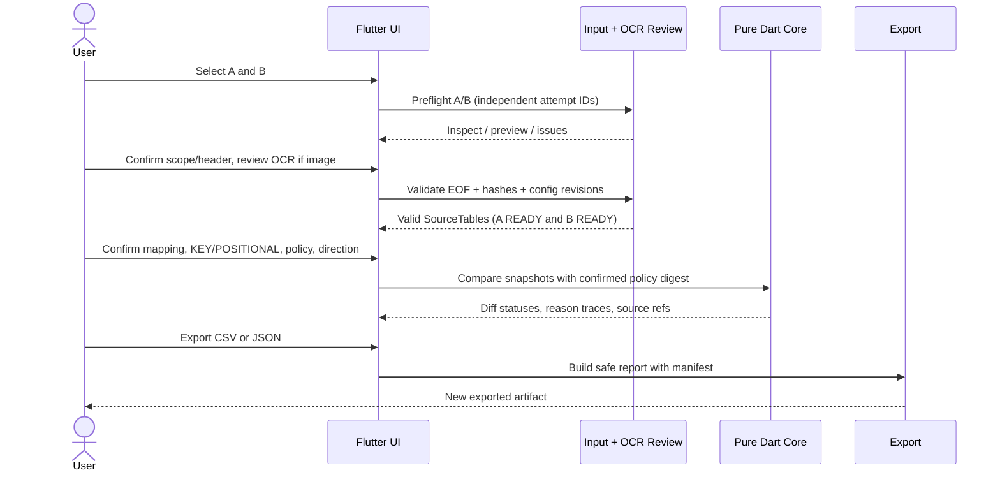

# Dytava — Software Architecture Document (SAD)

> **Nguồn chính thức cho cấu trúc, ranh giới module, phụ thuộc và runtime interaction của ứng dụng Flutter.** Đây là **target architecture**, không phải sơ đồ khẳng định code đã xây xong. [Input Specification](../specs/input/README.md) sở hữu source wire format/state/error; [Core Spec](../project/EXCELCOMPARE_Android_iPhone_Flutter_Package_2026-11-11/DATATYPE_POLICY_ENGINE_ANDROID_IOS_SPEC.md) sở hữu normalization/policy/matching; [ADR register](../decisions/ADR_REGISTER_P0_2026-11-11.md) sở hữu 9 lựa chọn đã chốt.

## 1. Context, architecture drivers và release

**Use case:** đọc hai nguồn A/B (XLSX/CSV/TSV hoặc tối đa một ảnh PNG/JPEG), bảo toàn bằng chứng, người dùng xác nhận schema/semantic, đối chiếu với Core Pure Dart rồi export CSV/JSON trên Android không cần Internet. External cloud/database không tham gia P0. iOS P1; Web/server trong monorepo là **implementation độc lập**, không phải evidence Flutter.

Architecture drivers: (a) source untrusted/read-only; (b) provenance + deterministic policy; (c) offline-first privacy; (d) memory-bounded Android; (e) OCR geometry + manual review; (f) platform-specific permission and lifecycle; (g) testability không phụ thuộc UI. NFR kiểm chứng tại [NFR](../requirements/NFR.md).

## 2. Logical decomposition / dependency direction



**Dependency rule:** Presentation → Application → Domain abstractions; Infrastructure implements domain/application ports, domain **không import** `flutter`, `material.dart`, `dart:ui`, Android/iOS SDK, OCR SDK, database drivers, file pickers. Input/OCR **không được tự canonicalize semantic**; comparator không nắm Android URI. Policy digest/version thuộc Core; raw file metadata + SourceRef thuộc Input.

**Sơ đồ liên quan:** [source-of-truth architecture.dot](../diagrams/architecture.dot), [rendered SVG](../diagrams/architecture.svg). Sơ đồ DOT hiện là luồng Input draft; SAD bổ sung toàn hệ thống. `flutter_architecture.png` là hình lịch sử Master 2.2 và **không** đủ thể hiện OCR P0.

## 3. C4-style containers và ownership

| Component | Owner thiết kế | Port / đầu vào | Output / invariant |
| --- | --- | --- | --- |
| Flutter Presentation | Architecture + PRD UX | User selections, review actions | UI state, **không** chứa business compare |
| Application/job coordinator | SAD + SRS | Source slots, revisions, confirmation receipts | Side import jobs, comparison job, cancellation |
| FileAccessPort | Input INP-002 | User-scoped SAF handles | Byte stream read-only, grants/access metadata |
| Preflight/FormatAdapter | Input INP-003/007 | File bytes + ImportConfig | SourceTable immutable, losses/capabilities, structured errors |
| OCR Adapter + Review | Input INP-010/ADR-002 | Bounded image, OCR recognizer, corrections | Geometry-backed `ocrText` cells, review receipts |
| Comparison Core | Core spec | Two validated snapshots + ComparisonConfig/policy | Canonical values, matched pairs, 4-state decisions, trace |
| Report exporter | SRS FR-013/NFR-SEC-03 | Comparison results + manifest | CSV diff + JSON report, safe output, no source writes |
| Private scratch/recovery | ADR-009/Input INP-008 | Non-seekable reads, attempt journal | Session-scoped temp only, reset/revalidate after restart |

**Adapter capability** (`FULL_SEMANTIC`, `TABULAR_VALUES_ONLY`, `OCR_REVIEW_REQUIRED`, `UNSUPPORTED`) là claim *có version/fixture evidence*, không suy theo file icon. Khi không đủ raw metadata, adapter phải ghi losses và chặn semantic mode tương ứng; không fabricate Excel address cho OCR/CSV.

## 4. Runtime interaction: import → compare → report



**Guards**:
- `A.PREVIEW_READY && B.PREVIEW_READY` **và** cả hai snapshots còn cùng hashes/config/parser versions; preview sampling không cấp READY.
- Key/policy/mapping/matching mode/direction phải user confirm; `KEY_DUPLICATE` không silent first-match; positional không yêu cầu key.
- OCR source `REVIEW_REQUIRED` cho tới khi **tất cả selected cells** confirmed, confidence không override.
- Config revision/source hash/extraction revision thay đổi → invalidate receipts, mapping hoặc comparison cache phù hợp; stale attempts callbacks bị loại.
- Cancel/timeout/kill → cleanup và không tạo report thành công một phần; restore state quay `SELECTED` và revalidate, không tiếp tục partial parse.

Nguồn chính cho state/event names: [INP-008](../specs/input/08_import_state_machine.md). Core statuses `EXACT/EQUIVALENT/DIFFERENT/UNRESOLVED` chỉ dành cho matched-cell comparison, không trộn với Input validation states.

## 5. OCR Android P0: trust boundary và contract gap

```text
Image (PNG/JPEG) read-only
  -> dimensions/orientation check (≤12MP bootstrap)
  -> app-private crop/rotation with transform-to-original
  -> ML Kit Text Recognition v2 bundled on-device (plugin PoC required)
  -> OCR tokens / polygons (not table structure guarantee)
  -> proposed grid (one table) + manual correction/confirmation
  -> versioned extraction manifest + review receipts
  -> SourceTable/SourceCell raw_lexeme + reviewed_text + SourceRef(polygon)
  -> Pure Dart Core only after review gate
```

Do not upload image or EXIF implicitly. Text recognition does **not** restore source Excel formulas/styles or hidden rows. Crop/rotation/layout mutation invalidates review receipts. A low confidence or null confidence must still require user confirmation.

**Blocking architecture gap:** current InputConfig schema 0.1.0 models tabular import, not image P0, despite schema SourceRef OCR shape. Implement a **versioned** InputConfig extension/migration plus OCR extraction/review receipt schemas and verifier fixtures **before** wiring OCR importer; do not mark `SUPPORTED` based on this SAD. Native ML Kit/plugin version/Android minSdk/camera permissions must pass compatibility PoC on actual build.

## 6. Repository: hiện thực vs mục tiêu

| Đường dẫn thực tế (đã kiểm tra) | Tình trạng | Kiến trúc mục tiêu / chưa có |
| --- | --- | --- |
| `mobile/lib/main.dart` | Flutter PoC: 2 text inputs, chọn semantic type, compare 2 cells | UI import A/B, OCR review, mapping, jobs, reports |
| `mobile/lib/design_system/` | Dart theme/components/assets | Dùng lại trong Presentation; không là processing evidence |
| `packages/excelcompare_core/lib/src/semantic_poc.dart` | Pure Dart semantic PoC subset | Policy compiler, keys, comparator/report semantics đầy đủ |
| `packages/excelcompare_core/test/semantic_poc_test.dart` | Core unit cases | Golden/matching/invariant corpus theo SRS |
| `mobile/android/` | Android project skeleton | Signed Android release, SAF integration/device tests |
| `mobile/ios/` | Chưa có trong snapshot được kiểm tra | iOS P1 scaffold & signing |
| `web/`, `server/` | Separate web/backend implementation | Không dùng để chứng nhận Android |
| `docs-dytava/specs/input/` | Schemas + fixtures + contract verifier, DRAFT | Image migration + adapters + runtime validation |

**Target module layout (không phải danh sách thư mục đang tồn tại):**

```text
mobile/lib/
  app/                           # router/composition root
  features/{import,ocr,mapping,policy,compare,results,export}/
  application/{use_cases,jobs}/  # cancellation, revisions, orchestration
  infrastructure/{file_access,adapters,ocr,export,scratch}/
  design_system/                 # existing
packages/excelcompare_core/lib/src/
  model/ policy/ normalization/ alignment/ compare/ report_contract/
```

**Decision về dependency:** Riverpod/go_router/Drift/file_picker/google_mlkit_text_recognition và package Excel mới là đề xuất/PoC, **không** được kê là dependencies đã cài nếu pubspec không khai báo. `excel` v4 là ứng viên XLSX PoC theo ADR-007; nếu raw lexemes/formula/cache không đạt, bổ sung OOXML-level processing hoặc thu hẹp supported mode và công bố loss. Không chuyển Apache POI JVM trực tiếp sang Pure Dart.

## 7. Resource, security, storage và deployment

- Android resource ceilings theo [ADR-004](../decisions/ADR_REGISTER_P0_2026-11-11.md): 10MiB/source, 64MiB XLSX decompressed, 2k ZIP entries, 100:1 ratio, 20k rows, 100 cols, 500k cells, 12MP image, 60s attempt watchdog. **Bootstrap rejection guards, chưa benchmark/không là SLO**.
- InputAdapter không chạy macro/formula, không fetch XML external entities/links; camera/gallery/SAF user action; no broad storage permission.
- Scratch app-private chỉ trong session/attempt, delete success/fail/cancel/close và startup sweep; no default raw cache; no claim encrypted storage nếu chưa implement.
- Output: JSON report và CSV diff mới; sanitized/typed strings chống formula injection; no source overwrite; user's explicit export action.
- Build/release: Flutter analyze/test + Dart core tests + contract verification + Android plugin/device/benchmark + signed APK smoke; CI build không thay thế device evidence. [Release guide](../project/EXCELCOMPARE_Android_iPhone_Flutter_Package_2026-11-11/ANDROID_IOS_BUILD_RELEASE_GUIDE.md) sở hữu ký và phát hành.

## 8. Risks, verification và change triggers

| Risk / trade-off | Mitigation & gate |
| --- | --- |
| XLSX parser mất raw token hoặc load whole workbook OOM | Adapter capability/loss + fidelity corpus + device profiling |
| OCR nhầm bảng/chữ/nhận layout không đúng | One-table scope, manual grid edits, review receipts, critical-field oracle |
| Suy key sai hoặc numeric identifier mất zeros | User confirmation; UNRESOLVED; no fabricated evidence |
| Stale snapshot sau revoke/crop/policy đổi | Attempt ID/revision/hash guards; invalidate dependent artifacts |
| Module separation trên giấy nhưng UI cài business logic | Domain package import checks + unit/integration code review |
| Architecture docs trông như code đã tồn tại | Bảng actual-vs-target + implementation evidence link cho từng module |

**Phê duyệt SAD:** owner/reviewer chưa được chỉ định; cần review cấu trúc ports, plugin PoC, Input schema migration, project layout thực và release gates. Không tự tuyên bố iOS parity hoặc OCR offline-ready trước device test. Khi đổi boundary/dependency phải ghi ADR mới hoặc sửa ADR liên quan rồi cập nhật SRS/NFR/traceability.
