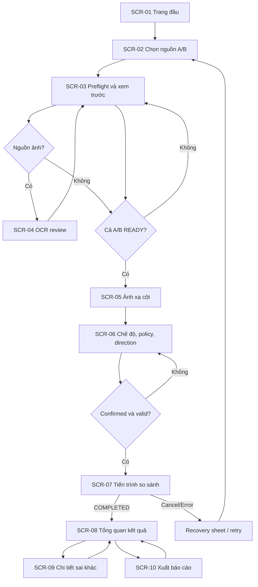

# Dytava — UI/UX Interaction & Screen Specification

> **Định hướng thiết kế chuẩn hóa: DYTAVA — Precision Workspace**
>
> **Triết lý:** **Editorial Minimalism × Data Instrument × Native Interaction**
>
> Vấn đề không nằm ở việc Dytava chưa áp dụng đủ Material Design. Vấn đề là **Dytava cần một ngôn ngữ thiết kế riêng đủ mạnh để người dùng nhận diện sản phẩm mà không cần nhìn logo**.
> Material 3 và Material 3 Expressive là nền tảng về hành vi và accessibility, không phải toàn bộ bản sắc. Dytava được định vị là ứng dụng đối chiếu dữ liệu có thẩm mỹ của công cụ phân tích chuyên nghiệp (data instrument), nhưng trải nghiệm thao tác tương tự các ứng dụng mobile hiện đại.
>
> **3 đặc trưng nhận diện cốt lõi (Core Signature Differentiators):**
> 1. **Comparison Rail:** Biểu diễn hai nguồn đầu vào A & B như hai luồng dữ liệu kết nối vật lý thuộc cùng một phiên đối chiếu, trạng thái nằm trực tiếp trên luồng.
> 2. **Difference Fingerprint:** Dải trực quan biểu diễn vị trí và mật độ sai khác trên toàn bảng, cho phép chạm vào từng phân đoạn để lọc/nhảy đến bản ghi tương ứng.
> 3. **Focus Diff:** Trải nghiệm xem sai lệch di động tập trung theo cặp giá trị Cũ/Mới, vuốt (swipe) để chuyển giữa các sai khác kèm haptic feedback, không ép đọc bảng nén chật chội.

## 1. Nguồn điều khiển và phạm vi

| Nguồn | Phần sở hữu (không lặp định nghĩa tại đây) |
| --- | --- |
| [PRD](../product/PRD.md) | US-01..US-15, persona, journey, scope P0/P1 |
| [SRS](../requirements/SRS.md) | FR-001..018, conditions, system behavior |
| [Business Requirements](../requirements/BUSINESS_REQUIREMENTS.md) | Business checkpoints, workflow và kịch bản ngoại lệ |
| [NFR](../requirements/NFR.md) | Accessibility, offline, dữ liệu lớn và release quality gates |
| [Input](../specs/input/README.md) / [Input State Machine](../specs/input/08_import_state_machine.md) | Artifact, preflight, import state, validation, OCR review |
| [Core](../project/EXCELCOMPARE_Android_iPhone_Flutter_Package_2026-11-11/DATATYPE_POLICY_ENGINE_ANDROID_IOS_SPEC.md) / [UDG3.1](../specs/engine/README.md) | Matching, verdicts, reason, evidence, runtime |
| [Report](../specs/report/README.md) | PDF formats/template, scope, manifest và export lifecycle |
| [Branding v2.0](../../branding/README_VI.md) / `mobile/lib/design_system/` | Màu, typography, icons, illustrations, Flutter theme |

**Thiết bị/nền tảng:** Android-first với Flutter và Material 3. Giao diện iOS P1 cần điều chỉnh theo tương tác nền tảng và QA riêng; không suy từ Android design ra iOS release proof.

**Nguyên tắc UX:** (1) Evidence before conclusion; (2) người dùng chủ động xác nhận các suy luận; (3) nhập dữ liệu và cấu hình độc lập cho A/B; (4) không che giấu trạng thái chưa xác định; (5) chỉ ra nguyên nhân và cách khắc phục; (6) ưu tiên nội dung nghiệp vụ hơn hình minh họa; (7) tối thiểu hóa quyền truy cập và dữ liệu lưu.

## 2. User journey và kiến trúc thông tin

### 2.1. Hành trình P0



### 2.2. Navigation model

- P0 dùng **guided step flow** (không dùng bottom-navigation đa tab chỉ để trang trí). Hiển thị tiến trình giai đoạn: **Nguồn → Cấu hình → So sánh → Kết quả**, với tiểu bước OCR/mapping khi phát sinh.
- `Back` giữ dữ liệu hợp lệ của bước trước; **đổi source bytes/scope/header** làm mất hiệu lực mapping và downstream result theo Input. Đổi **policy/direction** chỉ invalidate comparison/result, không tự hủy snapshots input.
- Sau run thành công, mở chi tiết bằng drill-down hoặc bottom sheet với nút **Trở về kết quả**. Không yêu cầu người dùng bắt đầu lại để xem một ô khác.
- Với tác vụ đang chạy, thao tác rời màn hình/đóng ứng dụng cần quy định về cancel/cleanup; **không** tuyên bố có background resume P0.
- `History` (khôi phục đầy đủ raw/results), cloud sync, accounts, admin, batch và iOS native-specific flows **không đặt vào thanh điều hướng P0** nếu chưa được phê duyệt trong scope.

### 2.3. Sơ đồ màn hình (screen inventory)

| ID | Màn hình | Người dùng đạt được gì | FR chính | Triển khai Flutter |
| --- | --- | --- | --- | --- |
| SCR-01 | Home / Start | Hiểu tác vụ, khởi tạo so sánh | US-01, FR-001 | FLOW_ONLY / fixture |
| SCR-02 | Source Selection | Chọn rõ A/B, đổi/đảo vai trò nguồn | FR-001, FR-012 | FLOW_ONLY / fixture |
| SCR-03 | Preflight & Scope Preview | Kiểm tra định dạng, cấu hình sheet/header/CSV, xem preview hợp lệ | FR-001..004, FR-016 | FLOW_ONLY / fixture |
| SCR-04 | OCR Review (conditional) | Xem ảnh gốc + geometry, sửa và xác nhận bảng | FR-003/012 | FLOW_ONLY / fixture |
| SCR-05 | Field Mapping | Ghép field A↔B bằng Field IDs 1:1 | FR-005 | FLOW_ONLY / fixture |
| SCR-06 | Matching & Policy | Chọn KEY/POSITIONAL, dtype, rules, direction | FR-004/006/008/009 | FLOW_ONLY / fixture |
| SCR-07 | Comparison Progress | Hiểu giai đoạn, progress/cancel, lỗi | FR-015/016 | FLOW_ONLY / fixture |
| SCR-08 | Results Overview | Thống kê chính xác, lọc, tìm sai khác | FR-007/009/013 | FLOW_ONLY / fixture |
| SCR-09 | Difference Detail | Kiểm tra raw A/B, canonical, rule/reason, SourceRef | FR-003/007/008/009/013 | FLOW_ONLY / fixture |
| SCR-10 | Export | Chọn CSV/JSON/2 PDF, phạm vi, lưu/chia sẻ | FR-013/015/017/018 | FLOW_ONLY / fixture |

Các trạng thái **Error / Empty / Loading / Review / Permission / Cancel** là các variants hoặc sheets theo ngữ cảnh, không cần một route độc lập cho mỗi lỗi. `CompareDemoPage` hiện hành giữ làm diagnostic/sandbox, không được gọi là SCR-08 production.

## 3. Đặc tả chi tiết màn hình (Precision Workspace 5-Screen Suite)

### SCR-01 — Home / Start (Workspace Overview)

**Ngôn ngữ thị giác:** Editorial Minimalism. Tránh kiểu dashboard nhiều thẻ màu mè hoặc biểu đồ trang trí rỗng.
- **Header:**
  - Wordmark: `dytava.` (lowercase bold, chữ đen graphite).
  - Sub-tag: `WORKSPACE / 01` (font kỹ thuật `IBM Plex Mono` / monospace, chữ xám trung tính, letter-spacing rộng).
  - Tiêu đề chính: **Đối chiếu dữ liệu** (Typography `Manrope` / displayMedium).
  - Slogan / Subtitle: *Hai nguồn. Một kết quả rõ ràng.* (Màu `textSecondary`, editorial spacing).
- **Thành phần trọng điểm — Comparison Rail (Active Comparison Card):**
  - Card chính bo **20dp**, viền hairline sắc nét `#E5E7EB`, nền `#FFFFFF` hoặc graphite tinh tế.
  - Header khối: `ACTIVE COMPARISON` kèm trạng thái luồng (ví dụ: `Đang chuẩn bị`, `Sẵn sàng đối chiếu` hoặc `Đã hoàn tất`).
  - **Luồng dữ liệu kết nối (Dual Stream Rail):** Nguồn A và Nguồn B được biểu diễn trực quan nối nhau bằng đường ray đồng nhất (Comparison Rail line):
    - **Nguồn A (Tham chiếu):** Huy hiệu tag `A` trên nền Signal Lime (`#D8F36A`) hoặc Neutral, tên tệp (vd: `sample-image.png`), nhãn trạng thái nghiệp vụ (vd: `Cần xác minh dữ liệu` hoặc `1,250 dòng · Sẵn sàng`).
    - **Nguồn B (Đối chiếu):** Huy hiệu tag `B`, tên tệp (vd: `Chọn nguồn B` hoặc `target-data.xlsx`), nhãn trạng thái (vd: `Chưa có dữ liệu`).
  - **Action CTA:** Nút chính bo **12dp** với màu Signal Lime (`#D8F36A`) chữ graphite đậm hoặc Primary Blue với nhãn **Tiếp tục thiết lập** (khi đã có dữ liệu) hoặc **Bắt đầu so sánh** (khi tạo mới).
- **Phân vùng Gần đây (Recent Sessions):**
  - Header: `Gần đây` bên trái, `Xem tất cả` bên phải.
  - Thẻ phiên hiện tại: `Phiên hiện tại · Bước 1/4 · Chưa hoàn tất` hoặc tóm tắt phiên gần nhất kèm fingerprint kết quả.
- **Thanh điều hướng tối giản (Minimal Navigation):**
  - 3 điểm chạm chính ở vùng ngón cái: `Trang chủ`, `Lịch sử`, `Cài đặt`.

### SCR-02 — Source Selection (Dual-Stream Comparison Rail)

**Cấu trúc:** Hai nguồn dữ liệu được kết nối bằng một cấu trúc thị giác chung mang tên **Comparison Rail**. Trạng thái đọc tệp, xác minh và chuẩn bị đối chiếu nằm ngay trên luồng, thay vì những form nhập liệu độc lập.
- **Visual Rail Pipeline:**
  - Một đường ray dọc bên trái hoặc dải liên kết giữa hai khối kết nối luồng A và B.
  - Các node trạng thái trên rail: `1. Đọc tệp` → `2. Xác minh định dạng (Format Guards)` → `3. Chuẩn bị đối chiếu`.
  - Node đổi màu theo trạng thái: Chờ (`#607276`), Đang xử lý (`#3B82F6`), Lỗi/Cần xem xét (`#E97965`), Sẵn sàng (`#D8F36A` / `#10B981`).
- **Thẻ Nguồn A & Nguồn B:**
  - Card bo **20dp**, nền trắng trên canvas trung tính (`#F8F9FA`).
  - Data chips bo **8dp** hiển thị dung lượng, định dạng (`XLSX`, `CSV`, `IMG/OCR`) và fingerprint rút gọn.
  - Thao tác tích hợp: `Chọn tệp / Đổi nguồn`, `Xem cấu hình & phạm vi (Preflight)`, `Đảo vai trò A ↔ B`.
- **Ràng buộc nghiệp vụ:** Khi một nguồn là ảnh (OCR), nguồn còn lại khóa chỉ cho chọn bảng tính và hiển thị giải thích rõ ràng.
- **CTA:** `Tiếp tục sang Ánh xạ` chỉ mở khi cả hai nguồn đạt `PREVIEW_READY`.

### SCR-03 — Preflight & Scope Preview

**Nhiệm vụ:** quan sát metadata, validation issues và preview sample; cấu hình source độc lập: XLSX sheet/range, CSV/TSV delimiter/encoding/header row; xác nhận header hoặc `none`. Header first-row **chỉ là gợi ý**, có thể trùng/trống. Bảng nhỏ hiển thị số hàng/cột biết được, nhưng ghi rõ **sample** hay **full validated**.

**Thiết kế đề xuất:** chuyển A/B bằng segmented control; vùng metadata tóm tắt; nhóm validation issues (Error/Needs review/Warning); vùng preview phân trang/virtualization; sticky header/row index; nút `Xác nhận phạm vi`.

### SCR-04 — OCR Review

**Bố cục:** vùng **Ảnh gốc** với crop/rotate và polygon/bounding boxes; vùng **Bảng dựng nháp** theo hàng/cột; thanh cảnh báo các ô chưa review hoặc cell/layout ambiguous; cho phép chỉnh văn bản ô, chia/gộp hàng/cột ở mức được implement, chọn selected scope, xác nhận từng ô/vùng và **Xác nhận toàn bộ sau review**.

### SCR-05 — Column Mapping (Data Instrument Pairing)

**Cấu trúc:** Thẩm mỹ công cụ đo lường dữ liệu chính xác (Data Instrument). Bố cục phân cấp sắc nét, loại bỏ chi tiết đồ họa dư thừa.
- **Ma trận ghép 1:1:**
  - Hiển thị song song hai cột: **Trường Nguồn A** ↔ **Trường Nguồn B**.
  - Mỗi hàng ghép là một **Mapping Rail Item** bo **10dp**, nền trắng, viền hairline `#E5E7EB`.
  - Cột giữa có connector chỉ thị trạng thái liên kết:
    - Mapped (Đã ghép): Đường line màu Signal Lime hoặc Primary kèm icon liên kết chắc chắn.
    - Unmapped (Chưa ghép): Đường đứt đoạn màu Precision Slate `#607276`.
    - Ambiguous / Conflict (Trùng/Xung đột): Điểm báo màu Difference Coral `#E97965`.
- **Tabular Figures:** Tên trường kèm kiểu dữ liệu suy luận (`IDENTIFIER`, `DECIMAL`, `TEXT`), chỉ số cột và giá trị mẫu sử dụng font `IBM Plex Mono` / monospace căn lề chuẩn xác.
- **Thanh tổng kết tiến độ ánh xạ:** `Đã ghép: X/Y trường` kèm nút `Tự động gợi ý` và `Tiếp tục cấu hình chính sách`.

### SCR-06 — Matching, Semantic Policy & Direction

**Sections:**
1. **Phương pháp ghép bản ghi:** `Theo vị trí (POSITIONAL)` hoặc `Theo khóa (KEY)`. KEY cho phép chọn một/nhiều field có thứ tự; hiện rõ số key null/duplicate nếu phát hiện được toàn scope.
2. **Kiểu và chính sách theo field:** IDENTIFIER, FREE_TEXT, DECIMAL, BOOLEAN, PERCENTAGE; tolerance, case, whitespace.
3. **Hướng so sánh:** A→B (hoặc B→A) được người dùng xác nhận có chủ đích.
4. **CTA:** `Chạy đối chiếu` kích hoạt tiến trình so sánh.

### SCR-07 — Comparison Progress

**Bố cục:** Tên phiên, progress stage (Read/Index/Align/Compare/Audit), số hàng đã xử lý dạng Tabular figures, nút `Hủy` an toàn.

### SCR-08 — Comparison Results (Difference Fingerprint & Summary)

**Thành phần chữ ký — Difference Fingerprint (Dải vân tay sai khác):**
- Đặt nổi bật ngay dưới header kết quả: Một dải ngang đa phân đoạn (Multi-segment density strip) thể hiện toàn bộ không gian dữ liệu đối soát:
  - Phân đoạn **Trùng khớp (Exact/Matched)**: Màu xám trung tính nhạt `#E5E7EB` / `#607276`.
  - Phân đoạn **Sai khác (Difference)**: Màu Difference Coral rực sáng `#E97965`.
  - Phân đoạn **Cần xem xét (Unresolved / Structural)**: Màu Amber `#F59E0B`.
- **Tương tác chạm (Interactive Drill-down):** Người dùng có thể chạm trực tiếp vào bất kỳ cụm màu nào trên Fingerprint để danh sách bên dưới tự động cuộn và lọc đến đúng khoảng dòng dữ liệu đó.
- Phía trên dải có legend giải thích: `Trùng khớp`, `Sai khác`, `Cần xem xét` cùng tỷ lệ phần trăm dạng Tabular figures.

**Phân vùng thống kê (Instrument Metrics):**
- Thống kê 4 nhóm kết luận (Exact, Equivalent, Different, Unresolved) trong các box bo **14dp** với số liệu lớn, font Tabular figures.
- Thay đổi cấu trúc (Thêm/Bớt hàng, Thêm/Bớt cột) được tách riêng, không cộng gộp lẫn lộn.
- Dải bộ lọc (Filter Rail) tối giản cho phép chuyển nhanh giữa `Tất cả`, `Sai khác (#E97965)`, `Tương đương`, `Chưa kết luận`.
- Danh sách sai khác hiển thị dưới dạng các thẻ tóm tắt có chỉ số dòng/khóa và nút mở `Chi tiết sai khác`.

### SCR-09 — Difference Detail (Focus Diff)

**Triết lý: Focus Diff trên màn hình nhỏ:** Không ép người dùng xem hai bảng Excel cạnh nhau gây tràn ngang và mất bối cảnh. Mỗi bản ghi được biểu diễn theo một **cặp giá trị Cũ/Mới tập trung**:
- **Cấu trúc Focus Diff Card:**
  - Card chính bo **20dp**, nền `#FFFFFF` với viền hairline sắc sảo.
  - **Khối Nguồn A (Tham chiếu / Cũ):** Nhãn `NGUỒN A`, giá trị raw, kiểu dữ liệu, định danh dòng và tọa độ SourceRef (`Sheet1!C4` hoặc dòng CSV).
  - **Đường chuyển tiếp Diff Connector:** Ký hiệu chuyển đổi hoặc mức độ chênh lệch.
  - **Khối Nguồn B (Đối chiếu / Mới):** Nhãn `NGUỒN B`, giá trị raw mới, highlight ký tự hoặc phần giá trị sai khác bằng màu Difference Coral (`#E97965`).
  - **Trường Canonical & Quy tắc áp dụng:** Hiển thị rõ giá trị sau chuẩn hóa, Rule ID và lý do kết luận (`reasons`).
- **Thao tác Native Interaction (Swipe & Haptics):**
  - Người dùng có thể vuốt ngang (hoặc dùng thanh điều hướng Previous/Next) để lật qua lại giữa các bản ghi sai khác trong danh sách đã lọc.
  - Mỗi lần lật bản ghi kích hoạt phản hồi xúc giác nhẹ (Haptics: `lightImpact` / `selectionClick`) tạo cảm giác tương tác vật lý chân thực như công cụ đo lường.
- Nút sao chép dữ liệu có nhãn bảo vệ tính riêng tư.

### SCR-10 — Export & Share

Tùy chọn xuất báo cáo đa định dạng (CSV, JSON, PDF diff hợp nhất A/B, PDF báo cáo Dytava). Cấu hình phạm vi xuất (Toàn bộ, Chỉ sai khác, Theo bộ lọc) kèm cảnh báo bảo mật trước khi chia sẻ.

**Tùy chọn chính:** `CSV diff`, `JSON report`, `PDF diff hợp nhất A/B`, `PDF báo cáo Dytava` (template/version). Có thể chọn nhiều output **nhưng mỗi loại tạo artifact riêng**; hai PDF không bị hợp nhất thành một output. Merged diff PDF là **một PDF bao gồm union A/B**.

**Cấu hình:** `Toàn bộ`, `Chỉ sai khác`, `Theo bộ lọc hiện tại`; có preview về số rows/cells được xuất so với tổng result và nhãn rõ khi scope không phải full. `UNRESOLVED` phải hiện diện trong differences-only; equivalent chỉ đưa vào theo setting/report contract. Chọn nơi lưu/chia sẻ qua Android document/share flow khi output hoàn tất.

**Ghi chú trước chia sẻ:** “Báo cáo có thể chứa dữ liệu nguồn; chỉ chia sẻ với người nhận phù hợp.” Report metadata không kèm path/token/EXIF. Với PDF cần hiển thị page/template setup nếu có.

**States:** VALIDATING → RENDERING → VERIFYING → PUBLISHING → COMPLETED / FAILED / CANCELLED (UX stage labels là đề xuất, exporter contract là nguồn chuẩn). Không đánh dấu `COMPLETED` trước khi ghi và verify file. Không tự suy source 1 GB tức PDF vô hạn; thiếu disk/resource báo có hướng xử lý.

## 4. Thiết kế hiển thị bảng trên màn hình nhỏ

| Vấn đề | Hướng UX đề xuất | Điều kiện cần test |
| --- | --- | --- |
| Nhiều cột | Cho cuộn ngang có affordance “kéo để xem thêm”, sticky row identity/key khi có thể | 320/360/412 dp; cột đầu và nhãn side không mất |
| Nhiều hàng | Chỉ render viewport/paged windows theo cursor; không tạo mọi widget cell cùng lúc | 50k×15, corpus tới 1 GB; jank/heap phải đo |
| Giá trị dài | Ellipsis có `Xem đầy đủ`, wrap trong detail, copy raw có thông báo | Long Unicode, multi-line, ký tự điều khiển được escape |
| Tên field trùng/trống | Dùng Field ID/số thứ tự, không ép tự đổi tên nguồn | Header duplicate/no header; mapping không nhầm |
| A/B khó đọc | Summary list ngắn; chi tiết side-by-side nếu đủ rộng, stack A trên B khi hẹp | Không lẫn bên, SourceRef và null kinds |
| Có nhiều trạng thái | Icon + label + màu; structural thay đổi tách khỏi verdicts | TalkBack, grayscale, color blindness |
| Tiến trình lớn | Thể hiện stage, chỉ phần trăm khi có denominator tin cậy; có cancel | Nguồn unknown-size/streaming và process death |

Không sử dụng một `DataTable` hiển thị đồng thời toàn bộ bảng lớn. Virtualization, search/filter và cursor queries phải tuân thủ UDG3.1/EX-1; giao diện không được yêu cầu materialize toàn result trong RAM.

## 5. Visual design — Chuẩn Precision Workspace (DYTAVA v3.2 UI Mockup Set)

### 5.1. Design Tokens chuẩn hóa Precision Workspace

| Semantic Role | Token Code | HEX | Mục đích & Ngữ cảnh sử dụng |
| --- | --- | --- | --- |
| **LIME PRIMARY** | `DytavaColors.limePrimary` | `#C8FF4A` | Hành động chính (CTA Pill, "Bắt đầu đối chiếu", "Tiếp tục"), toggle switch active, vòng tròn tiến trình |
| **LIME-600** | `DytavaColors.lime600` | `#86E63A` | Điểm nhấn viền active, hover state, chỉ báo tiến trình chạy nền |
| **OFF-WHITE** | `DytavaColors.offWhite` | `#F7F6F2` | Nền canvas sáng mặc định của ứng dụng và website, thanh nhã và êm mắt |
| **WARM SURFACE** | `DytavaColors.warmSurface` | `#EDEBE4` | Bề mặt container thẻ, vùng tải tệp và ô nhập dữ liệu |
| **GRAPHITE** | `DytavaColors.graphite` | `#0F1A1C` | Màu chữ chính trên nền sáng, nút phụ tương phản cao, header kỹ thuật |
| **GRAPHITE-800** | `DytavaColors.graphite800` | `#1B2426` | Bề mặt tối cho Dark Mode, container Focus Diff, status pill nền đen |
| **DIFFERENCE CORAL** | `DytavaColors.differenceCoral` | `#E97965` | Sai khác dữ liệu (`DIFFERENT`), mật độ sai lệch trên Difference Fingerprint, Focus Diff highlight |
| **NEUTRAL** | `DytavaColors.precisionNeutral` | `#607276` | Đường ray kết nối (rail), nhãn kỹ thuật, chỉ dẫn cấu trúc, trạng thái chờ |
| **EXACT / SUCCESS** | `DytavaColors.exact` | `#10B981` | Trùng khớp tuyệt đối 100% (`EXACT`), icon Excel xanh lá |
| **UNRESOLVED / AMBER** | `DytavaColors.unresolved` | `#F59E0B` | Chưa đủ căn cứ (`UNRESOLVED`), cảnh báo rà soát thủ công |
| **SOURCE BLUE** | `DytavaColors.sourceBlue` | `#38BDF8` | Phân định luồng dữ liệu Nguồn B |
| **SUBTLE BORDER** | `DytavaColors.border` | `#D8D5CC` | Đường hairline phân cách thẻ, phân vùng bảng tính |

**Quy chuẩn Typography:**
- **Tiêu đề / Display:** **Manrope** (500, 600, 700, 800) mang cấu trúc hình học hiện đại và dứt khoát.
- **Giao diện & Nội dung:** **Inter (System)** (400, 500, 600, 700) tối ưu cho việc đọc mật độ cao trên màn hình.
- **Dữ liệu kỹ thuật & số liệu:** **Inter (Tabular)** bắt buộc dùng **Tabular Figures** (`tabular-nums lining-nums`) để các cột số và số dòng căn thẳng hàng tuyệt đối.
- *Fallback offline cục bộ:* `Plus Jakarta Sans` cho Display, `Be Vietnam Pro` cho Interface, `IBM Plex Mono` cho Mono code.

**Quy chuẩn Signature Components:**
- **Nút chính (Primary CTA):** Hình dạng viên con nhộng (**Pill**, `border-radius: 9999px`), nền Lime Primary `#C8FF4A`, chữ Graphite `#0F1A1C` đậm, icon mũi tên `→`.
- **Nút phụ (Secondary):** Hình dạng viên con nhộng (**Pill**), nền Warm Surface `#EDEBE4` hoặc viền mảnh Graphite.
- **Status Pill:** Nền tối Graphite-800 `#1B2426`, chữ và chấm tròn phát sáng Lime Primary `#C8FF4A` (`● Đang tiến hành`).
- **Thẻ tệp (File Card):** Nền Warm Surface `#EDEBE4`, icon Excel xanh lá, hiển thị tên tệp, số dòng và kích thước.
- **Difference Fingerprint:** Ma trận trực quan hóa vị trí và mật độ sai khác theo từng sheet.
- **Donut Progress Ring:** Vòng cung Lime rực rỡ thể hiện tỷ lệ trùng khớp (`96,8% Trùng khớp`) hoặc tiến trình xử lý.

### 5.2. Quy ước trạng thái và nội dung chữ

| Kết luận | Label UI tiếng Việt | Icon/cue đề xuất | Hành vi |
| --- | --- | --- | --- |
| EXACT | Trùng khớp | Check + xanh | Xem raw và SourceRef nếu yêu cầu |
| EQUIVALENT | Tương đương theo quy tắc | Equal/check + xanh dương | Xem biểu diễn A/B, canonical, rule ID |
| DIFFERENT | Khác biệt | Alert/diff + đỏ | Thấy rõ A/B và lý do |
| UNRESOLVED | Chưa đủ căn cứ | Question/alert + vàng | Hướng dẫn kiểm tra thủ công, không suy là DIFFERENT |
| ROW_ADDED / REMOVED | Hàng thêm / Hàng thiếu theo hướng | + / − + nhãn | Hiển thị side hiện diện; **không là verdict thứ năm** |
| FIELD_ADDED / REMOVED | Cột thêm / Cột thiếu theo hướng | + / − + nhãn | Tách thống kê cấu trúc khỏi matched cells |

**Copy principles:** nội dung có tác vụ/giải pháp cụ thể. Ví dụ: “Nguồn B chưa hoàn tất kiểm tra. Chọn **Xem vấn đề** để xử lý.” Không dùng câu “Hai bảng giống nhau 100%” nếu vẫn có UNRESOLVED, unmatched, filtered scope hoặc thiếu bằng chứng.

### 5.3. Brand Asset Usage Specification (Tích hợp hệ thống Branding v2.0)

Thay vì nhúng thủ công `Icon(Icons.xxx)` hoặc đặt illustration trang trí dàn trải, tầng Presentation sử dụng hai thành phần chuẩn hóa trong [`dytava_asset.dart`](../../mobile/lib/design_system/dytava_asset.dart):

- **`BrandIcon`**: hiển thị Functional Icons (`116` icon trong `assets/dytava/icons/svg/`), File Format Icons (`18` định dạng trong `assets/dytava/formats/svg/`) và Status/Semantic Icons (`dtype-*`, `exact`, `equivalent`, `different`, `unresolved`). Cung cấp các factory ngữ nghĩa: `BrandIcon.format(SourceFormat)`, `BrandIcon.decision(DecisionStatus)`, `BrandIcon.semanticType(SemanticType)`, `BrandIcon.inputState(InputState)`.
- **`BrandIllustration`**: hiển thị Illustration Library (`47` SVG trong `assets/dytava/illustrations/svg/square/` và `/wide/`) theo trạng thái nghiệp vụ. Tự động điều chỉnh kích thước và tỷ lệ (`1:1` hoặc `16:9`) theo không gian màn hình (`320dp` / `360dp` / `412dp` / `tablet`) và tỷ lệ phóng chữ (`200%`) để không lấn át thao tác chính.

#### Quy tắc phân vai 3 lớp tài nguyên

| Lớp tài nguyên | Thành phần Flutter | Quy tắc sử dụng & Accessibility |
| --- | --- | --- |
| **Functional Icons** | `BrandIcon` (`DytavaIcons.*`) | Dùng cho điều hướng, nút bấm, định dạng tệp, kiểu dữ liệu (`dtype-*`) và trạng thái ô. Icon đi kèm nhãn chữ đặt `semanticLabel = null` (`excludeFromSemantics: true`); icon độc lập bắt buộc có `semanticLabel`. |
| **Contextual Illustrations** | `BrandIllustration` (`DytavaIllustrations.*`) | Dùng cho onboarding, empty state, trạng thái xử lý (`processing*`), hoàn tất (`success*`) và cảnh báo/lỗi (`status*`). Tối đa **1 illustration chính** trên vùng nhìn đầu tiên; mặc định loại khỏi thứ tự đọc TalkBack trừ khi mang thông tin trạng thái độc lập. |
| **Brand Identity** | `DytavaIcons.symbol` / `horizontal`, `DytavaColors`, `DytavaTypography` | Nhất quán nhận diện thương hiệu; không đổi màu logo để báo lỗi hay trạng thái dữ liệu. |

#### Ma trận phân bổ Asset theo màn hình và trạng thái (`SCR-01..10`)

| Màn hình | Trạng thái nghiệp vụ | Component chứa | Functional Icons (`BrandIcon`) | Illustration (`BrandIllustration`) | Kích thước & Thay thế |
| --- | --- | --- | --- | --- | --- |
| **SCR-01 Home** | Chưa có phiên / Đang có phiên | `HomeScreenView`, `DytavaSessionResumeCard` | `symbol`, `importData`, `play`, `fileXlsx`, `fileCsv`, `filePng`, `saveRule`, `settings` | `heroGetStarted` (chưa có phiên) hoặc `heroEmptyWorkspace` (đang có phiên); `securityLocal` ở thẻ bảo mật | Hero `maxHeight: 108dp` (co `0.82x` ở `<350dp`); `securityLocal` `42dp` |
| **SCR-02 Source Selection** | `UNSELECTED` → `SELECTED` / `PREVIEW_READY` | `SourceSelectionView`, `DytavaFileCard` | `play`, `check`, `fileCsv`, `ocr`, `preview`, `delete`, `cancel`, `mapping` | Đầu trang: `onboardingImport`. Trong từng thẻ A/B khi `UNSELECTED`: `emptyFiles` | Khi đã chọn tệp (`artifact != null`), **ẩn** `emptyFiles` và thay bằng `BrandIcon.format(format)` (`24dp`) |
| **SCR-03 Preflight & Preview** | `PREFLIGHTING` / `PARSING` / `PREVIEW_READY` / `FAILED` / `CANCELLED` | `PreviewScreenView`, `DytavaSheetPreviewTable` | `rows`, `columns`, `workbook`, `play`, `check`, `ocr`, `refresh`, `back` | Đang nạp: `processingImport`; Hợp lệ: `successImport`; Hủy: `statusCancelled`; Lỗi: `BrandIllustration.issue(...)` (`statusFileCorrupt`, `statusNoPermission`, `statusUnsupportedFormat`) | `processingImport` `72dp` kèm `LinearProgressIndicator` thực; `successImport` `48dp` |
| **SCR-04 OCR Review** | `NEEDS_REVIEW` (nhánh nguồn ảnh) | `OcrReviewScreenView` | `ocr`, `cells`, `check`, `crop` | `processingOcr` ở banner kiểm duyệt từng ô nhận dạng | `52dp`; khóa CTA xác nhận cho tới khi duyệt đủ 100% ô |
| **SCR-05 Field Mapping** | Chưa ghép cột (`mappings.isEmpty`) / Đã ghép cột | `MappingScreenView` | `mapping`, `columns`, `link`, `check`, `empty`, `policy` | Đầu trang: `onboardingMapping`; Khi chưa ghép cột nào: `emptyMapping` | Khi `mappings.isNotEmpty`, ẩn `emptyMapping` và hiển thị danh sách cặp cột 1:1 |
| **SCR-06 Matching & Policy** | Cấu hình khóa, quy tắc từng cột & chiều đối chiếu | `PolicyScreenView`, `showDytavaConfigConfirmationSheet` | `policy`, `key`, `normalize`, `compareFiles`, `BrandIcon.semanticType(type)` (`dtypeIdentifier`, `dtypeDecimal`, `dtypeString`, `dtypeBoolean`, `dtypePercentage`) | `onboardingPolicy` trên thẻ tóm tắt cấu hình | `onboardingPolicy` `maxHeight: 48dp`; mỗi cột hiển thị icon `dtype-*` `22dp` |
| **SCR-07 Comparison Progress** | `VALIDATING` / `RUNNING` / `CANCELLING` / `CANCELLED` / `FAILED` | `ProgressScreenView` | `cancel`, `back`, `refresh` | Đang chạy: `processingCompare`; Đã hủy: `statusCancelled`; Lỗi: `statusError` | `84dp`; bắt buộc đi kèm `LinearProgressIndicator` thực, không dùng hình động giả |
| **SCR-08 Results Overview** | `COMPLETED` / Lọc danh sách ô / Bảng `Sheet Diff` | `ResultsScreenView`, `DytavaPriorityDiffCard`, `DytavaSheetDiffView` | `exact`, `equivalent`, `different`, `unresolved`, `differences`, `added`, `removed`, `duplicate`, `compareTable`, `filter`, `preview`, `openExternal`, `export` | Header hoàn thành: `successCompare`; Khi bộ lọc có 0 kết quả: `emptyFilter` | `successCompare` `48dp`; ưu tiên hiển thị số liệu và `DytavaPriorityDiffCard` trước lưới bảng |
| **SCR-09 Difference Detail** | Kiểm tra bằng chứng 1 cặp ô (`EXACT` / `EQUIVALENT` / `DIFFERENT` / `UNRESOLVED`) | `DifferenceDetailScreenView`, `showDytavaCellDetailBottomSheet` | `back`, `forward`, `differences`, `policy`, `close` | `BrandIllustration.verdict(status)`: `statusExact`, `statusEquivalent`, `statusDifferent`, `statusUnresolved` | `52dp` ở thẻ tiêu đề kết luận; hai khối giá trị A/B xếp dọc trên điện thoại (`<680dp`) |
| **SCR-10 Export & Preview** | Cấu hình / Đang tạo preview / Hoàn tất preview RAM | `ExportScreenView` | `report`, `filter`, `fileJson`, `cancel`, `back` | Thẻ bảo mật: `securityLocal`; Thẻ cấu hình: `onboardingReport`; Đang dựng: `processingReport` | **Không** dùng `successExport` hoặc `processingCloud` khi mới chỉ tạo JSON preview trong bộ nhớ tạm |

> **Giới hạn phạm vi bắt buộc:** Tài nguyên tồn tại trong kho (`processingCloud`, `successExport`, `emptyFavorites`, `emptyNotifications`) không được đưa vào luồng thực thi khi tính năng tương ứng chưa được triển khai và kiểm chứng.

## 6. State/feedback contracts và quản lý lỗi

### 6.1. Import state thể hiện trên UI

Các state nguồn được **tham chiếu nguyên nghĩa** từ `INP-008`: `UNSELECTED`, `SELECTED`, `PREFLIGHTING`, `PARSING`, `NEEDS_REVIEW`, `PREVIEW_READY`, `FAILED`, `CANCELLED`. Không tự thêm alias `READY` làm trạng thái domain. Trên UI có thể dùng nhãn tiếng Việt:

| State | Label gợi ý | CTA |
| --- | --- | --- |
| UNSELECTED | Chưa chọn nguồn | Chọn nguồn |
| SELECTED | Đã chọn — chưa xác minh | Kiểm tra |
| PREFLIGHTING | Đang kiểm tra tệp | Hủy |
| PARSING | Đang phân tích dữ liệu | Hủy |
| NEEDS_REVIEW | Cần xác nhận thông tin | Xem và xác nhận |
| PREVIEW_READY | Nguồn hợp lệ để tiếp tục | Tiếp tục nếu cả A/B hợp lệ |
| FAILED | Không thể đọc nguồn | Xem lỗi / Thử lại / Đổi nguồn |
| CANCELLED | Đã hủy | Thử lại / Đổi nguồn |

### 6.2. Error/empty/loading/recovery matrix

| Context | Không được làm | Phản hồi bắt buộc | Hành động khôi phục |
| --- | --- | --- | --- |
| Chưa chọn A/B | Bắt đầu comparison | Trạng thái riêng từng nguồn | Chọn/tải lại nguồn |
| B chỉ có sample preview | Coi cả job READY | Banner “Đang xác minh toàn bộ nguồn B” | Chờ/kiểm tra lỗi, cancel |
| OCR chưa review | Auto-run | Số ô/chỗ chưa xác nhận nếu xác định được | Trở lại SCR-04 |
| KEY trùng/null | Ghép ngẫu nhiên | Danh sách key/số lượng và giới hạn | Chỉnh mode/key/policy theo contract |
| Tệp vượt guard | Silent truncate hoặc crash | Error code + observed/limit/profile ở mức an toàn | Đổi tệp hoặc profile có evidence |
| Permission revoked | Dùng cached READY giả | Thông báo nguồn không còn hợp lệ | Chọn lại quyền/tệp, revalidate |
| Cancel | Cho xuất kết quả partial | Hiển thị Cancelled và cleanup | Thử lại |
| Empty results | Kết luận 100% sai mẫu số | N/A nếu không có matched pairs | Xem structural/unresolved |
| Stale result sau config change | Cho export cũ | Banner cần so sánh lại | Run lại |
| Export disk full | Đánh dấu thành công | Chặn publish; lỗi cụ thể | Chọn đích khác/giảm scope, thử lại |
| Dữ liệu ký tự độc hại | Render markup/script | Text/escape trong UI và export | Không có hành động đặc biệt |

**Giới hạn phản hồi:** snackbar chỉ dùng cho thông báo ngắn, không thay thế lỗi blocking có thể dẫn đến sai kết luận. Mỗi blocker phải có inline text và hành động; `retry` tránh vòng lặp vô hạn.

## 7. Accessibility, privacy, responsiveness

- **TalkBack**: nhãn đầy đủ cho mỗi source side, field mapping, progress stage và verdict; order đọc A trước B, heading có semantics, không chỉ icon/màu; thông báo kết quả/error critical có live-region phù hợp.
- **Text scaling**: xác minh font lớn ít nhất tới mức người dùng tăng cao (đề xuất test 200%), không làm mất nút xác nhận OCR hoặc dữ liệu nguồn; kiểm tra layout 320, 360, 412 dp và màn hình ngang/tablet. Các giá trị kích thước này là **đề xuất QA**, không thay NFR hiện hành.
- **Contrast**: dùng WCAG contrast như chuẩn kiểm tra tham khảo (4.5:1 cho chữ thường, 3:1 cho chữ lớn/non-text khi áp dụng), **đo trực tiếp trên tổ hợp màu thực tế**; brand token không đồng nghĩa đạt WCAG.
- **Touch**: mục tiêu click areas >=48×48 dp cho thao tác quan trọng, gesture có action thay thế, không phụ thuộc vuốt một chiều.
- **Offline/privacy**: không tự gửi raw values/OCR images lên mạng; không ghi full path/access grants trong thông báo hoặc exported metadata; cảnh báo trước share output chứa dữ liệu nguồn.
- **Read-only**: tất cả thao tác chỉnh OCR/policy thực hiện trên bản sao cấu trúc/derivatives, không sửa ảnh/file nguồn.

## 8. UX acceptance checklist / QA traceability

| UX-TC | Kịch bản kiểm tra | Kỳ vọng | Trace |
| --- | --- | --- | --- |
| UX-TC-001 | Bắt đầu so sánh và chọn 2 file trùng tên | Hai thẻ nguồn độc lập; không nhầm/overwrite | SCR-01/02, FR-001, INP-TC-001 |
| UX-TC-002 | Nguồn A READY, B FAILED | Mapping CTA bị khóa, nêu rõ blocker phía B | SCR-02/03, INP-TC-036 |
| UX-TC-003 | XLSX nhiều sheet và header trùng | Chọn một sheet/range, mapping bằng Field ID | SCR-03/05, FR-002/005 |
| UX-TC-004 | Crop OCR sau khi confirm | UI đánh dấu receipts stale, chặn compare | SCR-04, INP-TC-039/040 |
| UX-TC-005 | Duplicate/null KEY | Hiển thị cảnh báo và không tự ghép bản ghi | SCR-06, FR-006 |
| UX-TC-006 | Đảo direction sau khi đã có result | Dấu ADDED/REMOVED đảo đúng sau rerun; stale export blocked | SCR-06/08/10, ADR-001 |
| UX-TC-007 | Kết quả gồm 4 verdict + added/removed | Summary đúng mẫu số; structural riêng | SCR-08, SRS §4.4 |
| UX-TC-008 | Chọn EQUIVALENT/UNRESOLVED trong detail | Raw A/B, rule/trace hoặc missing reason hiển thị đầy đủ | SCR-09, FR-009 |
| UX-TC-009 | Data 50k×15 và tới 1 GB trên device đã chốt | Bảng phân trang/scroll ổn, không silent truncate, hủy được | SCR-03/07/08, LARGE-TC-* |
| UX-TC-010 | Xuất hai loại PDF | Chọn được hai artifact độc lập, scopes/legend/summary nhất quán | SCR-10, REP-TC-* |
| UX-TC-011 | Kill/restart khi import/export | Không hiện READY/COMPLETED giả; có hành động recovery | SCR-03/07/10, FR-015 |
| UX-TC-012 | TalkBack, scale font lớn, grayscale | Đọc được nguồn, trạng thái và blocker, không chỉ dùng màu | SCR-01..10, NFR-UX-01 |
| UX-TC-013 | Tệp có null, missing, blank và chuỗi dài | Không gộp khái niệm; xem đầy đủ raw trong detail | SCR-08/09, FR-008 |
| UX-TC-014 | Chọn filtered export với unresolved | Output scope được ghi rõ, không đổi nghĩa thành full; unresolved được giữ | SCR-10, REP-TC-008/012 |

`UX-TC-*` là **đề xuất bổ sung vào test registry**, chưa được chạy. Khi tích hợp repository, cần thêm vào [Traceability Matrix](../requirements/TRACEABILITY_MATRIX.md) với cột test/evidence và người chịu trách nhiệm; không xóa/thay INP-TC/REP-TC đã có.

## 9. Design handoff cho Flutter

**Bộ thông tin tối thiểu khi giao mỗi screen cho lập trình:** screen ID và route; User Story/FR refs; view model/state, entry/exit gates; các component cần tái sử dụng; layout các kích thước; interactive prototype/wireframe; loading/empty/review/error/cancel variants; accessibility labels; analytics/privacy rule; UX acceptance; screenshot và commit evidence sau implement.

**Tách domain khỏi UI:** route guard đọc từ các source/job/result state machines; không duplicate business logic trong widget. Screen chỉ gửi event `Select`, `Confirm`, `Run`, `Cancel`, `Export` tới use case; asynchronous callback stale phải được chặn ở application/input layer theo INP-008. Reactivity của Flutter không thể thay validator, source snapshots hoặc rule engine.

**Cấu trúc tầng Presentation thực tế trong repository (`mobile/lib/`):**

```text
mobile/lib/
  design_system/
    design_system.dart          # Barrel export toàn bộ Design System v2.0
    dytava_asset.dart           # BrandIcon, BrandIllustration, DytavaAsset
    dytava_colors.dart          # Bảng màu ngữ nghĩa chính thức
    dytava_components.dart      # Mobile UI Patterns: StatusBadge, SessionResumeCard, StickyActionBar,
                                # ResultCard, PriorityDiffCard, SheetPreviewTable, SheetDiffView,
                                # CellDetailBottomSheet, ConfigConfirmationSheet, EmptyState
    dytava_icons.dart           # 100+ hằng số SVG icons/formats & resolvers theo trạng thái
    dytava_illustrations.dart   # 47 hằng số SVG illustrations & resolvers verdict/issue
    dytava_theme.dart           # Material 3 ThemeData
    dytava_typography.dart      # Plus Jakarta Sans, Be Vietnam Pro, IBM Plex Mono
  features/
    workflow/
      workflow_page.dart        # Coordinator Scaffold, AppBar, Adaptive Layout & điều phối 4 bước
      screens/
        home_screen_view.dart           # SCR-01: Guided Home, Hero Illustration, Session Resume
        source_selection_view.dart      # SCR-02: Adaptive A/B Cards, emptyFiles → Format Icon
        preview_and_ocr_view.dart       # SCR-03 & SCR-04: Summary, SheetPreviewTable & OCR Review
        mapping_and_policy_view.dart    # SCR-05 & SCR-06: 1:1 Mapping, Policy Groups & dtype Icons
        progress_view.dart              # SCR-07: State-driven Illustration + LinearProgressIndicator
        results_and_detail_view.dart    # SCR-08, SCR-09 & SCR-10: Results, Vertical A/B Detail & Export
      widgets/
        workflow_common_widgets.dart    # GuidedStepHeader, IssueList, InfoBanner & Auxiliary Views
```

## 10. Các điểm chưa chốt và rủi ro UX

1. **OCR manual review cost:** phải thử trên ảnh khó, đặc biệt bảng lệch/gãy dòng; nếu sửa từng ô không khả thi, không được âm thầm rút điều kiện review.
2. **Large-file interaction:** cần benchmark preview/scroll/search/cancel trên thiết bị Android tham chiếu; số 1 GB là scope, không phải runtime evidence.
3. **Information density:** chi tiết SourceRef/rule/policy khá lớn; cần nghiên cứu người dùng để xác định phần mặc định và phần advanced disclosure mà vẫn không che giấu căn cứ kết luận.
4. **A/B direction comprehension:** phải usability-test cách đặt tên “Tham chiếu/Đối chiếu” và nhận thức Added/Removed khi đảo chiều.
5. **Color accessibility:** semantic colors v2.0 cần kiểm tra contrast với nền/chữ ở tất cả trạng thái, không đánh đồng đồng bộ branding với đạt accessibility.
6. **Design owner/reviewer:** chưa có reviewer chính thức cho wireframes/prototypes; cần duyệt trước khi đánh dấu `APPROVED`.

## 11. Definition of done cho một screen

- [ ] Có wireframe/prototype gắn đúng `SCR-*`, mock data và trạng thái lỗi/thành công.
- [ ] Có refs US/FR/BIZ/NFR và entry/exit conditions.
- [ ] Không vượt scope Android P0 hoặc tuyên bố đã có feature chưa build.
- [ ] Có Flutter implementation và widget/integration tests tương ứng.
- [ ] Có screenshot/video từ thiết bị, build commit SHA và review accessibility.
- [ ] Các test liên quan PASS với evidence; không chỉ pass unit test domain.
- [ ] Không tạo state/gate khác với Input/Core/Report contracts.

**Định nghĩa xong tài liệu ≠ xong sản phẩm.** Trước phát hành, mọi screen P0 phải gắn test actual, người duyệt và release gate theo NFR và CI/device verification.
