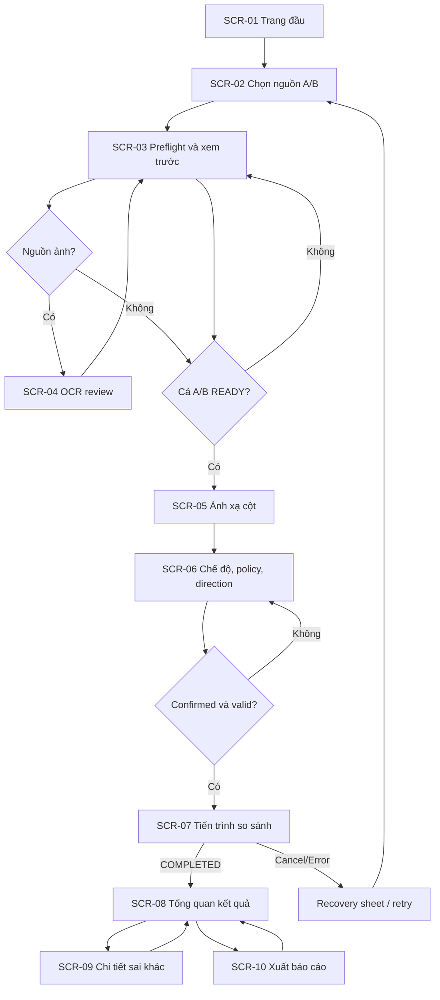

# Dytava — UI/UX Interaction & Screen Specification

> **Mục tiêu:** chuyển yêu cầu PRD/SRS thành hành vi giao diện có thể thiết kế, lập trình và kiểm thử trên Flutter Android. Đây là **bản thiết kế mục tiêu**, không phải ảnh chụp chức năng đang chạy.
>
> **Implementation evidence:** theo `mobile/README.md` và `mobile/lib/main.dart`, mobile hiện chỉ có **CompareDemoPage**, nhập hai giá trị, chọn semantic type, bấm so sánh và xem status/rule/canonical. Các màn hình `SCR-01..SCR-10` bên dưới **PROPOSED / NOT_IMPLEMENTED**, trừ những thành phần demo/design-system tái sử dụng được. Không được ghi chúng là đã triển khai.

## 1. Nguồn điều khiển và phạm vi

| Nguồn | Phần sở hữu (không lặp định nghĩa tại đây) |
| --- | --- |
| [PRD](../product/PRD.md) | US-01..US-15, persona, journey, scope P0/P1 |
| [SRS](../requirements/SRS.md) | FR-001..018, conditions, system behavior |
| [Business Requirements](../requirements/BUSINESS_REQUIREMENTS.md) | Business checkpoints, workflow và kịch bản ngoại lệ |
| [NFR](../requirements/NFR.md) | Accessibility, offline, dữ liệu lớn và release quality gates |
| [Input](../specs/input/README.md) / [Input State Machine](../specs/input/08_import_state_machine.md) | Artifact, preflight, import state, validation, OCR review |
| [Core](../project/EXCELCOMPARE_Android_iPhone_Flutter_Package_2026-11-11/DATATYPE_POLICY_ENGINE_ANDROID_IOS_SPEC.md) / [UDG3.1](../specs/engine/README.md) | Matching, verdicts, reason, evidence, runtime |
| [Report](../specs/report/README.md) | PDF formats/template, scope, manifest và export lifecycle |
| [Branding v2.0](../../branding/README_VI.md) / `mobile/lib/design_system/` | Màu, typography, icons, illustrations, Flutter theme |

**Thiết bị/nền tảng:** Android-first với Flutter và Material 3. Giao diện iOS P1 cần điều chỉnh theo tương tác nền tảng và QA riêng; không suy từ Android design ra iOS release proof.

**Nguyên tắc UX:** (1) Evidence before conclusion; (2) người dùng chủ động xác nhận các suy luận; (3) nhập dữ liệu và cấu hình độc lập cho A/B; (4) không che giấu trạng thái chưa xác định; (5) chỉ ra nguyên nhân và cách khắc phục; (6) ưu tiên nội dung nghiệp vụ hơn hình minh họa; (7) tối thiểu hóa quyền truy cập và dữ liệu lưu.

## 2. User journey và kiến trúc thông tin

### 2.1. Hành trình P0



### 2.2. Navigation model

- P0 dùng **guided step flow** (không dùng bottom-navigation đa tab chỉ để trang trí). Hiển thị tiến trình giai đoạn: **Nguồn → Cấu hình → So sánh → Kết quả**, với tiểu bước OCR/mapping khi phát sinh.
- `Back` giữ dữ liệu hợp lệ của bước trước; **đổi source bytes/scope/header** làm mất hiệu lực mapping và downstream result theo Input. Đổi **policy/direction** chỉ invalidate comparison/result, không tự hủy snapshots input.
- Sau run thành công, mở chi tiết bằng drill-down hoặc bottom sheet với nút **Trở về kết quả**. Không yêu cầu người dùng bắt đầu lại để xem một ô khác.
- Với tác vụ đang chạy, thao tác rời màn hình/đóng ứng dụng cần quy định về cancel/cleanup; **không** tuyên bố có background resume P0.
- `History` (khôi phục đầy đủ raw/results), cloud sync, accounts, admin, batch và iOS native-specific flows **không đặt vào thanh điều hướng P0** nếu chưa được phê duyệt trong scope.

### 2.3. Sơ đồ màn hình (screen inventory)

| ID | Màn hình | Người dùng đạt được gì | FR chính | Triển khai Flutter |
| --- | --- | --- | --- | --- |
| SCR-01 | Home / Start | Hiểu tác vụ, khởi tạo so sánh | US-01, FR-001 | PROPOSED |
| SCR-02 | Source Selection | Chọn rõ A/B, đổi/đảo vai trò nguồn | FR-001, FR-012 | PROPOSED |
| SCR-03 | Preflight & Scope Preview | Kiểm tra định dạng, cấu hình sheet/header/CSV, xem preview hợp lệ | FR-001..004, FR-016 | PROPOSED |
| SCR-04 | OCR Review (conditional) | Xem ảnh gốc + geometry, sửa và xác nhận bảng | FR-003/012 | PROPOSED |
| SCR-05 | Field Mapping | Ghép field A↔B bằng Field IDs 1:1 | FR-005 | PROPOSED |
| SCR-06 | Matching & Policy | Chọn KEY/POSITIONAL, dtype, rules, direction | FR-004/006/008/009 | PROPOSED |
| SCR-07 | Comparison Progress | Hiểu giai đoạn, progress/cancel, lỗi | FR-015/016 | PROPOSED |
| SCR-08 | Results Overview | Thống kê chính xác, lọc, tìm sai khác | FR-007/009/013 | PROPOSED |
| SCR-09 | Difference Detail | Kiểm tra raw A/B, canonical, rule/reason, SourceRef | FR-003/007/008/009/013 | PROPOSED |
| SCR-10 | Export | Chọn CSV/JSON/2 PDF, phạm vi, lưu/chia sẻ | FR-013/015/017/018 | PROPOSED |

Các trạng thái **Error / Empty / Loading / Review / Permission / Cancel** là các variants hoặc sheets theo ngữ cảnh, không cần một route độc lập cho mỗi lỗi. `CompareDemoPage` hiện hành giữ làm diagnostic/sandbox, không được gọi là SCR-08 production.

## 3. Đặc tả chi tiết màn hình

### SCR-01 — Home / Start

**Thông tin bắt buộc:** logo Dytava; heading “So sánh hai nguồn dữ liệu”; giải thích ngắn “Phát hiện sai khác và vị trí giữa hai bảng”; CTA **So sánh mới**; chú thích quyền riêng tư “Xử lý tại thiết bị; không tự tải dữ liệu lên mạng”. Có thể hiển thị biểu tượng định dạng đầu vào được **phê duyệt P0** chứ không tuyên bố hỗ trợ tất cả icon trong vault.

**Empty state:** không có phiên so sánh; CTA luôn sẵn sàng. **Không** tạo số liệu lịch sử, nút đăng nhập hoặc “AI so sánh tự động” nếu chưa có tính năng.

**Acceptance UX:** người dùng chạm một CTA để chuyển sang chọn A/B; TalkBack đọc được logo, tiêu đề và CTA theo thứ tự hợp lý.

### SCR-02 — Source Selection

**Cấu trúc:** hai thẻ/nhóm **Nguồn A (tham chiếu)** và **Nguồn B (đối chiếu)**; mỗi thẻ hiển thị tên hiển thị, detected format, dung lượng, status, nút `Chọn`, `Thay`, `Xóa`, `Chi tiết`. Chọn từ document picker hoặc camera/gallery theo scope Android. Chỉ một phía được chọn ảnh; khi một phía đã là ảnh, phía kia chỉ chọn bảng, kèm giải thích vì sao.

**Trạng thái:** UNSELECTED / SELECTED / PREFLIGHTING / NEEDS_REVIEW / PREVIEW_READY / FAILED / CANCELLED (nguồn thật tại INP-008). Hai nguồn có thể trùng tên; UI không gộp. Có thể hiển thị fingerprint ngắn/ID kỹ thuật ở **Chi tiết nguồn**, không để người dùng tự dựa vào tên để phân biệt.

**CTA:** `Tiếp tục` chỉ khi cả hai slot có artifact để tiến tới cấu hình; không cho vào mapping cho đến khi **cả hai** PREVIEW_READY. Nếu thay file, hiển thị impact “Cấu hình ánh xạ và kết quả liên quan sẽ cần thiết lập lại”.

**Bảo mật:** dùng scoped picker, không yêu cầu quyền storage rộng; không cho phép ghi đè nguồn. Không tự tải tệp cloud từ ứng dụng; file provider OS có thể có đặc tính riêng, cần thông báo nếu nguồn không có bytes local.

### SCR-03 — Preflight & Scope Preview

**Nhiệm vụ:** quan sát metadata, validation issues và preview sample; cấu hình source độc lập: XLSX sheet/range, CSV/TSV delimiter/encoding/header row; xác nhận header hoặc `none`. Header first-row **chỉ là gợi ý**, có thể trùng/trống. Bảng nhỏ hiển thị số hàng/cột biết được, nhưng ghi rõ **sample** hay **full validated**.

**Thiết kế đề xuất:** chuyển A/B bằng segmented control; vùng metadata tóm tắt; nhóm validation issues (Error/Needs review/Warning); vùng preview phân trang/virtualization; sticky header/row index; nút `Xác nhận phạm vi`.

**Phân biệt trạng thái:** hiển thị “Đang xem trước một phần” trong lúc parse và “Đã kiểm tra toàn bộ nguồn” chỉ khi PREVIEW_READY đầy đủ; **không** dùng 100% preview làm tín hiệu full validation. Dung lượng lớn hiển thị progress theo stage, số byte đọc/thời điểm có thể đo; không bịa phần trăm khi provider không cho biết total.

**Exception:** sai MIME/định dạng, parser unsupported, hết space, invalid encoding, permission revoked, ZIP/pixel guard → mã lỗi an toàn + mô tả + hành động `Thử lại`, `Đổi tệp`, `Chỉnh cấu hình`; không lộ toàn URI/raw cells trong logs hoặc UI lỗi.

### SCR-04 — OCR Review

**Bố cục:** vùng **Ảnh gốc** với crop/rotate và polygon/bounding boxes; vùng **Bảng dựng nháp** theo hàng/cột; thanh cảnh báo các ô chưa review hoặc cell/layout ambiguous; cho phép chỉnh văn bản ô, chia/gộp hàng/cột ở mức được implement, chọn selected scope, xác nhận từng ô/vùng và **Xác nhận toàn bộ sau review**.

**Bắt buộc:** đối chiếu ảnh gốc ↔ text đã nhận dạng; phân biệt `recognized_raw_text` với `reviewed_text`; confidence chỉ là tín hiệu tham khảo; hiển thị dấu tiếng Việt và mã `00123` đúng, không tự ép kiểu. Mỗi selected OCR cell có receipt hiện hành. `Thay crop / rotation / layout / ảnh` invalidate receipts bị ảnh hưởng theo Input contract; CTA tiếp tục bị khóa cho đến khi re-review.

**Không hứa:** tự phục hồi bảng chính xác 100%, formula/style, multiple pages, handwriting, cloud OCR hay ảnh–ảnh P0.

**UX acceptance:** một ô chưa confirm thì không thể compare; người dùng có thể tìm ra tại sao bị chặn; bảng quá kém chất lượng được thông báo `NEEDS_REVIEW`/`UNSUPPORTED` đúng ngữ cảnh, không dựng ô đoán rồi cho qua.

### SCR-05 — Field Mapping

**Cấu trúc:** hai cột thông tin **Field A ↔ Field B**, nhãn hiển thị, Field ID kỹ thuật khi cần, sample raw/dtype gợi ý; dropdown/chọn tương ứng cho từng field, trạng thái mapped/unmapped/ambiguous; structural fields không map cũng phải được nêu rõ.

**Hành vi:** P0 mapping **thủ công 1:1**, không cho chọn hai fields B vào cùng một field A hoặc mapping đến field đã không còn ở snapshot hiện hành. Gợi ý tự động (nếu có trong phiên tương lai) **không mặc định xác nhận**.

**CTA:** `Tiếp tục` khi mapping hợp lệ; khi đổi scope/header thì mapping stale bị loại và yêu cầu xác nhận lại. Cho phép quay về preview để sửa scope mà không gây lỗi ngầm.

### SCR-06 — Matching, Semantic Policy & Direction

**Sections:**
1. **Phương pháp ghép bản ghi:** `Theo vị trí (POSITIONAL)` hoặc `Theo khóa (KEY)`. KEY cho phép chọn một/nhiều field có thứ tự; hiện rõ số key null/duplicate nếu phát hiện được toàn scope và hành vi xử lý/blocked tương ứng. Không giải thích POSITIONAL là đối chiếu “dù đổi thứ tự vẫn đúng”.
2. **Kiểu và chính sách theo field:** IDENTIFIER, FREE_TEXT, DECIMAL, BOOLEAN, PERCENTAGE và null kinds; source-specific separators/locale, trim, absolute tolerance chỉ khi policy cho phép; trường inference mặc định là “Gợi ý”. Không tự chuẩn hóa ngầm.
3. **Hướng so sánh:** mặc định giao diện gợi ý A→B nhưng **người dùng phải xác nhận**; giải thích: A→B, chỉ ở B = ADDED, chỉ ở A = REMOVED; đảo direction đổi các nhãn này.
4. **Review summary:** hai source hashes/identity rút gọn, scopes, mapping, key/mode, số fields, policy digest/version, các warning cần chấp nhận.

**CTA:** `Chạy so sánh` chỉ khi A/B snapshots hiện hành, OCR receipts đủ, mapping, mode, dtype/policy và direction confirmed. Nếu blocker, để CTA disabled có kèm danh sách lý do **dễ đọc**, không chỉ tooltip.

### SCR-07 — Comparison Progress

**Bố cục:** tên phiên, progress stage (Read/Index/Align/Compare/Audit), số hàng đã xử lý/số byte hoặc trạng thái indeterminate tùy evidence, elapsed time nếu đo được, nút `Hủy`. Không hiển thị % giả hoặc “xử lý thành công” khi chưa có kết quả hoàn chỉnh.

**Khi hủy:** thao tác cancel và cleanup an toàn; kết quả bị hủy không thể được xuất như completed. **Khi lỗi:** hiển thị stage, nguyên nhân có thể hiểu và đường dẫn `Sửa nguồn/cấu hình`, `Thử lại`; không “tiếp tục từ byte X” nếu chưa triển khai resume P0. **Sau app kill:** về luồng chọn nguồn/revalidation thay vì giả khôi phục READY.

### SCR-08 — Results Overview

**Thứ tự thông tin:**
1. Nguồn A/B + direction đã xác nhận, scope/metadata và badge kết quả COMPLETED.
2. Phần **Thống kê ô ghép**: EXACT, EQUIVALENT, DIFFERENT, UNRESOLVED. `compared_matched_pairs = tổng 4 nhóm`; exact rate và semantic agreement rate có mẫu số, **N/A nếu 0**.
3. Phần **Thay đổi cấu trúc** riêng: ROW_ADDED / ROW_REMOVED, FIELD_ADDED / FIELD_REMOVED; không trộn vào cell count.
4. Bộ lọc `Tất cả`, `Khác biệt`, `Tương đương`, `Chưa kết luận`, `Thay đổi cấu trúc`; ô tìm kiếm theo key/field khi có và hỗ trợ phân trang.
5. Danh sách diff (row identity, field, side A/B, status + lý do ngắn) và nút `Chi tiết`; CTA `Xuất báo cáo`.

**Default list:** ưu tiên các trường hợp `DIFFERENT`, `UNRESOLVED` và structural, nhưng số liệu toàn bộ phiên vẫn hiện rõ. Danh sách có thể cho chọn tất cả theo tab/filter nhưng **không** giấu EXACT khỏi summary.

**Empty states:** không có khác biệt có thể hiển thị “Không phát hiện khác biệt theo quy tắc đã xác nhận” **chỉ khi** không có unresolved/structural differences; nếu có unresolved thì không tuyên bố hai nguồn hoàn toàn giống nhau.

### SCR-09 — Difference Detail

**Thông tin bắt buộc:** loại `MATCHED_CELL` hoặc structural event, key/ordinal, mapping field, status + reason/rule, **A raw / B raw** có side labels, parsed/canonical nếu có và khi được phép hiển thị, SourceRef **thực** từng phía (XLSX sheet/cell, CSV logical record/physical lines, OCR polygon/image coordinates), missing reason nếu không có reference.

**Thiết kế:** hai khối A và B có cùng mức ưu tiên, nút copy **có nhãn dữ liệu nhạy cảm** nếu phù hợp, next/previous diff trong cùng filter; mở rộng panel `Vì sao có kết luận này?` hiển thị rule_id/version/policy trace; biểu diễn null/missing/blank/empty string bằng nhãn khác nhau.

**Hành vi:** `EQUIVALENT` vẫn cho thấy **hai biểu diễn raw khác nhau**; `UNRESOLVED` giải thích thiếu chứng cứ nào; không cho đổi verdict bằng thao tác tô màu. Nếu người dùng thay policy/scope thì phải thực hiện comparison mới; detail cũ được đánh dấu stale/không thể export.

### SCR-10 — Export & Share

**Tùy chọn chính:** `CSV diff`, `JSON report`, `PDF diff hợp nhất A/B`, `PDF báo cáo Dytava` (template/version). Có thể chọn nhiều output **nhưng mỗi loại tạo artifact riêng**; hai PDF không bị hợp nhất thành một output. Merged diff PDF là **một PDF bao gồm union A/B**.

**Cấu hình:** `Toàn bộ`, `Chỉ sai khác`, `Theo bộ lọc hiện tại`; có preview về số rows/cells được xuất so với tổng result và nhãn rõ khi scope không phải full. `UNRESOLVED` phải hiện diện trong differences-only; equivalent chỉ đưa vào theo setting/report contract. Chọn nơi lưu/chia sẻ qua Android document/share flow khi output hoàn tất.

**Ghi chú trước chia sẻ:** “Báo cáo có thể chứa dữ liệu nguồn; chỉ chia sẻ với người nhận phù hợp.” Report metadata không kèm path/token/EXIF. Với PDF cần hiển thị page/template setup nếu có.

**States:** VALIDATING → RENDERING → VERIFYING → PUBLISHING → COMPLETED / FAILED / CANCELLED (UX stage labels là đề xuất, exporter contract là nguồn chuẩn). Không đánh dấu `COMPLETED` trước khi ghi và verify file. Không tự suy source 1 GB tức PDF vô hạn; thiếu disk/resource báo có hướng xử lý.

## 4. Thiết kế hiển thị bảng trên màn hình nhỏ

| Vấn đề | Hướng UX đề xuất | Điều kiện cần test |
| --- | --- | --- |
| Nhiều cột | Cho cuộn ngang có affordance “kéo để xem thêm”, sticky row identity/key khi có thể | 320/360/412 dp; cột đầu và nhãn side không mất |
| Nhiều hàng | Chỉ render viewport/paged windows theo cursor; không tạo mọi widget cell cùng lúc | 50k×15, corpus tới 1 GB; jank/heap phải đo |
| Giá trị dài | Ellipsis có `Xem đầy đủ`, wrap trong detail, copy raw có thông báo | Long Unicode, multi-line, ký tự điều khiển được escape |
| Tên field trùng/trống | Dùng Field ID/số thứ tự, không ép tự đổi tên nguồn | Header duplicate/no header; mapping không nhầm |
| A/B khó đọc | Summary list ngắn; chi tiết side-by-side nếu đủ rộng, stack A trên B khi hẹp | Không lẫn bên, SourceRef và null kinds |
| Có nhiều trạng thái | Icon + label + màu; structural thay đổi tách khỏi verdicts | TalkBack, grayscale, color blindness |
| Tiến trình lớn | Thể hiện stage, chỉ phần trăm khi có denominator tin cậy; có cancel | Nguồn unknown-size/streaming và process death |

Không sử dụng một `DataTable` hiển thị đồng thời toàn bộ bảng lớn. Virtualization, search/filter và cursor queries phải tuân thủ UDG3.1/EX-1; giao diện không được yêu cầu materialize toàn result trong RAM.

## 5. Visual design — sử dụng hệ Dytava v2.0

### 5.1. Design tokens có nguồn mã thật

| Semantic role | Token Flutter/source | HEX |
| --- | --- | --- |
| Primary action / EQUIVALENT | `DytavaColors.primary/equivalent` | `#2563EB` |
| Secondary blue | `DytavaColors.secondary` | `#3B82F6` |
| Mapping/export accent | `DytavaColors.purple` | `#8B5CF6` |
| OCR accent | `DytavaColors.cyan` | `#06B6D4` |
| EXACT / import | `DytavaColors.exact` | `#10B981` |
| UNRESOLVED / review | `DytavaColors.unresolved` | `#F59E0B` |
| DIFFERENT / destructive error | `DytavaColors.different` | `#EF4444` |
| Background | `DytavaColors.background` | `#F3F4F6` |
| Surface / border | `DytavaColors.white/border` | `#FFFFFF` / `#E5E7EB` |
| Main text / secondary text | `DytavaColors.textPrimary/textSecondary` | `#1E293B` / `#64748B` |

**Typography hiện có:** `Plus Jakarta Sans` (headings/display), `Be Vietnam Pro` (tiếng Việt/UI copy), `IBM Plex Mono` (key/hash/địa chỉ/metrics), fallback Roboto. **Components hiện có** trong design system như status badge và illustration là tài sản để tái sử dụng, không phải xác nhận screen đã có.

**Khuyến nghị trình bày (PROPOSED, chưa duyệt token):** spacing dựa 4 dp (8/12/16/24), card radius 12–16 dp theo theme, minimum tap targets mục tiêu 48×48 dp; max readable column width/line length xác định qua usability test. Không sửa màu logo/brand chỉ để báo status; dùng semantic icon/label kèm màu mềm, tránh chữ màu amber/green nhỏ trên trắng nếu không đủ contrast.

### 5.2. Quy ước trạng thái và nội dung chữ

| Kết luận | Label UI tiếng Việt | Icon/cue đề xuất | Hành vi |
| --- | --- | --- | --- |
| EXACT | Trùng khớp | Check + xanh | Xem raw và SourceRef nếu yêu cầu |
| EQUIVALENT | Tương đương theo quy tắc | Equal/check + xanh dương | Xem biểu diễn A/B, canonical, rule ID |
| DIFFERENT | Khác biệt | Alert/diff + đỏ | Thấy rõ A/B và lý do |
| UNRESOLVED | Chưa đủ căn cứ | Question/alert + vàng | Hướng dẫn kiểm tra thủ công, không suy là DIFFERENT |
| ROW_ADDED / REMOVED | Hàng thêm / Hàng thiếu theo hướng | + / − + nhãn | Hiển thị side hiện diện; **không là verdict thứ năm** |
| FIELD_ADDED / REMOVED | Cột thêm / Cột thiếu theo hướng | + / − + nhãn | Tách thống kê cấu trúc khỏi matched cells |

**Copy principles:** nội dung có tác vụ/giải pháp cụ thể. Ví dụ: “Nguồn B chưa hoàn tất kiểm tra. Chọn **Xem vấn đề** để xử lý.” Không dùng câu “Hai bảng giống nhau 100%” nếu vẫn có UNRESOLVED, unmatched, filtered scope hoặc thiếu bằng chứng.

## 6. State/feedback contracts và quản lý lỗi

### 6.1. Import state thể hiện trên UI

Các state nguồn được **tham chiếu nguyên nghĩa** từ `INP-008`: `UNSELECTED`, `SELECTED`, `PREFLIGHTING`, `PARSING`, `NEEDS_REVIEW`, `PREVIEW_READY`, `FAILED`, `CANCELLED`. Không tự thêm alias `READY` làm trạng thái domain. Trên UI có thể dùng nhãn tiếng Việt:

| State | Label gợi ý | CTA |
| --- | --- | --- |
| UNSELECTED | Chưa chọn nguồn | Chọn nguồn |
| SELECTED | Đã chọn — chưa xác minh | Kiểm tra |
| PREFLIGHTING | Đang kiểm tra tệp | Hủy |
| PARSING | Đang phân tích dữ liệu | Hủy |
| NEEDS_REVIEW | Cần xác nhận thông tin | Xem và xác nhận |
| PREVIEW_READY | Nguồn hợp lệ để tiếp tục | Tiếp tục nếu cả A/B hợp lệ |
| FAILED | Không thể đọc nguồn | Xem lỗi / Thử lại / Đổi nguồn |
| CANCELLED | Đã hủy | Thử lại / Đổi nguồn |

### 6.2. Error/empty/loading/recovery matrix

| Context | Không được làm | Phản hồi bắt buộc | Hành động khôi phục |
| --- | --- | --- | --- |
| Chưa chọn A/B | Bắt đầu comparison | Trạng thái riêng từng nguồn | Chọn/tải lại nguồn |
| B chỉ có sample preview | Coi cả job READY | Banner “Đang xác minh toàn bộ nguồn B” | Chờ/kiểm tra lỗi, cancel |
| OCR chưa review | Auto-run | Số ô/chỗ chưa xác nhận nếu xác định được | Trở lại SCR-04 |
| KEY trùng/null | Ghép ngẫu nhiên | Danh sách key/số lượng và giới hạn | Chỉnh mode/key/policy theo contract |
| Tệp vượt guard | Silent truncate hoặc crash | Error code + observed/limit/profile ở mức an toàn | Đổi tệp hoặc profile có evidence |
| Permission revoked | Dùng cached READY giả | Thông báo nguồn không còn hợp lệ | Chọn lại quyền/tệp, revalidate |
| Cancel | Cho xuất kết quả partial | Hiển thị Cancelled và cleanup | Thử lại |
| Empty results | Kết luận 100% sai mẫu số | N/A nếu không có matched pairs | Xem structural/unresolved |
| Stale result sau config change | Cho export cũ | Banner cần so sánh lại | Run lại |
| Export disk full | Đánh dấu thành công | Chặn publish; lỗi cụ thể | Chọn đích khác/giảm scope, thử lại |
| Dữ liệu ký tự độc hại | Render markup/script | Text/escape trong UI và export | Không có hành động đặc biệt |

**Giới hạn phản hồi:** snackbar chỉ dùng cho thông báo ngắn, không thay thế lỗi blocking có thể dẫn đến sai kết luận. Mỗi blocker phải có inline text và hành động; `retry` tránh vòng lặp vô hạn.

## 7. Accessibility, privacy, responsiveness

- **TalkBack**: nhãn đầy đủ cho mỗi source side, field mapping, progress stage và verdict; order đọc A trước B, heading có semantics, không chỉ icon/màu; thông báo kết quả/error critical có live-region phù hợp.
- **Text scaling**: xác minh font lớn ít nhất tới mức người dùng tăng cao (đề xuất test 200%), không làm mất nút xác nhận OCR hoặc dữ liệu nguồn; kiểm tra layout 320, 360, 412 dp và màn hình ngang/tablet. Các giá trị kích thước này là **đề xuất QA**, không thay NFR hiện hành.
- **Contrast**: dùng WCAG contrast như chuẩn kiểm tra tham khảo (4.5:1 cho chữ thường, 3:1 cho chữ lớn/non-text khi áp dụng), **đo trực tiếp trên tổ hợp màu thực tế**; brand token không đồng nghĩa đạt WCAG.
- **Touch**: mục tiêu click areas >=48×48 dp cho thao tác quan trọng, gesture có action thay thế, không phụ thuộc vuốt một chiều.
- **Offline/privacy**: không tự gửi raw values/OCR images lên mạng; không ghi full path/access grants trong thông báo hoặc exported metadata; cảnh báo trước share output chứa dữ liệu nguồn.
- **Read-only**: tất cả thao tác chỉnh OCR/policy thực hiện trên bản sao cấu trúc/derivatives, không sửa ảnh/file nguồn.

## 8. UX acceptance checklist / QA traceability

| UX-TC | Kịch bản kiểm tra | Kỳ vọng | Trace |
| --- | --- | --- | --- |
| UX-TC-001 | Bắt đầu so sánh và chọn 2 file trùng tên | Hai thẻ nguồn độc lập; không nhầm/overwrite | SCR-01/02, FR-001, INP-TC-001 |
| UX-TC-002 | Nguồn A READY, B FAILED | Mapping CTA bị khóa, nêu rõ blocker phía B | SCR-02/03, INP-TC-036 |
| UX-TC-003 | XLSX nhiều sheet và header trùng | Chọn một sheet/range, mapping bằng Field ID | SCR-03/05, FR-002/005 |
| UX-TC-004 | Crop OCR sau khi confirm | UI đánh dấu receipts stale, chặn compare | SCR-04, INP-TC-039/040 |
| UX-TC-005 | Duplicate/null KEY | Hiển thị cảnh báo và không tự ghép bản ghi | SCR-06, FR-006 |
| UX-TC-006 | Đảo direction sau khi đã có result | Dấu ADDED/REMOVED đảo đúng sau rerun; stale export blocked | SCR-06/08/10, ADR-001 |
| UX-TC-007 | Kết quả gồm 4 verdict + added/removed | Summary đúng mẫu số; structural riêng | SCR-08, SRS §4.4 |
| UX-TC-008 | Chọn EQUIVALENT/UNRESOLVED trong detail | Raw A/B, rule/trace hoặc missing reason hiển thị đầy đủ | SCR-09, FR-009 |
| UX-TC-009 | Data 50k×15 và tới 1 GB trên device đã chốt | Bảng phân trang/scroll ổn, không silent truncate, hủy được | SCR-03/07/08, LARGE-TC-* |
| UX-TC-010 | Xuất hai loại PDF | Chọn được hai artifact độc lập, scopes/legend/summary nhất quán | SCR-10, REP-TC-* |
| UX-TC-011 | Kill/restart khi import/export | Không hiện READY/COMPLETED giả; có hành động recovery | SCR-03/07/10, FR-015 |
| UX-TC-012 | TalkBack, scale font lớn, grayscale | Đọc được nguồn, trạng thái và blocker, không chỉ dùng màu | SCR-01..10, NFR-UX-01 |
| UX-TC-013 | Tệp có null, missing, blank và chuỗi dài | Không gộp khái niệm; xem đầy đủ raw trong detail | SCR-08/09, FR-008 |
| UX-TC-014 | Chọn filtered export với unresolved | Output scope được ghi rõ, không đổi nghĩa thành full; unresolved được giữ | SCR-10, REP-TC-008/012 |

`UX-TC-*` là **đề xuất bổ sung vào test registry**, chưa được chạy. Khi tích hợp repository, cần thêm vào [Traceability Matrix](../requirements/TRACEABILITY_MATRIX.md) với cột test/evidence và người chịu trách nhiệm; không xóa/thay INP-TC/REP-TC đã có.

## 9. Design handoff cho Flutter

**Bộ thông tin tối thiểu khi giao mỗi screen cho lập trình:** screen ID và route; User Story/FR refs; view model/state, entry/exit gates; các component cần tái sử dụng; layout các kích thước; interactive prototype/wireframe; loading/empty/review/error/cancel variants; accessibility labels; analytics/privacy rule; UX acceptance; screenshot và commit evidence sau implement.

**Tách domain khỏi UI:** route guard đọc từ các source/job/result state machines; không duplicate business logic trong widget. Screen chỉ gửi event `Select`, `Confirm`, `Run`, `Cancel`, `Export` tới use case; asynchronous callback stale phải được chặn ở application/input layer theo INP-008. Reactivity của Flutter không thể thay validator, source snapshots hoặc rule engine.

**Đề xuất tổ chức màn hình** (chưa phải cấu trúc repo đã có):

```text
mobile/lib/
  features/
    home/presentation/
    sources/presentation/
    preview/presentation/
    ocr_review/presentation/
    field_mapping/presentation/
    comparison_config/presentation/
    comparison_progress/presentation/
    results/presentation/
    difference_detail/presentation/
    export/presentation/
  design_system/      # Đã có: nên tái sử dụng, không fork tokens
```

## 10. Các điểm chưa chốt và rủi ro UX

1. **OCR manual review cost:** phải thử trên ảnh khó, đặc biệt bảng lệch/gãy dòng; nếu sửa từng ô không khả thi, không được âm thầm rút điều kiện review.
2. **Large-file interaction:** cần benchmark preview/scroll/search/cancel trên thiết bị Android tham chiếu; số 1 GB là scope, không phải runtime evidence.
3. **Information density:** chi tiết SourceRef/rule/policy khá lớn; cần nghiên cứu người dùng để xác định phần mặc định và phần advanced disclosure mà vẫn không che giấu căn cứ kết luận.
4. **A/B direction comprehension:** phải usability-test cách đặt tên “Tham chiếu/Đối chiếu” và nhận thức Added/Removed khi đảo chiều.
5. **Color accessibility:** semantic colors v2.0 cần kiểm tra contrast với nền/chữ ở tất cả trạng thái, không đánh đồng đồng bộ branding với đạt accessibility.
6. **Design owner/reviewer:** chưa có reviewer chính thức cho wireframes/prototypes; cần duyệt trước khi đánh dấu `APPROVED`.

## 11. Definition of done cho một screen

- [ ] Có wireframe/prototype gắn đúng `SCR-*`, mock data và trạng thái lỗi/thành công.
- [ ] Có refs US/FR/BIZ/NFR và entry/exit conditions.
- [ ] Không vượt scope Android P0 hoặc tuyên bố đã có feature chưa build.
- [ ] Có Flutter implementation và widget/integration tests tương ứng.
- [ ] Có screenshot/video từ thiết bị, build commit SHA và review accessibility.
- [ ] Các test liên quan PASS với evidence; không chỉ pass unit test domain.
- [ ] Không tạo state/gate khác với Input/Core/Report contracts.

**Định nghĩa xong tài liệu ≠ xong sản phẩm.** Trước phát hành, mọi screen P0 phải gắn test actual, người duyệt và release gate theo NFR và CI/device verification.
