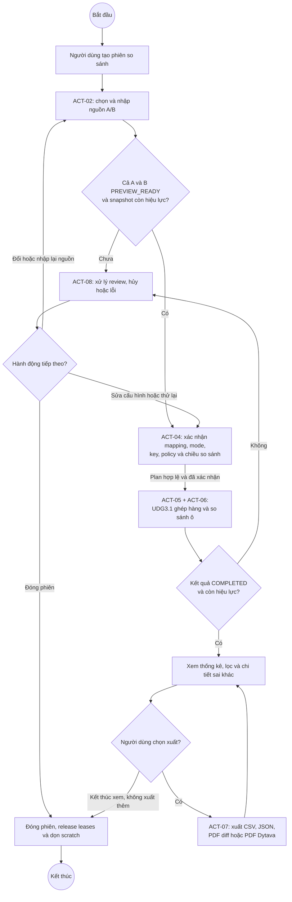
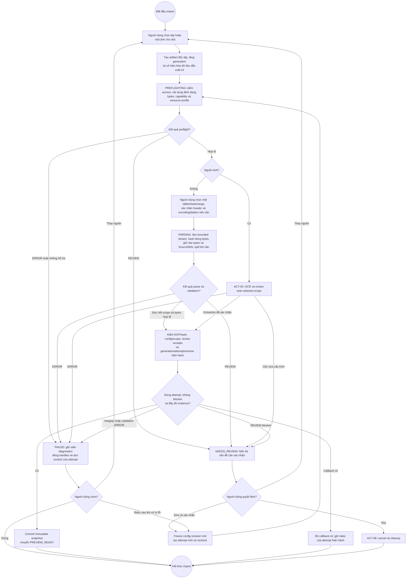
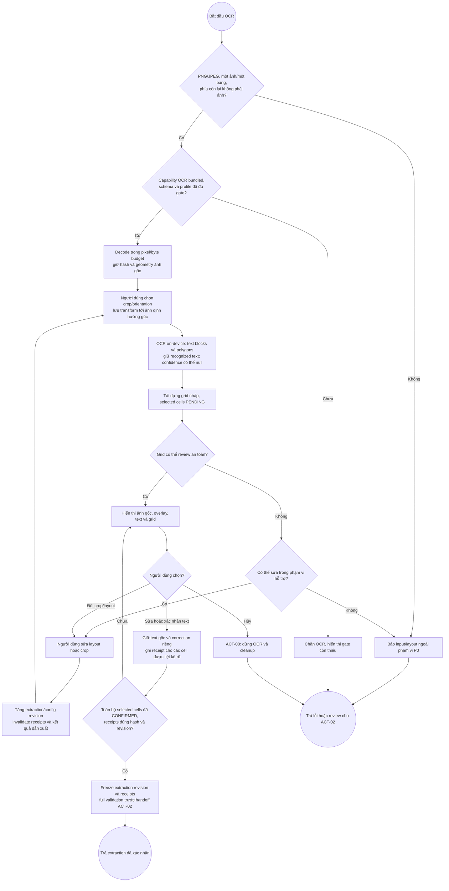
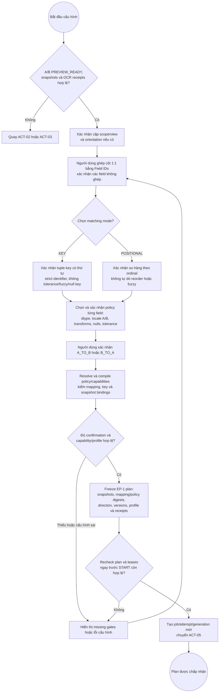
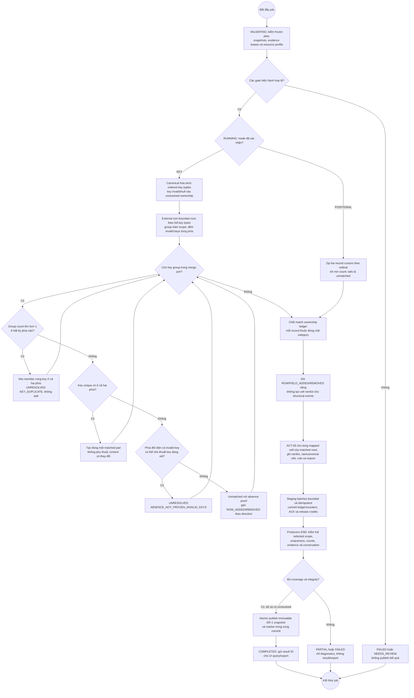
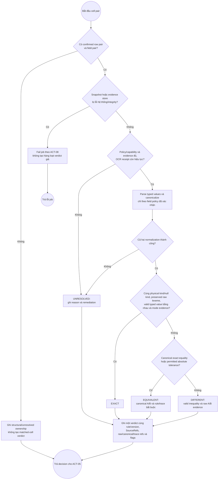
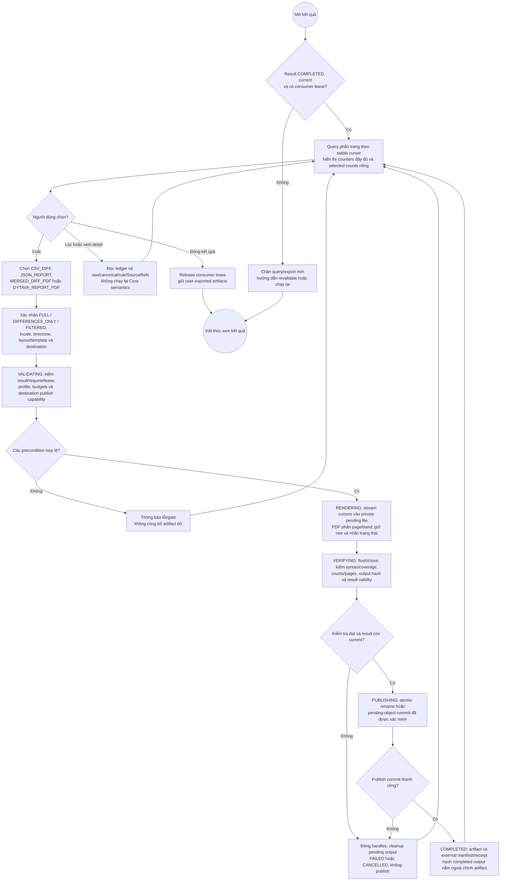
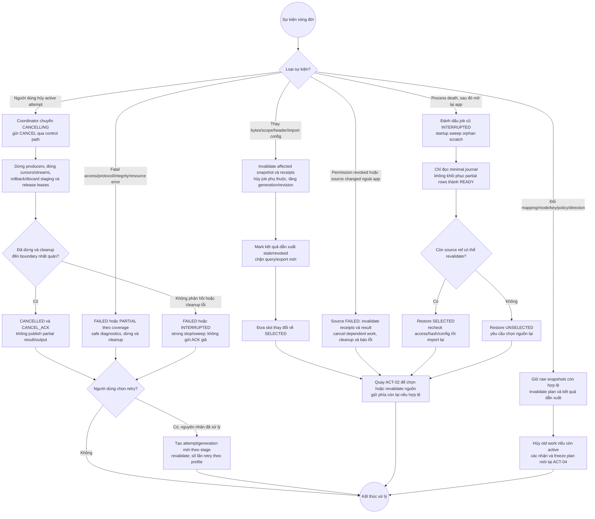

# Activity cốt lõi — Dytava Mobile

Các sơ đồ mô tả **hành vi mục tiêu** của ứng dụng Flutter/Android theo docs hiện hành, không khẳng định app đã triển khai các chức năng này. Mỗi sơ đồ là một góc nhìn của cùng hành trình; các lời gọi `ACT-xx` trỏ tới sơ đồ chi tiết bên dưới. Không thay đổi hoặc định nghĩa thêm hợp đồng nghiệp vụ.

Ký hiệu: nút tròn là bắt đầu/kết thúc; hình chữ nhật là hoạt động; hình thoi là quyết định; nhãn cạnh là điều kiện. Đây là sơ đồ luồng hoạt động bằng Mermaid, không phải sơ đồ lớp hoặc danh sách Android `Activity` native. A/B là hai slot nguồn độc lập; mũi tên không quy định số worker hoặc bắt buộc xử lý đồng thời.

## Chỉ mục và truy vết

| Sơ đồ | Hoạt động | Yêu cầu / nguồn sở hữu |
| --- | --- | --- |
| [ACT-01](#act-01--hành-trình-tổng-quan) · [SVG](mobile-activities/01-overview.svg) | Bắt đầu → nhập → cấu hình → so sánh → kết quả → xuất | [PRD §5](../product/PRD.md#5-user-journey-p0-và-tiêu-chí-trải-nghiệm), [SRS](../requirements/SRS.md) |
| [ACT-02](#act-02--nhập-và-xác-thực-một-nguồn-ab) · [SVG](mobile-activities/02-import.svg) | Import độc lập cho mỗi slot A/B | FR-001..004/015/016; [INP-008](../specs/input/08_import_state_machine.md), [ISC-1](../specs/input/11_streaming_snapshot_contract.md) |
| [ACT-03](#act-03--ocr-một-ảnh-và-review-bắt-buộc) · [SVG](mobile-activities/03-ocr-review.svg) | Ảnh → OCR cục bộ → sửa/xác nhận → snapshot | FR-012; [INP-010](../specs/input/10_ocr_image_input.md) |
| [ACT-04](#act-04--xác-nhận-cấu-hình-và-đóng-băng-plan) · [SVG](mobile-activities/04-confirm-plan.svg) | Scope/mapping/mode/key/policy/direction → frozen plan | FR-005/006/009/014; [EP-1](../specs/engine/01_execution_plan.md), [Geometry](../specs/engine/02_geometry_mapping.md) |
| [ACT-05](#act-05--udg31-ghép-hàng-và-hoàn-tất-kết-quả) · [SVG](mobile-activities/05-comparison.svg) | KEY/POSITIONAL → ownership → diff → atomic publish | FR-006..009/014; [Matching](../specs/engine/03_candidate_alignment.md), [ER-1](../specs/engine/04_result_runtime.md) |
| [ACT-06](#act-06--quyết-định-trạng-thái-một-cặp-ô) · [SVG](mobile-activities/06-cell-decision.svg) | EXACT / EQUIVALENT / DIFFERENT / UNRESOLVED | FR-008/009; [Core decisions](../specs/core/COMPARISON_DECISIONS.md), [CE-1](../specs/core/CANONICAL_ENCODING.md) |
| [ACT-07](#act-07--xem-chi-tiết-lọc-và-xuất-báo-cáo) · [SVG](mobile-activities/07-query-export.svg) | Query/detail → chọn output → kiểm tra → publish | FR-013/017/018; [Report](../specs/report/README.md), [EX-1](../specs/report/STREAMING_EXPORT_CONTRACT.md) |
| [ACT-08](#act-08--hủy-lỗi-thay-đổi-nguồn-và-khôi-phục) · [SVG](mobile-activities/08-cancel-recovery.svg) | Cancel, invalidation, retry và process death | FR-015; [INP-008](../specs/input/08_import_state_machine.md), [WP-1](../specs/engine/04_result_runtime.md#5-wp-1-envelope-và-delivery) |

Mermaid trong tài liệu là nguồn chỉnh sửa; các SVG và [PNG tổng quan](mobile-activities/01-overview.png) là bản render dẫn xuất bằng Mermaid 11.12.2.

## ACT-01 — Hành trình tổng quan

**Actor chính:** người dùng. **Hệ thống:** Flutter UI, Input/OCR, Core worker, result store và exporter.

- `IMPORT` có thể gọi OCR tại ACT-03. P0 nhận XLSX/CSV/TSV và **tối đa một** ảnh PNG/JPEG trong hai nguồn; không ảnh–ảnh.
- Mỗi phía có đúng một table/scope được xác nhận. Đổi nguồn hoặc cấu hình phải qua invalidation tại ACT-08; không xuất kết quả cũ như kết quả hiện hành.
- Trần thiết kế là **1 GB/source**, kèm resource profile, streaming/chunking và private spill theo [NFR §3](../requirements/NFR.md#3-resource-profiles-và-trần-input-1-gb). Đây không phải tuyên bố hiệu năng đã đạt.

## ACT-02 — Nhập và xác thực một nguồn A/B

Chạy riêng cho mỗi slot. Bên A sẵn sàng không làm bên B tự sẵn sàng; retry B giữ được A nếu snapshot A còn hợp lệ.

Preview mẫu có thể xuất hiện sớm nhưng **không cấp PREVIEW_READY**. Review không tự retry; cần hành động xác nhận của người dùng. Hủy, thay nguồn, thu hồi quyền hoặc process death ở bất kỳ giai đoạn đang chạy nào xử lý theo ACT-08. Snapshot/evidence stores còn consumer sử dụng không bị dọn như orphan scratch.

## ACT-03 — OCR một ảnh và review bắt buộc

Confidence cao không bỏ qua review. OCR không sinh công thức, hidden values hoặc physical number từ ảnh; không fallback sang cloud. Thay crop/layout làm mất hiệu lực receipts liên quan; text correction phải có receipt gắn revision hiện hành. Lỗi access/decode/resource dừng an toàn theo ACT-08.

## ACT-04 — Xác nhận cấu hình và đóng băng plan

Key null/trùng của dữ liệu được kiểm **toàn selected scope** tại ACT-05, không chứng minh uniqueness từ preview. Plan phải có key definition và confirmation đúng; record không có key hợp lệ được xử lý unresolved, không tự chọn first/last. Cấu hình yêu cầu dtype/operation chưa hỗ trợ bị chặn trước RUNNING. Nếu chỉ so structural differences và không có mapped fields, phải xác nhận rõ; không suy ra các record là UNCHANGED từ tập field rỗng.

## ACT-05 — UDG3.1: ghép hàng và hoàn tất kết quả

Các nút ledger/cell/staging biểu diễn thứ tự phụ thuộc logic, không yêu cầu giữ toàn bộ pairs/cells trong RAM; triển khai dùng cursors, stores và batches có giới hạn. KEY so **full framed tuple bytes**, digest chỉ hỗ trợ tăng tốc; không nối key bằng delimiter hoặc coi hash bằng nhau là identity. POSITIONAL gán nhãn tails theo direction, không tìm lại key để “sửa” pairing.

Điều kiện finalize theo ER-1:

- `input_records_a = matched_record_pairs + unmatched_records_a + unresolved_records_a`; phía B tương tự.
- `compared_matched_cell_pairs = exact + equivalent + different + unresolved`.
- Unmatched rows/fields có counters riêng. Không có mapped fields thì paired records mang content state `UNRESOLVED / NO_MAPPED_FIELDS`; cell denominator bằng 0, tỷ lệ hiển thị `N/A`.
- Full coverage có unresolved vẫn có thể `COMPLETED`; xử lý chưa hết scope không được giả là hoàn tất. Hủy/lỗi trong các vòng lặp hoặc commit xử lý theo ACT-08.

## ACT-06 — Quyết định trạng thái một cặp ô

Chỉ gọi khi row pair và field pair đã được xác nhận. Đây là thứ tự ưu tiên theo Core; không dùng candidate score làm cell verdict.

P0 dtypes: IDENTIFIER, FREE_TEXT, DECIMAL, BOOLEAN, PERCENTAGE. Missing/blank/empty/null/zero/false phân biệt mặc định; không đoán locale, không dùng binary floating point thay exact decimal. Identifier numeric thiếu lexical evidence → unresolved, không dựng lại leading zeros. `TYPE_CHANGED` hoặc `OCR_REVIEWED` là flags, không phải trạng thái thứ năm. Tolerance chỉ theo policy field đã confirm, không áp cho KEY.

## ACT-07 — Xem chi tiết, lọc và xuất báo cáo

Export do người dùng khởi tạo, không ghi đè nguồn. Retry export tạo attempt mới; nếu commit bền vững nhưng mất ACK thì lookup receipt để tránh xuất trùng. Hủy/lỗi/resource exhaustion tại các active stages đi qua cleanup của ACT-08. Provider chỉ ghi trực tiếp visible output mà không có pending/rollback guarantee bị từ chối trước publish.

Hai PDF là **hai export kinds riêng**: một PDF diff hợp nhất A/B và một PDF theo template Dytava. Một kind tạo một tệp PDF dù nhiều trang. Output ghi scope/filter và counts, không silent truncation hoặc tự thu nhỏ scope khi hết budget. `DIFFERENCES_ONLY` phải giữ unresolved; equivalent inclusion là lựa chọn được ghi rõ. Result stale/partial/cancelled không được export; lease giữ evidence đủ lâu cho renderer.

## ACT-08 — Hủy, lỗi, thay đổi nguồn và khôi phục

Sơ đồ áp dụng ngang cho import, comparison và export. Terminal states của từng loại attempt theo hợp đồng riêng; nhánh cancel bên dưới thể hiện trạng thái comparison/export.

- Callback/message chỉ commit khi tuple job/attempt/generation/revision còn hiện hành; callback cũ bị bỏ, replay hợp lệ xử lý idempotent. `COMPLETED` không bị đổi thành `CANCELLED` bởi cancel đến muộn.
- Comparison NEEDS_REVIEW: người dùng RESOLVE → cancel old work → new generation → VALIDATING. Không sửa plan đang chạy tại chỗ.
- Đóng handle nguồn bình thường sau frozen snapshot không đồng nghĩa thu hồi quyền. Snapshot đủ evidence có thể phục vụ export qua lease mà không mở lại nguồn gốc.
- Đóng phiên release consumers rồi dọn private scratch/raw/OCR stores không còn owner. Không xóa artifact người dùng đã export. Lịch sử mặc định không lưu raw contents.

## Phạm vi và điều kiện triển khai

Nguồn sở hữu hiện hành: [Document Control](../governance/DOCUMENT_CONTROL.md), [baseline UDG3.1](../governance/SPECIFICATION_BASELINE_3_1.md). Các sơ đồ này là bản dẫn xuất phục vụ phân tích/thiết kế; khi owner contract thay đổi phải cập nhật sơ đồ tương ứng. Capability/profile chưa verified phải được chặn tại validation; sơ đồ không cấp quyền tự bật capability.

Không đưa iOS, JSON input, MULTISET/ORDERED_SEQUENCE, formula/style comparison, PDF input hoặc cloud OCR vào đường P0. Target OCR/schema migration, pipeline 1 GB, result/runtime và hai PDF vẫn cần implementation/device evidence theo owner docs. Công việc này chỉ bổ sung sơ đồ, không thay code mobile hoặc đánh dấu acceptance PASS.
