# System, domain và deployment diagrams — Dytava Mobile

Các mô hình dưới đây là **thiết kế mục tiêu**. Tên vai trò/domain objects lấy từ owner contracts; không suy ra class, package, database schema hoặc dependencies đã cài. [Coverage](MOBILE_DIAGRAM_COVERAGE.md) ghi ranh giới P0/extension và nguồn đối chiếu. Các flowchart context/use case/deployment là biểu diễn tương đương bằng Mermaid, không giả định Mermaid hỗ trợ ký pháp UML/C4 native đầy đủ.

| Sơ đồ | Góc nhìn | Bản render |
| --- | --- | --- |
| MOD-01 | Context và use cases | [SVG](mobile-models/01-context-use-cases.svg) |
| MOD-02 | Components, ports và dependency direction | [SVG](mobile-models/02-components.svg) |
| MOD-03 | Domain class model, logical references | [SVG](mobile-models/03-domain-classes.svg) |
| MOD-04 | ER logical của result persistence | [SVG](mobile-models/04-result-erd.svg) |
| MOD-05 | Android deployment và trust boundaries | [SVG](mobile-models/05-deployment.svg) |
| MOD-06 | UDG3.1 L0–L10 và cross-cutting contracts | [SVG](mobile-models/06-udg-layers.svg) |
| MOD-07 | Geometry, merged cells và logical transpose | [SVG](mobile-models/07-geometry.svg) |
| MOD-08 | Canonical signatures, policy/config digest và cache binding | [SVG](mobile-models/08-signatures-cache.svg) |
| MOD-09 | Resource governor và ownership/lease lifecycle | [SVG](mobile-models/09-resources-leases.svg) |
| MOD-10 | Capability/phase gates và extension paths | [SVG](mobile-models/10-extension-gates.svg) |
| MOD-11 | Verification và release evidence gates | [SVG](mobile-models/11-release-gates.svg) |

## MOD-01 — Context và use cases

Nguồn: [PRD](../product/PRD.md), [SRS](../requirements/SRS.md), [ADR scope](../decisions/ADR_SCOPE_EXPANSION_2026-11-12.md), [Architecture §1–4](../architecture/ARCHITECTURE.md).

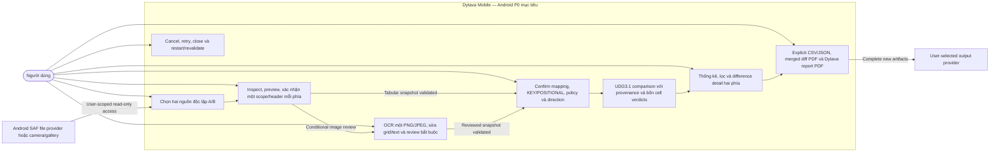

Use cases không phải quan hệ UML `include/extend` tự động; edges mô tả phạm vi/tương tác và dependencies của hành trình. P0 không có admin actor, backend/cloud OCR, đăng nhập bắt buộc hoặc upload. Một workbook nhiều sheets chỉ phục vụ chọn một scope; không batch compare. Target input ≤1.000.000.000 bytes mỗi nguồn, vẫn có separate decompression/pixel/resource guards.

## MOD-02 — Components, ports và dependency direction

Nguồn: [Architecture §2–3](../architecture/ARCHITECTURE.md), [ER-1/WP-1](../specs/engine/04_result_runtime.md), [EX-1](../specs/report/STREAMING_EXPORT_CONTRACT.md).

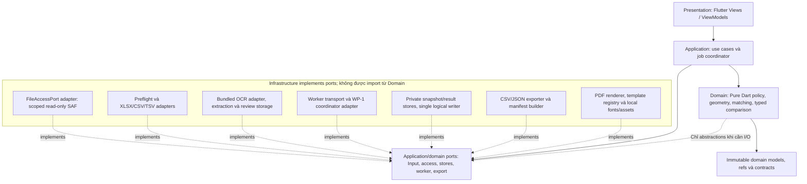

Đây là **code dependency** view: solid arrow là dependency, dotted `implements` là hướng thực thi abstraction. Không dùng các mũi tên này làm byte/data-flow arrows. Ports thuộc application/domain theo trách nhiệm; không tạo vòng import ngược Infrastructure→Domain→Infrastructure. Composition root bên ngoài Domain wire implementations. Core không import Flutter, Android SDK, OCR SDK, database driver, file picker hoặc URI. Input/OCR không tự canonicalize semantic; exporter không chạy lại Core.

## MOD-03 — Domain class model

Nguồn: [INP-002](../specs/input/02_source_artifacts.md), [ISC-1](../specs/input/11_streaming_snapshot_contract.md), [EP-1](../specs/engine/01_execution_plan.md), [ER-1](../specs/engine/04_result_runtime.md). Đây là logical references; cardinality không buộc materialize arrays trong heap.

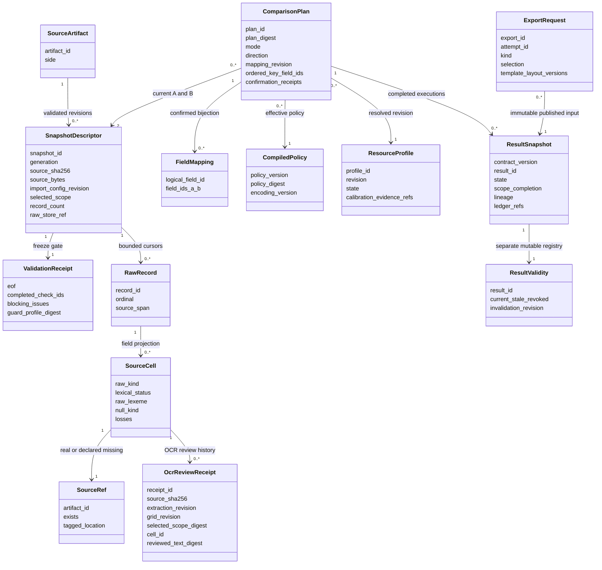

`CompiledPolicy`, `FieldMapping` và `ResourceProfile` là tên vai trò model để gom các fields trong contract, không định nghĩa schema mới. SourceRef là closed union theo Input; JSON refs thuộc P1, không bật JSON input từ model. OCR receipts chỉ áp OCR; non-OCR cells không mang OCR receipt fields. Một receipt hiện hành cho mỗi selected OCR cell tại freeze; lịch sử revisions không thay thế current receipt gate. SourceArtifact giữ private access metadata tại infrastructure; sơ đồ bỏ access refs khỏi public/Domain projection.

## MOD-04 — Logical ER: result persistence

Nguồn: [ER-1 §1–4](../specs/engine/04_result_runtime.md), [EX-1](../specs/report/STREAMING_EXPORT_CONTRACT.md). Đây là quan hệ logic, không phải SQL DDL/Drift schema đã tồn tại. IDs/refs nằm trong frozen result/generation, không encode raw key hoặc PII.

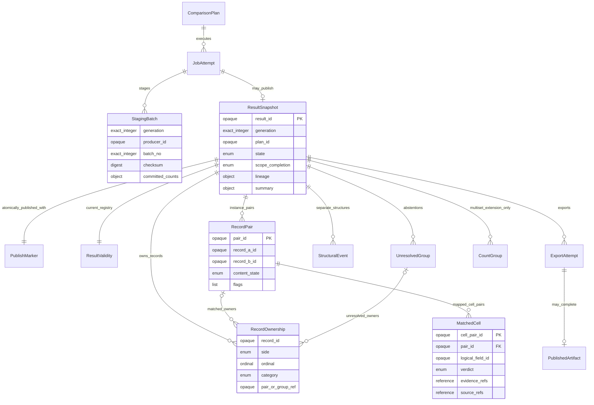

Ràng buộc bắt buộc dù adapter không dùng SQL:

- Ownership unique `(generation, scope, side, record_id)`, category đúng một trong MATCHED/UNMATCHED/UNRESOLVED. MATCHED có pair ref, UNRESOLVED có group ref, UNMATCHED có reason; không đồng thời cả pair/group. Một pair có đúng hai matched owners A/B trong scope.
- Unique record A và B trong paired ledger; unique `(pair_id, logical_field_id)` cho cells. Zero mapped fields được phép structural-only nhưng pair content UNRESOLVED/NO_MAPPED_FIELDS; không tạo cell giả.
- Batch unique `(generation, producer_id, batch_no)`; replay cùng checksum idempotent, khác checksum là integrity conflict. Không unique raw key toàn DB vì duplicate keys là dữ liệu cần báo.
- `INSTANCE_PAIR`: có record pairs/cells, không CountGroup. `COUNT_GROUP` extension: groups/member cursors/multiplicities, không fabricated instance pairs/cells. ER edges không cho phép trộn hai variants trong một result.
- Result snapshot/marker/COMPLETED publish cùng atomic boundary; validity registry mutable riêng. Summary reconciles ledgers, counters exact integers; JSON adapters dùng decimal strings. PublishedArtifact chỉ có khi commit hoàn chỉnh.

## MOD-05 — Android deployment và trust boundaries

Nguồn: [Architecture §5–7](../architecture/ARCHITECTURE.md), [NFR](../requirements/NFR.md), [ADR register](../decisions/ADR_REGISTER_P0_2026-11-11.md). Sơ đồ deployment logic, không chốt thư viện/plugin chưa PoC.

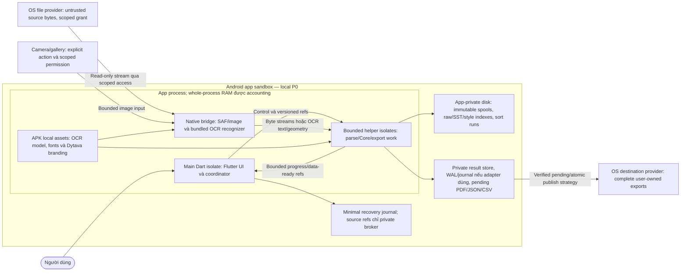

Các stores là logical responsibilities, không bắt buộc ba database/process. Isolates không share mutable heaps; native allocations, message copies, fonts/bitmap, DB cache và WAL đều tính budget. Android can suspend/kill process; không claim background completion hoặc xóa scratch ngay lúc bị kill. Startup sweep và revalidation theo SEQ-08. P0 không có network/backend/cloud dependency; provider có thể network-backed nhưng không tự fetch embedded links hoặc bypass access failure. iOS/Web cần deployment/profile/device evidence riêng; không suy parity.

## MOD-06 — UDG3.1 theo L0–L10

Nguồn: [UDG3.1 index](../specs/engine/README.md). Layers là trách nhiệm logic, không yêu cầu thêm 11 packages, cũng không cấm streaming overlap hợp lệ.

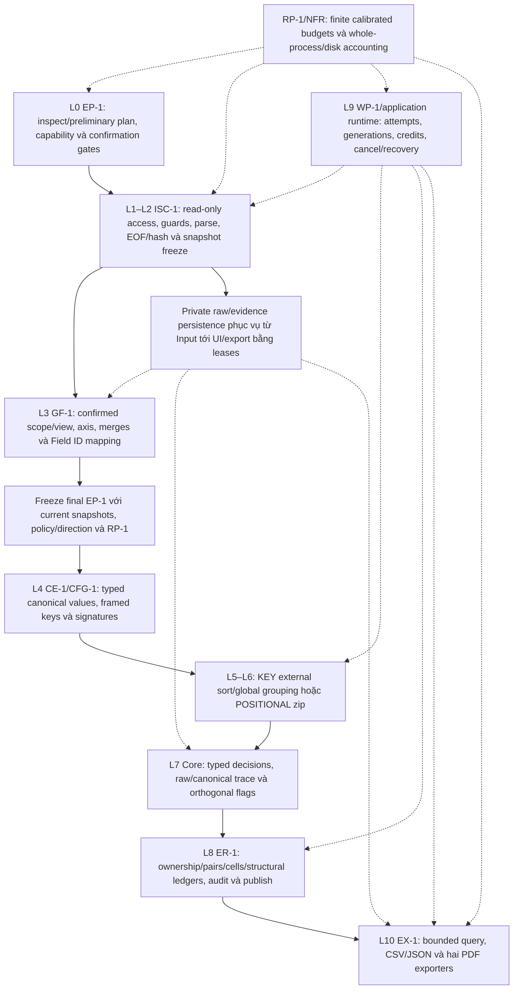

L0 có preliminary inspect plan trước EOF nhưng final freeze chỉ sau các preconditions. L8 persistence bắt đầu phục vụ Input, không đợi L7 mới lưu. L9 điều phối xuyên pipeline, không phải stage cuối mới nhận cancel. Domain normalization không diễn ra ở Input. Result query/render chỉ đọc published snapshot, không tái tính semantics.

## MOD-07 — Geometry, merged cells và transpose

Nguồn: [Geometry L3](../specs/engine/02_geometry_mapping.md), [INP-004](../specs/input/04_tabular_structure.md).

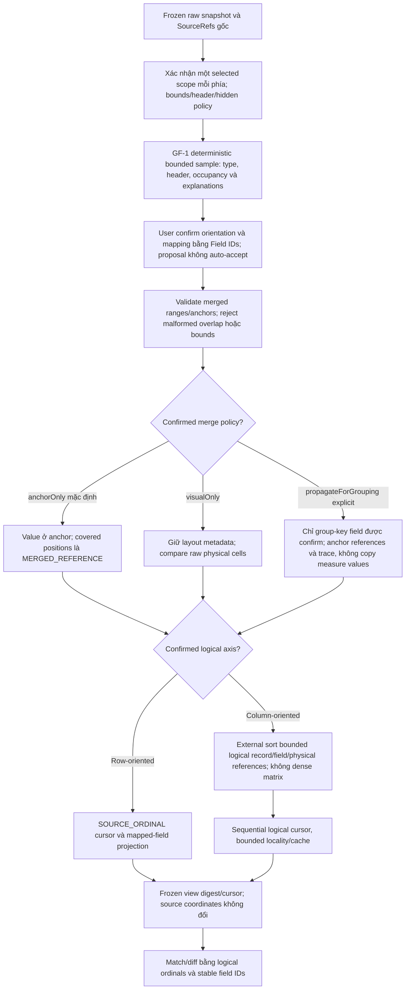

GF-1 dùng first source ordinals trong **cả** sample-record/sample-byte budgets; missing features là null, ties giữ proposals, stable ID chỉ ổn định UI. Timeline không có explicit parse profile không được đoán kiểu. Transpose/mapping đổi tạo view/cursor binding mới; không đổi SourceRef. Multi-scope future aggregate phải reject overlap trước freeze; không auto-deduplicate các ô đếm hai lần. Cancel khi build view bỏ staging refs, không publish view một phần.

## MOD-08 — Signatures và cache binding

Nguồn: [CE-1/CFG-1](../specs/core/CANONICAL_ENCODING.md), [EP-1 invalidation](../specs/engine/01_execution_plan.md#3-invalidation-matrix).

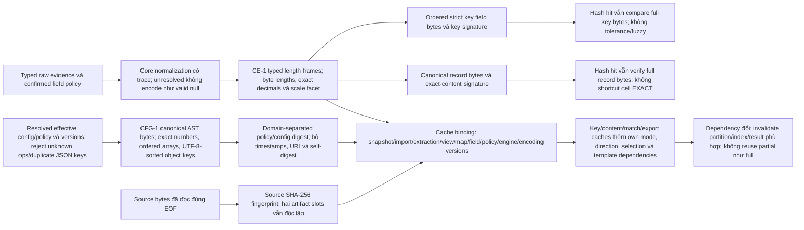

Source fingerprint là SHA-256 raw bytes không CE framing; signatures khác dùng domain separation `H(domain,payload)` theo CE-1. Key equality không dùng whole-record content hash; sửa non-key value vẫn giữ entity pair nếu key hợp lệ. Tolerance không bắc cầu nên không key/MULTISET grouping. Cache chỉ usable khi raw/evidence leases đủ; same raw text khác locale/source profile không share normalization entry. Không implicit NFC/trim/casefold ở serializer.

Policy precedence theo Core: conservative defaults → policy defaults → field semantic/comparison rules → A/B overrides **chỉ parse**. Compiler reject unknown keys/operations, mapping không bijective, keys thiếu/không strict, tolerance âm, separator conflict hoặc aliases collision. Policy schema_version2, policy_version2.1.0 và engine/encoding versions có nghĩa riêng; không thay thế lẫn nhau.

## MOD-09 — Resource governor và lease ownership

Nguồn: [RP-1](../requirements/RESOURCE_PROFILES.md), [ISC-1](../specs/input/11_streaming_snapshot_contract.md), [ER-1 §7](../specs/engine/04_result_runtime.md#7-resources-cancellation-và-retention).

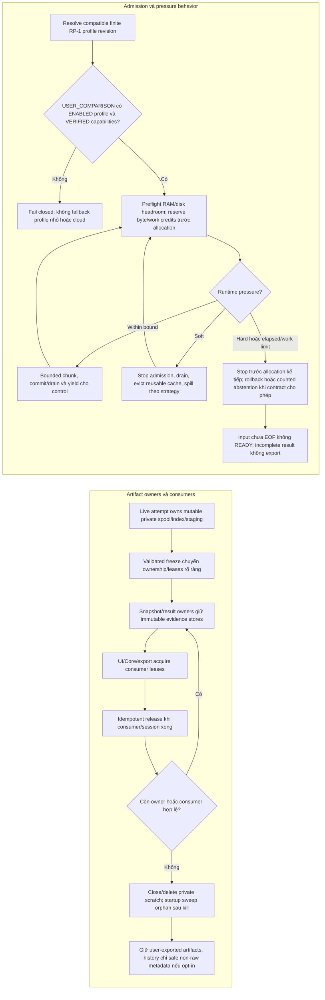

Internal `CALIBRATION_TEST` là path riêng với build gate, CALIBRATING finite candidate profiles và safety guards; không dùng cho user compare hoặc production claim. Soft-pressure retries vẫn chịu finite stage/work/inactivity limits, không loop vô hạn. Data queues không chiếm control-reserved bytes; cancel có observe/stop/cleanup bounds riêng. RAM tính UI/all isolates/native/DB/messages/fonts/bitmaps; disk tính source+SST+raw+sort+results+WAL+pending outputs và overlap. Không xóa live snapshot để lấy disk cho export. Không điền ngưỡng chưa đo hoặc suy throughput từ source-size cap.

## MOD-10 — Pha và extension eligibility

Nguồn: [PRD §3](../product/PRD.md#3-release-scope--nguồn-quản-lý-duy-nhất-cho-phase-assignment), [Matching §5–7](../specs/engine/03_candidate_alignment.md#5-multiset-extension), [Core decisions §3–4](../specs/core/COMPARISON_DECISIONS.md#3-dateformulastyle-extensions).

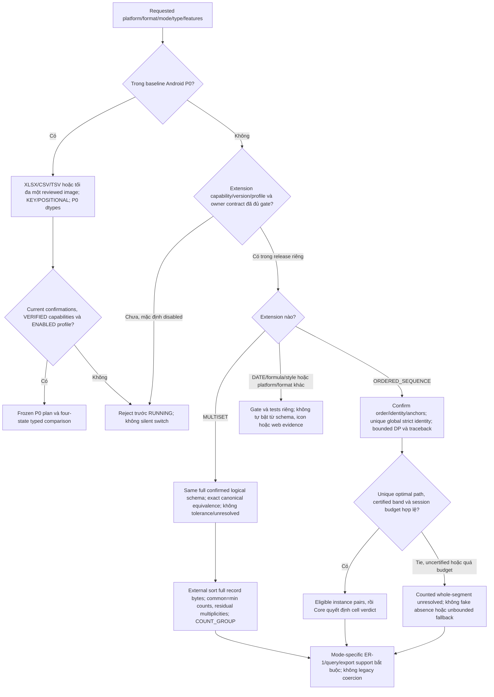

Extension count-group không sinh arbitrary instance pairs/cell rates; denominator paired cells bằng0/N/A. ORDERED có insertion/deletion cost1, eligible match cost0; noneligible diagonal bị cấm, path count capped2 để abstain ties. Band chỉ finalize nếu certified optimality hoặc user-confirmed displacement constraint. Candidate/DP/work counters cộng dồn **toàn job**, top-k/truncation không chứng minh absence. Coordinate shift là flag, không P0 definitive MOVED.

DATE serial60/thiếu date-system, DATETIME zone/DST ambiguity và formula cache missing/stale có unresolved decisions theo Core; không suy source metadata. Formula modes không evaluate expressions; style/metadata là facets riêng không trộn cell similarity. JSON input/iOS là P1; PDF input, cloud OCR và unsupported formats không được enable bằng sơ đồ này. Các extension paths là diễn giải contracts có sẵn, không thay phase assignment hoặc khẳng định release đã có.

## MOD-11 — Verification và release evidence gates

Nguồn: [NFR §5](../requirements/NFR.md#5-phương-pháp-test-chỉ-số-và-quality-gates), [RP-1](../requirements/RESOURCE_PROFILES.md), [Build/Release guide](../project/EXCELCOMPARE_Android_iPhone_Flutter_Package_2026-11-11/ANDROID_IOS_BUILD_RELEASE_GUIDE.md), [UDG acceptance](../testing/UDG_CONTRACT_ACCEPTANCE.md).

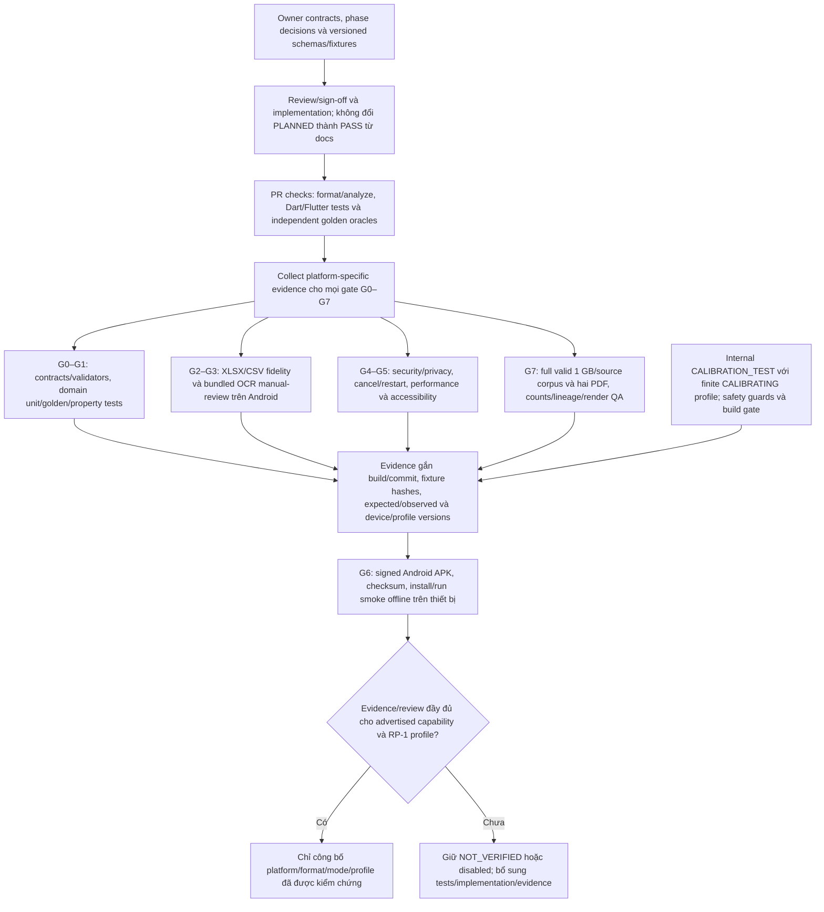

Các cạnh là dependency/evidence flow, không bắt buộc lịch chạy tuần tự hoặc song song. Calibration harness cho phép đo trước enable, tránh vòng lặp yêu cầu ENABLED trước khi có thể tạo evidence. G6 ký/build không thay G7 1 GB/PDF hoặc plugin/device tests. Các TARGET chưa đo (preview, crash-free, coverage, OCR metrics) không được điền thành kết quả. Android evidence không cấp iOS/Web parity; iOS P1 cần signing/permissions/VoiceOver/device gates riêng. Sơ đồ không thực hiện build, ký, upload hoặc phát hành.

## Đọc cùng

[Activity diagrams](MOBILE_ACTIVITIES.md) · [Sequence diagrams](MOBILE_SEQUENCES.md) · [State diagrams](MOBILE_STATES.md) · [Coverage và baseline](MOBILE_DIAGRAM_COVERAGE.md).
