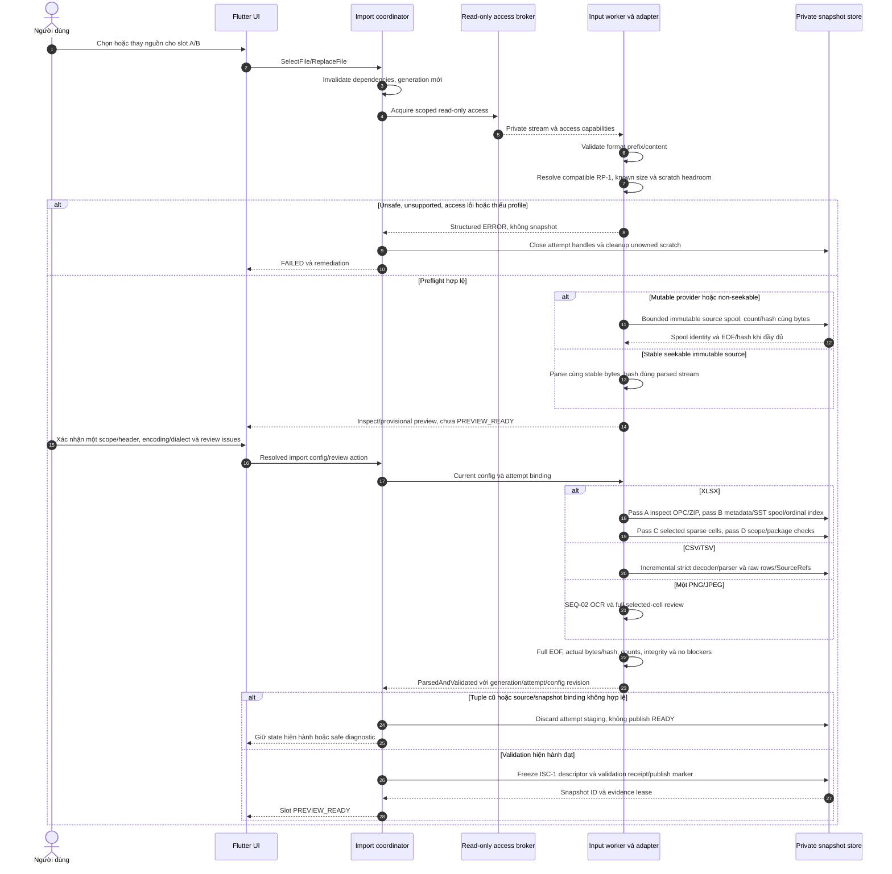
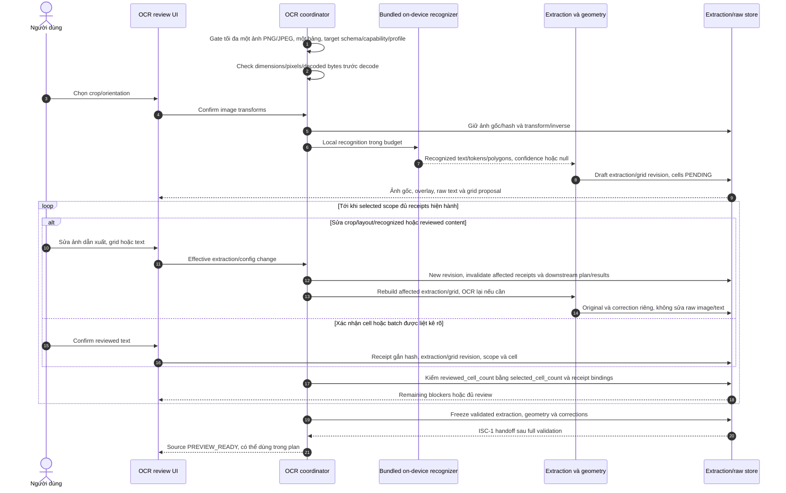
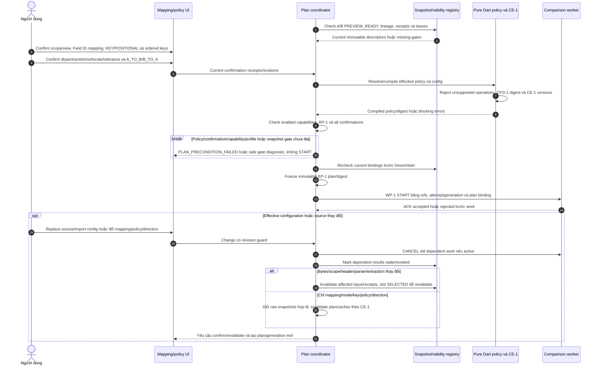
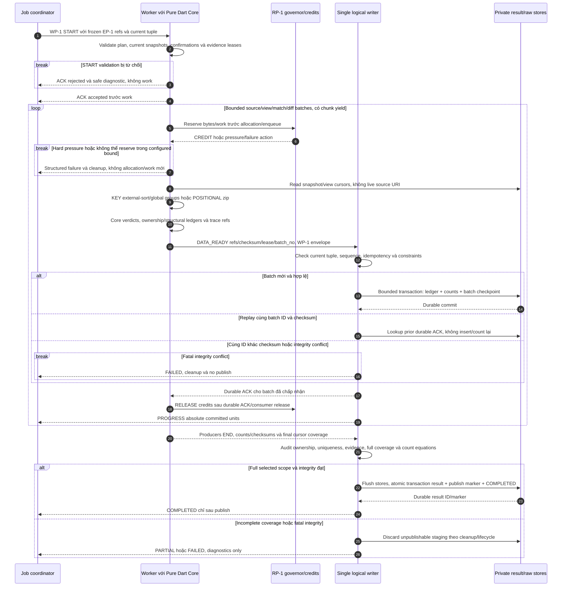
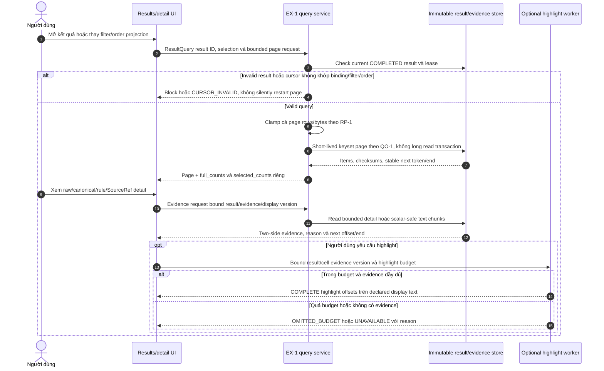
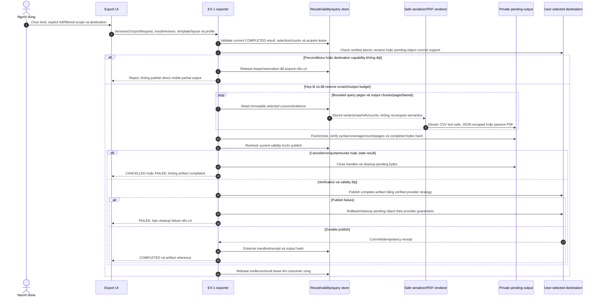
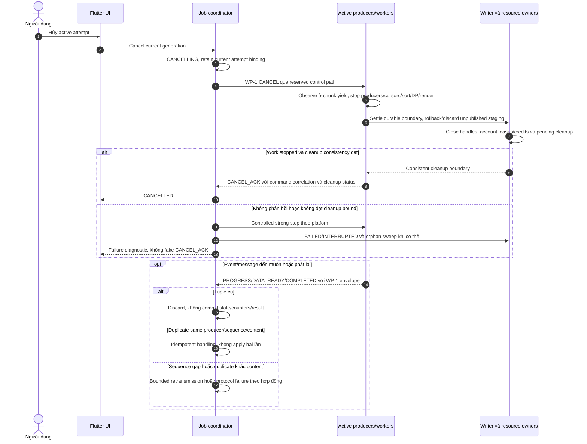
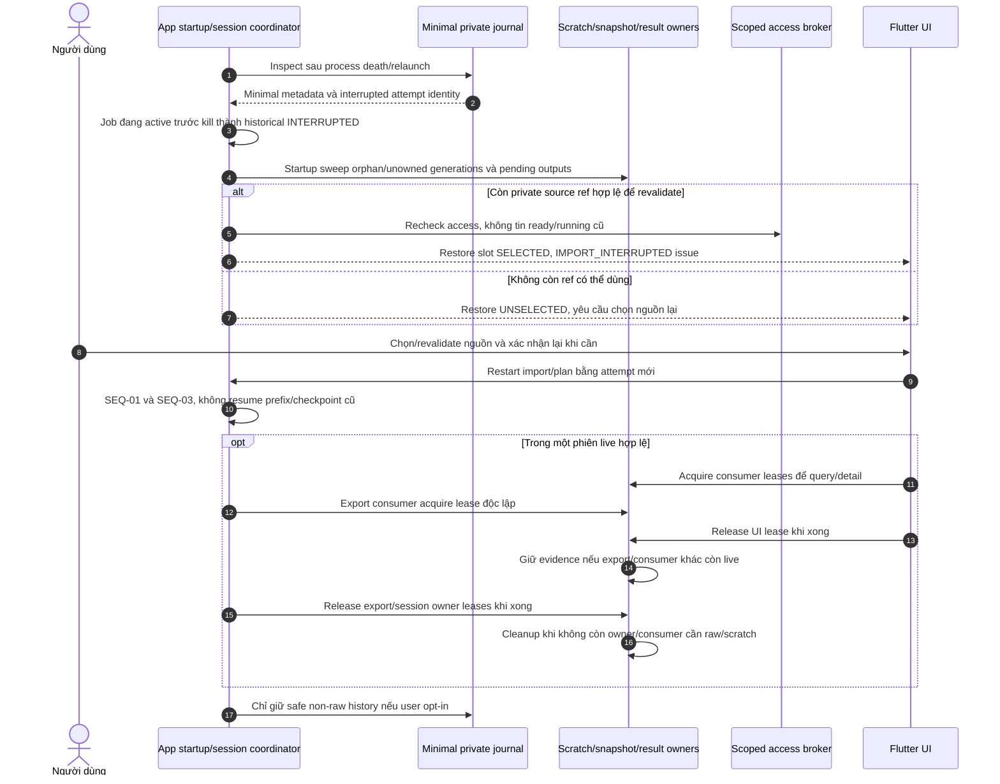

# Sequence diagrams — Dytava Mobile

Mô tả tương tác **mục tiêu**, dẫn xuất từ owner contracts; không là API/implementation hoặc bằng chứng chạy thật. Participants là vai trò logic, không bắt buộc mỗi vai trò thành một isolate/package. Messages diễn giải hành vi trừ các tên WP-1/ER-1/EX-1 đã có trong nguồn. Không bổ sung payload type hoặc wire schema mới.

A/B độc lập; lịch chạy workers tuân RP-1, không mặc định parse hai nguồn song song. Mọi callback/command phải có binding hiện hành; private URI/token chỉ đi qua access broker, không vào Core hoặc public report.

Lỗi/cancel giữa các bước không có nhánh riêng trong hình vẫn dừng attempt theo owner state machine, cleanup và không publish partial. `break` là nhánh kết thúc interaction; không chạy các messages còn lại khi điều kiện break xảy ra.

| Sơ đồ | Luồng | Nguồn chính |
| --- | --- | --- |
| SEQ-01 · [SVG](mobile-sequences/01-import.svg) | Chọn → inspect/review → full parse → freeze | [ISC-1](../specs/input/11_streaming_snapshot_contract.md), [INP-008](../specs/input/08_import_state_machine.md) |
| SEQ-02 · [SVG](mobile-sequences/02-ocr-review.svg) | OCR, corrections và review receipts | [INP-010](../specs/input/10_ocr_image_input.md), [ISC-1 §4](../specs/input/11_streaming_snapshot_contract.md#4-target-input-020-migration--logical-fields) |
| SEQ-03 · [SVG](mobile-sequences/03-plan-invalidation.svg) | Confirm/freeze plan và invalidation | [EP-1](../specs/engine/01_execution_plan.md), [Geometry](../specs/engine/02_geometry_mapping.md), [CE-1](../specs/core/CANONICAL_ENCODING.md) |
| SEQ-04 · [SVG](mobile-sequences/04-worker-publish.svg) · [PNG](mobile-sequences/04-worker-publish.png) | Worker, byte credits, staging và publish | [ER-1/WP-1](../specs/engine/04_result_runtime.md), [RP-1](../requirements/RESOURCE_PROFILES.md) |
| SEQ-05 · [SVG](mobile-sequences/05-query-detail.svg) | Result query, stable cursor, detail/highlight | [EX-1 §1](../specs/report/STREAMING_EXPORT_CONTRACT.md#1-query-cursor), [Core decisions §4](../specs/core/COMPARISON_DECISIONS.md#4-long-text-và-highlight) |
| SEQ-06 · [SVG](mobile-sequences/06-export.svg) | Bốn export kinds và publication | [Report](../specs/report/README.md), [EX-1](../specs/report/STREAMING_EXPORT_CONTRACT.md) |
| SEQ-07 · [SVG](mobile-sequences/07-cancel-protocol.svg) | Cancel, stale events và delivery guards | [WP-1 §5–7](../specs/engine/04_result_runtime.md#5-wp-1-envelope-và-delivery), [INP-008](../specs/input/08_import_state_machine.md) |
| SEQ-08 · [SVG](mobile-sequences/08-recovery-leases.svg) | Process death, restore và retention | [ER-1 §6–7](../specs/engine/04_result_runtime.md#6-comparison-state-transitions), [ADR-009](../decisions/ADR_REGISTER_P0_2026-11-11.md) |

## SEQ-01 — Import một slot A hoặc B

Review/error phát sinh trong parse cũng đóng stream và chuyển NEEDS_REVIEW/FAILED theo INP-008; ConfirmAndRetry tạo attempt mới. Prefix giữ nguyên trong byte stream đã hash; không hash một lượt provider khác với parsed bytes. XLSX pass A–D là dependencies logic; actual ZIP expansion/entry/token limits vẫn kiểm trong khi đọc, kể cả declared sizes hợp lệ. Một slot thất bại không làm mất snapshot hợp lệ của slot kia.

## SEQ-02 — OCR và review receipts

Text do user thêm vì không detect được giữ `recognized_text=null`, `lexical_status=UNAVAILABLE`, loss `OCR_NO_DETECTION`, `correction_origin=USER_ENTERED` và polygon/receipt thật. Không biến text nhập tay thành recognition evidence. Confidence không bypass review; không upload hoặc cloud fallback. Schema0.1 không biểu diễn IMAGE: phải có target0.2 validators/fixtures và capability gates trước enable; sơ đồ không bỏ qua điều kiện này.

## SEQ-03 — Freeze EP-1 và invalidation

Profile revision đổi cũng cần job mới; nếu profile tham gia import semantics thì revalidate affected Input. Không auto-accept proposal GF-1, không suy key uniqueness từ sample. Null/duplicate keys của records được xử lý ownership trong matching, không tự chọn first-match. Explicit access revoke khác đóng source handle bình thường.

## SEQ-04 — Bounded worker, staging và atomic result publication

Nhánh integrity conflict là terminal cho attempt, không tiếp tục vòng lặp/finalize. Audit failure không phát COMPLETED. Byte credits áp cả queue lẫn producer-held buffers; CANCEL có control reserve riêng tại SEQ-07. SQL/SQLite là adapter candidate, invariant single logical writer và transaction semantics không phụ thuộc tên thư viện. Full uncertainty đã có complete ownership có thể COMPLETED; full snapshot không được thay bằng prefix parse.

## SEQ-05 — Stable query, detail và optional highlight

Highlight không sửa cell verdict và không chạy lại normalization/matching. `NOT_REQUESTED` khi chưa yêu cầu. Text offsets là Unicode scalar positions, không byte/UTF-16 offsets. Unresolved groups hiển thị owned records từng phía, không dựng one-to-one pairs. UI giữ bounded page cache; denominator không tính lại từ các hàng đang hiển thị.

## SEQ-06 — Export và publish artifact hoàn chỉnh

`CSV_DIFF`, `JSON_REPORT`, `MERGED_DIFF_PDF`, `DYTAVA_REPORT_PDF`: một artifact/attempt/kind. Hai PDF là hai tệp riêng; mỗi kind vẫn một PDF nhiều trang, không tự split. Template Dytava1.0.0 và local fonts/assets theo Report. Full output quá budget thất bại; không tự đổi filtered scope hoặc truncate text. Output hash không nhúng vào chính artifact đã hash. Publish thành công nhưng mất ACK: tra receipt, không ghi tệp thứ hai; cancel sau durable publish không xóa user-owned artifact như temp.

JSON target ER-1 khác legacy renderer envelope1.0.0; bridge chỉ subset representable và admitted memory budget, reject precision/provenance/COUNT_GROUP mismatch. CSV quote đúng dialect chưa đủ chống formula injection; safe-text capability phải có reader-specific evidence. PDF không scripts/attachments/remote fetch.

## SEQ-07 — Cancel và protocol delivery guards

Import dùng state/event của INP-008, không bắt buộc phát comparison WP-1 message types. Comparison đã COMPLETED không bị cancel đến muộn đổi thành CANCELLED. Sequence numbers tăng theo producer/attempt/generation; JSON sequence/generation/counts là exact decimal integer strings. Không bỏ qua gaps của terminal/counter events. Khi RESOLVE thay effective plan, cancel old work và new generation → VALIDATING.

## SEQ-08 — Recovery và lease retention

Journal có thể giữ private recovery ref theo platform controls; không serialize raw/URI/token vào logs hoặc public history. Sau process death không dùng durable batch/publish marker để bypass revalidation/startup lifecycle. Trong live attempt, mất ACK sau durable batch/publish có thể lookup idempotent receipt nếu lineage/leases còn hợp lệ. User-exported files thuộc người dùng, không bị startup sweep như scratch. Đóng source handle bình thường không phải access revoke.

## Đọc cùng

[Activity diagrams](MOBILE_ACTIVITIES.md) · [State diagrams](MOBILE_STATES.md) · [System/domain diagrams](MOBILE_MODELS.md) · [Coverage và baseline](MOBILE_DIAGRAM_COVERAGE.md). Khi chủ sở hữu hợp đồng đổi nội dung, kiểm tra lại sơ đồ; không tự đổi owner contracts để khớp hình.
