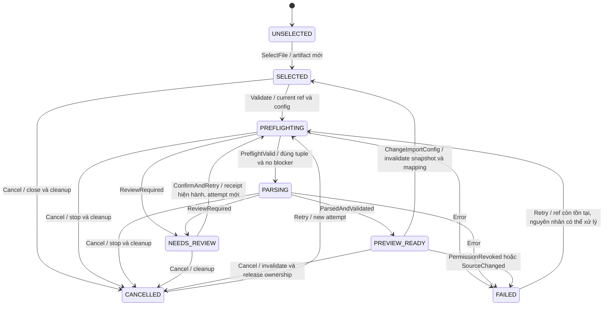
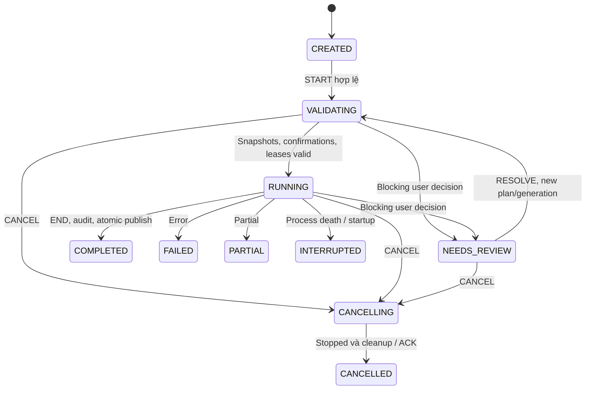
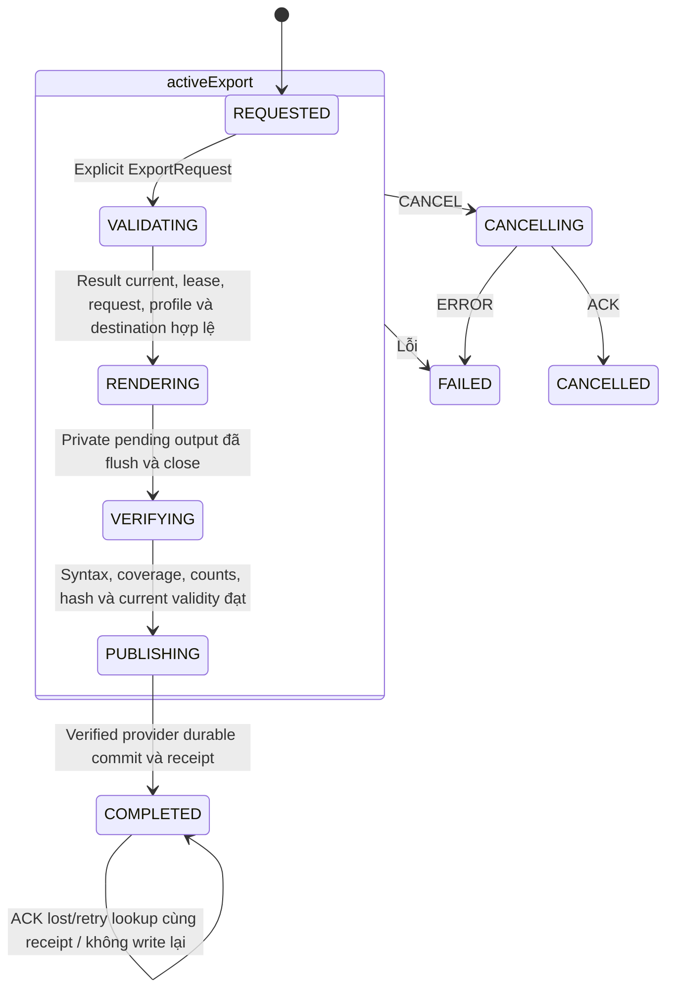

# State machines — Dytava Mobile

Ba máy trạng thái tách biệt: **Input slot**, **comparison job** và **export attempt**. `EXACT/EQUIVALENT/DIFFERENT/UNRESOLVED` là cell verdicts, không phải trạng thái của ba máy này. State names và guards dẫn xuất từ owner contracts, không bổ sung enum vào wire schemas.

| Sơ đồ | Bản render | Owner |
| --- | --- | --- |
| ST-01 Import slot | [SVG](mobile-states/01-input.svg) | [INP-008](../specs/input/08_import_state_machine.md) |
| ST-02 Comparison job | [SVG](mobile-states/02-comparison.svg) | [ER-1/WP-1 §6](../specs/engine/04_result_runtime.md#6-comparison-state-transitions), [EP-1](../specs/engine/01_execution_plan.md) |
| ST-03 Export attempt | [SVG](mobile-states/03-export.svg) | [EX-1 §6](../specs/report/STREAMING_EXPORT_CONTRACT.md#6-state-và-publication-protocol) |

## ST-01 — Một slot Input

**Quy tắc toàn cục của transition table INP-008** (không vẽ lặp mọi cạnh để giữ hình đọc được):

| Event | Áp dụng / effect |
| --- | --- |
| SelectFile / ReplaceFile | Từ mọi state: cancel/close old attempt, invalidate dependent snapshot/mapping, generation++, artifact mới → SELECTED |
| ChangeImportConfig | Mọi state có artifact: cancel old work, revision++, invalidate dependencies → SELECTED |
| PermissionRevoked / SourceChanged | Mọi state có artifact, đúng tuple: invalidate/cleanup → FAILED |
| Reset | Từ mọi state: generation++, cancel/cleanup, clear source → UNSELECTED |
| Restore | Ref còn tồn tại → SELECTED + INP-ERR-018 và revalidate; không có ref → UNSELECTED |
| Callback/event sai state hoặc stale tuple | Không đổi state; safe diagnostic/discard theo contract |

`PREVIEW_READY` cần **full** EOF/hash/config/receipt validation, không chỉ sample. OCR handoff phải về đúng validation gate, không nhảy PENDING→READY. A/B là hai instance độc lập. Logical transition Cancel chỉ hoàn tất sau stop/cleanup consistent; không công bố snapshot usable sau cancel. Stores còn consumer hợp lệ giữ bằng lease, không xóa vô điều kiện.

## ST-02 — Comparison job

Gate từ CREATED không đạt thì START rejected, không tạo RUNNING; diagnostics theo EP-1/WP-1. Các cạnh lỗi/partial/interrupted từ RUNNING là ví dụ đường chính; bảng dưới áp dụng toàn cục, không chỉ RUNNING:

| Event / guard | Áp dụng và effect |
| --- | --- |
| Fatal access/protocol/integrity/resource error | Mọi active state → FAILED và safe cleanup |
| Known safe diagnostics nhưng selected work chưa đủ | Mọi active state → PARTIAL, không result/export usable |
| Process death | Mọi active state được ghi historical INTERRUPTED tại startup |
| Duplicate terminal/CANCEL sau terminal | Idempotent/already-terminal ACK; không thêm result/counts, không đổi terminal state |
| CANCELLING không stop/cleanup trong bound | Controlled FAILED/INTERRUPTED và strong stop/sweep, không fake CANCEL_ACK |

`RESOLVE` thay effective plan tạo generation mới; arrow không có nghĩa mutate old generation tại chỗ. Retry terminal job tạo job/attempt mới theo finite profile limits. INTERRUPTED là trạng thái lịch sử được ghi khi mở lại app; Input restore SELECTED/UNSELECTED và revalidate, không resume old work.

COMPLETED có thể chứa unresolved ownership/cells đã counted đầy đủ. Result validity là registry riêng `current/stale/revoked`, **không** đổi immutable job/result bytes thành CANCELLED. Thay source/config/plan invalidate derived result, chặn query/export mới; source handle close bình thường không đồng nghĩa revoke.

## ST-03 — Export attempt

`activeExport` là grouping của REQUESTED/VALIDATING/RENDERING/VERIFYING/PUBLISHING, không thêm state vào EX-1. PUBLISHING cũng chịu cancel/error trước durable commit. Process death của active export được journal/startup đánh dấu interrupted attempt và sweep theo SEQ-08, không suy ra output đã hoàn tất. Retry tạo export attempt mới, không nối bytes cũ; durable publish nhưng mất ACK phải lookup receipt trước quyết định retry.

COMPLETED không bị cancel đến muộn biến thành CANCELLED; user-owned artifact đã publish không bị xóa như temp. Destination không có verified atomic rename/pending commit bị chặn trước publish. Full output vượt budget → failure và người dùng chọn một ExportRequest mới; không tự filter/truncate/split PDF.

## Đọc cùng

[Sequence diagrams](MOBILE_SEQUENCES.md) · [Activity diagrams](MOBILE_ACTIVITIES.md) · [System/domain diagrams](MOBILE_MODELS.md) · [Coverage và baseline](MOBILE_DIAGRAM_COVERAGE.md).
