# DYTAVA — UNIFIED DATA GEOMETRY & COMPARISON ENGINE

> **SUPERSEDED — nguồn lịch sử v3.0.** Đặc tả hiện hành: [UDG3.1 theo layer](../../specs/engine/README.md), hoàn thiện từ [30 gaps](../../testing/UDG_CONTRACT_ACCEPTANCE.md). Body/diagrams bên dưới giữ để audit; các phase/status/budget/pseudocode mâu thuẫn không ghi đè owner contracts mới. PDF/DOCX cùng bộ vẫn là bản3.0 lịch sử.

**ĐẶC TẢ KỸ THUẬT V3.0 — IMPLEMENTATION-READY DESIGN**  
**Ngày:** 13/11/2026 · **Nền tảng:** Flutter/Dart (Android ưu tiên; iOS mở rộng)  
**Trạng thái:** Đặc tả đề xuất, chưa phải xác nhận mã nguồn hoặc benchmark đạt yêu cầu  
**Nguồn nền:** Tài liệu thuật toán v1 do người dùng cung cấp; v2.0; mô tả Dytava, đề cương tiểu luận.  
**Nguyên tắc:** Không sửa file nguồn; kết quả có thể kiểm toán; không suy đoán sự tương đương khi thiếu căn cứ.

> **Quy ước trạng thái:** `[SPEC]` là yêu cầu thiết kế; `[IMPLEMENT]` cần lập trình; `[VERIFY]` cần kiểm tra thực tế; `[OUT OF SCOPE]` chưa cam kết. Các chỉ số định lượng dưới đây nếu không ghi là *đã đo* đều chỉ là mục tiêu kiểm thử.

## 0. Executive summary và quyết định kiến trúc

Dytava đối chiếu 2 workbook và nhiều vùng bảng: dữ liệu thêm/xóa/sửa/di chuyển; kiểu dữ liệu, công thức và provenance; xác định được vùng chưa chắc chắn. Không dùng một thuật toán LCS cho mọi bảng: chọn *keyed*, *ordered*, *positional*, *multiset*, hoặc *manual* theo chính sách và tín hiệu. Bản v3 bổ sung **XLSX bounded streaming ingestion, workbook-level orchestration, disk-backed indexes, explicit resource budgets, state machine, mobile worker protocol, reproducible testing**.

**5 quyết định bắt buộc:** (D1) ưu tiên đúng hơn tự động; (D2) giá trị typed khác presentation; (D3) sheet/region là đơn vị scheduling; (D4) không nạp toàn bộ object graph workbook vào RAM; (D5) báo cáo phải phân biệt `COMPLETE`, `PARTIAL`, `FAILED`, `CANCELLED`.

### 0.1. Yêu cầu sản phẩm và ranh giới

- **P0:** nhập hai XLSX, inventory tất cả sheet, ghép sheet rõ ràng, chọn region và khóa, compare record/cell, thống kê, xem nguồn, xuất JSON/CSV, hủy an toàn.
- **P1:** tự nhận diện vùng/axis có confidence; indexing ngoài RAM; hỗ trợ đa sheet hàng loạt; resume theo checkpoint có kiểm soát.
- **P2:** phân tích style, khả năng nhận diện đổi tên sheet, token-level diff tiếng Việt, OCR connector riêng.
- **Ngoài phạm vi v3 core:** tính toán lại toàn bộ công thức Excel, macro VBA, chart/pivot semantic equivalence, OCR image engine, Cloud sync, đảm bảo đúng cho workbook không giới hạn.

### 0.2. Lý do cần v3

V1 dựa trên unroll→axis→xxHash64→LCS→cell diff, còn chưa khớp được record modified nếu toàn vector hash đổi; v2 khắc phục ở mức logical matching nhưng thiếu mô hình multi-sheet streaming, storage/worker protocol và performance gates. V3 định nghĩa các thành phần đó để có thể phân rã thành implementation tickets.


## 1. Bài toán, giả định, tiêu chí tính đúng

Cho workbook A, B, policy P. Kết quả là tập sheet-pair, region-pair, one-to-one record pairs, unmatched sets, unresolved candidates và diff events. `MATCH` không đồng nghĩa record có cùng vị trí. Sheet hoặc region không ghép được không được tự động đánh dấu là toàn bộ INSERT/DELETE nếu vẫn có ứng viên chưa giải quyết.

**Các trường hợp trọng tâm:** (a) đảo hàng, chèn 1 hàng giữa; (b) mã định danh và số có zero padding; (c) timeline ngang; (d) merged header và multi-table; (e) thay đổi công thức; (f) nhiều sheet đổi tên, ẩn sheet; (g) workbook rất rộng, sparse, file nén nhỏ nhưng XML giải nén lớn.

**Tiêu chí đúng:** không ghép nhầm bản ghi với khóa duy nhất; bảng thống kê đối soát được; trạng thái không xác định được báo rõ; provenance đủ cho người dùng tái kiểm tra; file gốc bất biến. Không tuyên bố tự nhận diện ngữ nghĩa vượt quá policy.

**Hình 1. Ngữ cảnh hệ thống và luồng nhập/xuất**

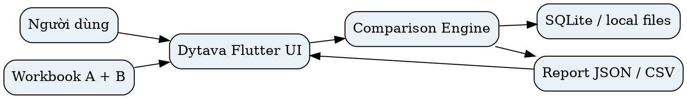


## 2. Kiến trúc hệ thống, module và biên trách nhiệm

- **Presentation:** chọn file, inventory sheet, editor mapping, comparison progress, diff list ảo hóa, review queue, export.
- **Application:** session state, budget allocator, task scheduling, worker message correlation, retry/cancel, checkpoint.
- **Domain (Pure Dart):** canonical model, policy evaluator, hashing/verification, matching, typed comparison, invariants.
- **Data:** streaming ingress adapters, SQLite repository, bounded temp files, checkpoint, report exporter.
- **Platform adapters:** Android Storage Access Framework / iOS document picker, local file handles và permission; không để Domain phụ thuộc platform APIs.

**Dependency rule:** Presentation → Application → Domain interfaces; Data/Platform implements ports. Không đưa `Widget`, `BuildContext`, file-picker object hoặc SQLite transaction vào domain model. Chạy worker bằng long-lived isolate khi cần nhiều tiến trình và cancel; `Isolate.run` phù hợp cho tác vụ ngắn nhưng không cung cấp tiến độ liên tục theo mặc định.

**Hình 2. Sơ đồ thành phần logic và quan hệ phụ thuộc**

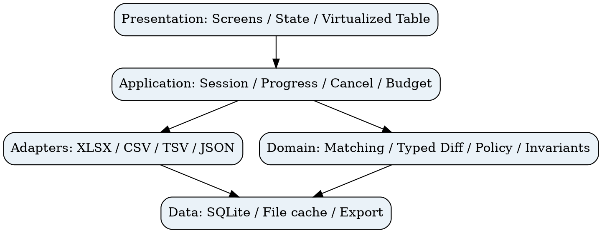


## 3. Pipeline chính thức gồm 9 giai đoạn

| Giai đoạn | Input → output | Quy tắc/điều kiện hoàn tất |
|---|---|---|
| 0 Ingestion | Source → bounded ZIP/XML streams | xác minh phần tệp, giới hạn size, provenance |
| 1 Canonicalization | cells → typed sparse cells | giữ raw, formula, display và source |
| 2 Workbook/region mapping | sheets → region pairs | không tự ghép nếu mơ hồ |
| 3 Axis/field/policy | regions → normalized record schema | chốt orientation, key, type |
| 4 Hash/candidates | canonical records → candidate index | verify full canonical when hashes match |
| 5 Alignment | candidates → matched/unmatched/ambiguous | one-to-one conservation |
| 6 Typed diff | paired fields → change events | do not use fuzzy similarity as equality |
| 7 Classification/audit | events → validated summaries | compare invariants + completeness |
| 8 Persist/export | records → disk + UI | transactional finalize |

Các bước 0–3 có thể xử lý theo dòng hoặc lô; bước 5 có thể cần index hoặc buffer ứng viên. Độ lớn batch và mức song song là cấu hình resource governor, không số cố định bắt buộc.

**Hình 3. Luồng xử lý chín giai đoạn**

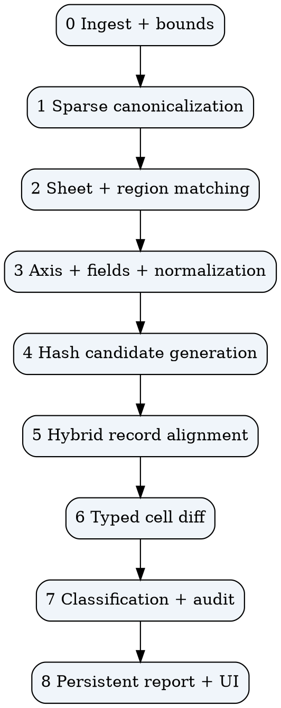


## 4. XLSX parsing an toàn và đa worksheet

### 4.1. Cấu trúc gói và thư tự đọc

`.xlsx` là OPC/ZIP; xác nhận `[Content_Types].xml`, `xl/workbook.xml`, relationships rồi resolve worksheet part theo **relationship ID**, không suy ra sheetN.xml từ tên hiển thị. Đọc workbook properties/date system, sharedStrings, styles, formulas và merged ranges. Với worksheet streaming SAX/pull, chỉ giữ các record/batch cần thiết; parse XML an toàn (vô hiệu external entity/DTD nếu không cần). Nếu thư viện Dart chưa có streaming ZIP/XML đúng nghĩa, adapter cần POC hoặc FFI/native streaming theo đánh giá riêng; không gọi một API decode-to-memory là streaming.

**Bounded ZIP checks:** compressed bytes, uncompressed bytes tổng và từng part, tỷ lệ nở, entry count, path traversal, CRC/integrity, overlap/truncated entries, giới hạn text/shared strings, XML depth, cell count, timeout/cancel. Các giá trị limit phải thực nghiệm theo thiết bị và cấu hình chính sách. File mã hóa không được hỗ trợ thì trả lỗi có cấu trúc; tuyệt đối không thử parse như file chuẩn.

**Shared Strings:** workbook-level table có thể lớn; cho phép index trỏ vị trí/offset hoặc materialize từng đoạn nếu parser hỗ trợ; có fallback rõ ràng nếu không thể xử lý với ngân sách RAM. Tham chiếu style và number format khi suy luận date; serial 1900/1904 phải xét leap-day anomaly. Cached formula value không bảo đảm mới nhất.

**Hình 4. Các thành phần đọc XLSX có giới hạn**

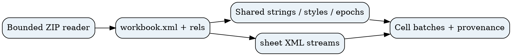

### 4.2. Ingestion adapter contract

```dart
abstract interface class WorkbookReader {
  Future<WorkbookManifest> inspect(SourceHandle source, ResourceBudget budget);
  Stream<CellBatch> readRegion(SourceHandle source, SheetRef sheet,
    RegionBounds bounds, ReadPolicy policy, CancellationSignal cancel);
}
```

`CellBatch`: {sessionId, sheetId, regionId, batchNo, sparseCells[], sourceRange, warnings[], checksum}. Reader không được thay đổi input. Không giữ toàn bộ `CellBatch` trong luồng UI; batch chỉ đi qua queue bounded hoặc ghi vào storage.

### 4.3. Phân biệt nội dung được và không được hỗ trợ

| Thành phần | V3 core | Ghi chú |
|---|---|---|
| Cell value typed, merged ranges, multiple worksheets | Có trong thiết kế | cần test theo fixture |
| Formula expression, cached result | Có | không recalculate |
| Hidden sheets/rows, styles | metadata + policy | mặc định không coi là value change |
| Excel structured table, named range | optional metadata | validate boundaries |
| Pivot, chart, drawing, macro | Không so sánh ngữ nghĩa | warning/unsupported |
| External links và data connections | không fetch | offline/privacy |


## 5. Workbook-level orchestration và matching nhiều sheet

**Inventory:** mỗi sheet có `sheetId`, name, visibility, declared/observed dimensions, nonempty samples, header signature, region count, formula/link metadata và parse warnings. Ghép sheet theo explicit mapping trước; nếu chưa có, thử tên chính xác, tên đã chuẩn hóa, structural signature, header overlap và sample-based confidence. Không dùng tên sheet là chứng cứ duy nhất. Sheet renamed/moved được phép nhưng cần confidence, giữ old/new names. Các sheet candidates nhiều–một hoặc score gần nhau → `NEEDS_REVIEW`.

**Scheduling:** xử lý sheet pairs lần lượt theo mức ưu tiên người dùng; concurrency mặc định 1 khi workbook lớn, chỉ tăng khi bộ nhớ còn đủ. Có thể chia một sheet thành nhiều regions; kiểm tra các region không trùng nhau hoặc xác nhận overlap. Aggregator thống kê matched/modified/inserted/deleted/ambiguous theo sheet và workbook; kết quả partial luôn hiện sheet nào đã xử lý.

**Hình 5. Ghép worksheet và điều phối so sánh**

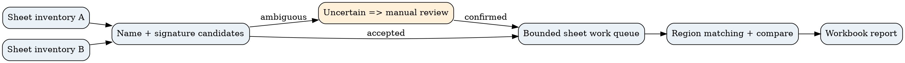

### 5.1. Quy tắc mapping sheet

1. Explicit user mapping luôn cao nhất và được audit. 2. Exact normalized name chỉ là tín hiệu mạnh, không thay thế kiểm tra content. 3. Signature matching phải xác thực header/region shape. 4. Unique and high margin mới auto accept. 5. Nghi ngờ rename có thể chỉ hiển thị gợi ý; không xóa nguyên sheet và thêm nguyên sheet khi chưa được xác nhận. 6. Sheet bị xóa/thêm chỉ là kết luận khi không còn đối tượng cạnh tranh phù hợp theo chính sách.

### 5.2. Lịch xử lý và tài nguyên

`WorkQueue` có giới hạn độ sâu, một worker xử lý trên cặp worksheet và nhiều region; mỗi unit có `checkpointId`, `inputFingerprint`, `policyFingerprint`, `state`. Sau khi app kill, chỉ resume nếu cả fingerprint và phiên bản engine/policy phù hợp, nếu không restart hoặc báo không thể resume.


## 6. Canonical geometry và provenance

### 6.1. Các model lõi

```text
WorkbookManifest(id, fingerprint, sheetEntries[], dateSystem, warnings)
SheetManifest(id, workbookId, relId, name, visibility, bounds, metadata)
TableRegion(id, sheetId, bounds, headerRanges[], orientation, confidence)
SourceCell(sheetId, row, col, rawKind, rawValue, formula, cached,
           styleId, formattedText?, mergeAnchor?, provenance)
CanonicalField(fieldId, logicalType, mappingA, mappingB, comparisonRules)
CanonicalRecord(recordId, regionId, ordinal, key?, fields[], sourceSpan)
RecordMatch(aId?, bId?, status, candidateScore?, rationale[])
DiffEvent(kind, scope, sourceA?, sourceB?, before?, after?, policyId, reason)
```

`sourceSpan` là tọa độ một hoặc nhiều ô, vì một field có thể lấy từ merged anchor hoặc tổng hợp cột. Phân biệt hàng/cột vật lý, trục logic và thứ tự ghi nhận. Lưu merge anchors dạng interval index; không nhân bản một giá trị merged vào từng cell khi không có chính sách.

### 6.2. Merged cells

Với `M=[r1,r2]×[c1,c2]`, `virtualCell(r,c)=Ref(r1,c1)` chỉ để đọc hình học. Chính sách mặc định `anchorOnly`; `propagateForGrouping` chỉ dùng cho group key, không áp dụng một cách mù quáng; `visualOnly` tách merge layout khỏi nghĩa dữ liệu. Khả năng tra cứu O(1) không được cam kết trừ khi có chỉ mục cụ thể cùng đánh đổi bộ nhớ.

### 6.3. Axis/region confidence

Không dùng số ngày tăng dần như một định nghĩa entropy. Tính `Score(row)` và `Score(column)` từ tính nhất quán kiểu, tính duy nhất khóa, khuôn mẫu header, mật độ và chuỗi thời gian. Chỉ auto khi khoảng cách ≥ δ và score đạt ngưỡng tối thiểu đã calibrate. Chuyển vị bằng logical view không tạo copy của toàn bộ ma trận.

**Hình 6. Truy vết từ ô gốc đến báo cáo sai khác**

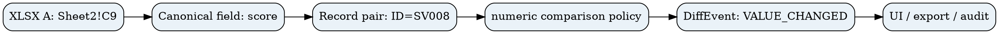


## 7. Hybrid matching — thuật toán định tuyến

### 7.1. Chọn mode

`keyed` nếu khóa ổn định, duy nhất và hợp lệ ở cả hai bên; `ordered` nếu sequence có ý nghĩa thứ tự; `positional` chỉ khi người dùng yêu cầu đối chiếu tọa độ; `multiset` nếu không thứ tự và so sánh nguyên record; `manual` nếu các ứng viên không có căn cứ duy nhất. Không tự chọn keyed khi null/duplicate vượt ngưỡng policy. Ưu tiên tạo candidate ít tốn chi phí nhưng phải xác thực exact canonical khi hash bằng nhau.

**Hình 7. Cây quyết định chiến lược ghép bản ghi**

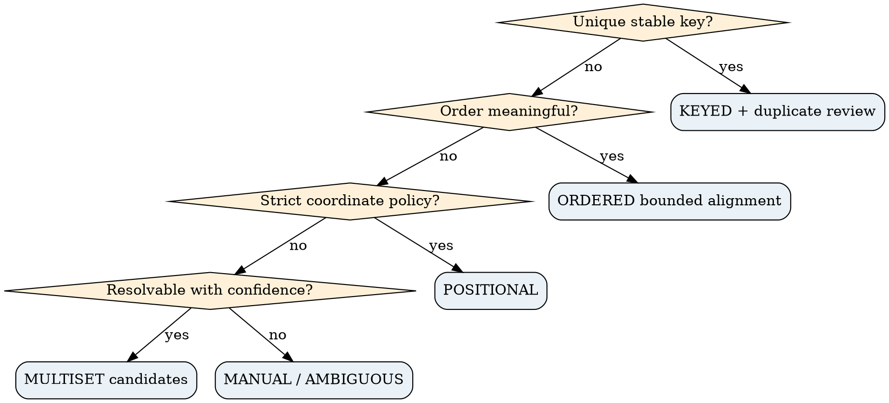

### 7.2. Keyed matching

Index records theo canonical key có `keyType`, length-delimited encoding. Key duplicates → bucket list; nếu bucket >1, disambiguation theo stable fields hoặc `AMBIGUOUS`, không ghép tùy ý. Nếu field khóa bị sửa, mặc định đó có thể là DELETE+INSERT, không suy diễn record vẫn là một thực thể nếu không đủ trường hỗ trợ. Collision hash → full key compare.

**Expected** O(n+m) lookup với hash-based index; phải cộng chi phí canonicalization, I/O, duplicate handling và build indexes.

### 7.3. Ordered matching

Hash equal anchored candidates chỉ là các đoạn exact; chọn anchor duy nhất, monotonic và không chồng. Các đoạn giữa anchors dùng bounded edit/sequence DP có `SUBSTITUTE` cost dựa stable fields; chỉ cho match modified khi score-margin vượt threshold calibrate. Nếu quá `maxDpCells`, chuyển sang banded alignment hoặc trả `AMBIGUOUS`/manual, **không** bỏ qua đoạn dư.

### 7.4. Multiset/positional/manual

- Multiset: hash buckets + canonical equality + count multiplicities, không coi bản ghi giống hệt lặp lại là nhiều match độc nhất có nguồn gốc chắc chắn.
- Positional: so từng tọa độ sau field mapping, báo hậu quả của row-shift nếu có dấu hiệu.
- Manual: chọn mapping field/key/region, lưu audit; sau khi người dùng confirm chạy lại affected region, không rewrite silently.

### 7.5. Invariants ghép

`A_count = matched + deleted + unresolved_A`; `B_count = matched + inserted + unresolved_B`. Không record nào tham gia >1 cặp một–một. Với multiset identical duplicates, `source-specific identity` có thể không xác định — phân biệt count-level matching và instance-level matching.


## 8. Typed comparison, công thức và sự không chắc chắn

`equivalent(a,b,P)` là boolean có điều kiện khi có thể đánh giá; nếu không thể đánh giá trả `UNDETERMINED`. Jaro–Winkler/token similarity chỉ phục vụ candidate ranking hoặc highlight, không gán `EQUIVALENT` do điểm cao.

| Loại | Luật mặc định an toàn | Tùy chọn |
|---|---|---|
| Text | exact Unicode code point sau NFC nếu policy bật; case-sensitive | trim/casefold/whitespace/diacritics có khai báo |
| Numeric | typed decimal/number equality, xử lý NaN/errors riêng | abs+relative tolerance, đơn vị |
| Identifier | giữ zero padding và type | explicit cast theo field |
| Date | cùng calendar semantics + 1900/1904 conversion | timezone rule nếu datetime timestamp |
| Boolean | true/false typed | explicit text coercion |
| Missing | NULL ≠ EMPTY ≠ BLANK theo policy | custom equivalence |
| Formula | expression và/hoặc cached value | cache missing/stale → warning/unknown |
| Style | không tính vào content diff mặc định | format event separate |

Giới hạn: Excel serial 60 trong 1900 system cần xử lý sai lệch lịch; không coi 1900-02-29 là ngày hợp lệ. Numeric display string có thể khác locale; loại dữ liệu gốc phải dẫn dắt đối chiếu. Hash signature dùng encoding kiểu, length, field ID, normalization policy version; khớp hash phải verify record.

**Hình 8. Quyết định so sánh từng ô theo kiểu**

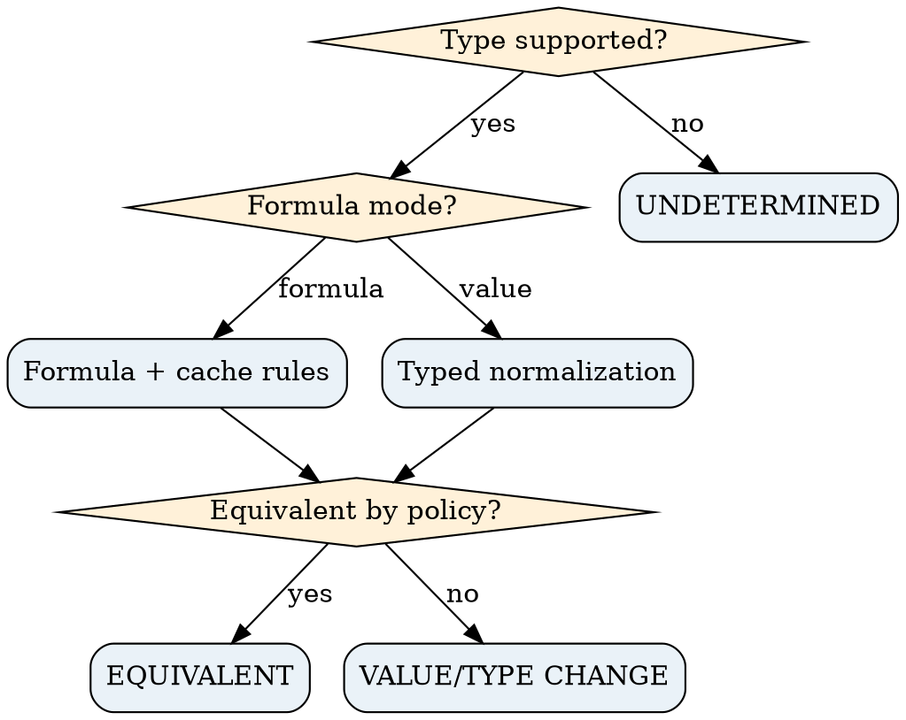

### 8.1. Hai lớp kết quả

`RecordStatus = UNCHANGED | MODIFIED | INSERTED | DELETED | MOVED | AMBIGUOUS`; `CellStatus = EQUIVALENT | VALUE_CHANGED | TYPE_CHANGED | FORMULA_CHANGED | FORMAT_CHANGED | UNDETERMINED`. `MOVED` có thể đồng thời `MODIFIED` dưới cấu trúc events độc lập (không ép exclusive khi hai thuộc tính khác trục). Parser errors → `PROCESSING_ERROR` riêng, không kết luận thành dữ liệu thay đổi.

### 8.2. Fuzzy score và calibration

Ngưỡng 0.65/0.85 trong v1 **không có chứng cứ thực nghiệm**; không sử dụng làm luật kết luận mặc định. Với matching candidates phải huấn luyện/hiệu chỉnh trên fixture có ground truth, đánh giá precision-recall theo domain và chấp nhận abstention khi score-margin thấp.


## 9. Mobile runtime, isolates và lifecycle

Flutter main isolate thực hiện UI + orchestration nhẹ; long-lived compute isolate(s) thực hiện parse/compare, chuyển message serializable nhỏ (`START`, `PROGRESS`, `WARNING`, `NEEDS_REVIEW`, `CANCEL`, `CANCEL_ACK`, `COMPLETED`, `FAILED`), payload lớn qua file path/temp DB reference, không send cả workbook dưới dạng object graph. Domain layer thuần Dart; platform file pick/permission thường ở UI/platform adapter. Số worker song song tự điều chỉnh theo RAM, số core, thermal và write contention.

**Cancellation:** cờ cancel được worker thăm dò ở parser chunk, batch insert, matching bounded loops, export. `CANCEL_ACK` chỉ sau khi stop + transaction rollback/flush xác định; kill isolate mạnh có thể cần cleanup bằng session recovery marker. App background hoặc OS kill không được coi chắc chắn có thời gian hoàn tất.

**Hình 9. Thông điệp giữa UI, bộ điều phối và worker**

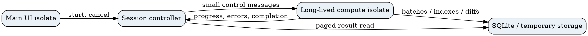

### 9.1. Worker protocol JSON-like

```json
{"type":"START","jobId":"job-001","sessionId":"s-001","policyHash":"sha256:...","inputRefs":["local:A","local:B"]}
{"type":"PROGRESS","jobId":"job-001","phase":"ALIGN","sheetId":"sheet-2","completedUnits":1200,"totalUnits":5000}
{"type":"NEEDS_REVIEW","jobId":"job-001","mappingId":"map-17","options":["sheet-a","sheet-b"]}
{"type":"CANCEL","jobId":"job-001"}
{"type":"COMPLETED","jobId":"job-001","reportRef":"db:session/s-001","complete":true}
```

Các giá trị URI/path trên chỉ là ví dụ hợp đồng. `jobId`, `sessionId`, `sequenceNo`, `protocolVersion` phải có ở mọi event trong triển khai để chống duplicate/out-of-order; progress phải theo giai đoạn vì `totalUnits` có thể chưa biết. `CANCEL` phải idempotent.

### 9.2. State machine

**Hình 10. Vòng đời phiên so sánh**

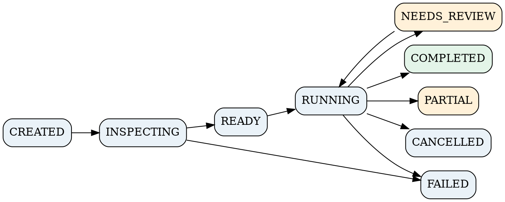

`NEEDS_REVIEW` là trạng thái tạm dừng có thể quay lại RUNNING; `PARTIAL` là báo cáo không đầy đủ, không đồng nghĩa PASSED. Các transition invalid phải bị từ chối và ghi log.


## 10. Disk-backed index, persistence và dữ liệu tạm

Một database SQLite cục bộ lưu session, sheet inventory, region mappings, record key index, compact typed values/offsets, match links, diff events và audit. Không bắt buộc lưu toàn bộ cell raw nếu có thể re-read theo offset hợp lệ; với XLSX compressed stream, random seek không miễn phí nên tùy adapter chọn spool từng worksheet hoặc materialize có giới hạn.

**Hình 11. Mô hình quan hệ tối thiểu trên thiết bị**

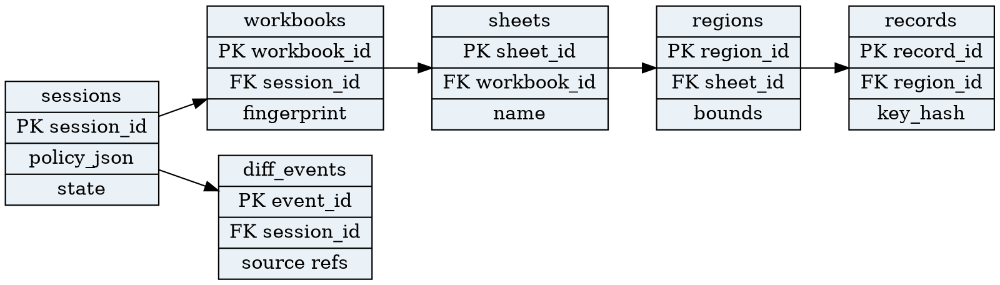

### 10.1. DDL tham khảo

```sql
CREATE TABLE sessions (session_id TEXT PRIMARY KEY, status TEXT NOT NULL,
  policy_json TEXT NOT NULL, policy_hash TEXT NOT NULL, engine_version TEXT NOT NULL,
  created_at TEXT NOT NULL, completed_at TEXT);
CREATE TABLE workbooks (workbook_id TEXT PRIMARY KEY, session_id TEXT NOT NULL,
  role TEXT NOT NULL, source_fingerprint TEXT NOT NULL, manifest_json TEXT NOT NULL);
CREATE TABLE sheets (sheet_id TEXT PRIMARY KEY, workbook_id TEXT NOT NULL,
  rel_id TEXT, name TEXT NOT NULL, visible INTEGER NOT NULL, metadata_json TEXT);
CREATE TABLE regions (region_id TEXT PRIMARY KEY, sheet_id TEXT NOT NULL,
  bounds_json TEXT NOT NULL, mapping_json TEXT, state TEXT NOT NULL);
CREATE TABLE records (record_id TEXT PRIMARY KEY, region_id TEXT NOT NULL,
  ordinal INTEGER NOT NULL, key_hash BLOB, key_blob BLOB, payload_ref TEXT);
CREATE INDEX idx_records_key ON records(region_id, key_hash);
CREATE TABLE diff_events (event_id TEXT PRIMARY KEY, session_id TEXT NOT NULL,
  region_pair_id TEXT, kind TEXT NOT NULL, status TEXT NOT NULL,
  source_a_json TEXT, source_b_json TEXT, payload_json TEXT NOT NULL);
CREATE INDEX idx_diff_page ON diff_events(session_id, region_pair_id, kind);
```

Production cần FK constraints, migrations, indexes cho joins, transactions, retention và encryption policy riêng; schema trên là contract starter chứ không phải migration release-ready. Với WAL cần monitor file `-wal`, checkpoint và cleanup; đừng giả định disk free không có giới hạn.

### 10.2. Dữ liệu có thể mất/được giữ

- Dữ liệu nguồn chỉ đọc; checksum/fingerprint theo bytes; không sửa hoặc overwrite.
- Tệp tạm ở application sandbox, có TTL; xóa khi cancel/fail nếu policy không cần resume.
- Session đã complete được giữ theo retention policy người dùng; xóa session dọn cả indexes, spool và diff.
- Kết quả lưu không chứa raw sensitive values nếu cấu hình metadata-only; report export có cảnh báo PII.


## 11. Backpressure, RAM/Disk budgets và xử lý ngoại lệ

**Điểm nghẽn chính:** decompress ZIP, shared strings, XML token objects, candidate index, DP cache, mass diff events, serialization between isolates, SQLite write amplification. Bộ quản lý tài nguyên áp hard/soft budgets theo loại thiết bị và kích thước đầu vào; khi vượt soft-limit giảm batch/parallelism, spill ra disk; vượt hard-limit chuyển `PARTIAL` hoặc `FAILED` có lý do, không claim success.

**Hình 12. Backpressure và các ngưỡng cấp phát tài nguyên**

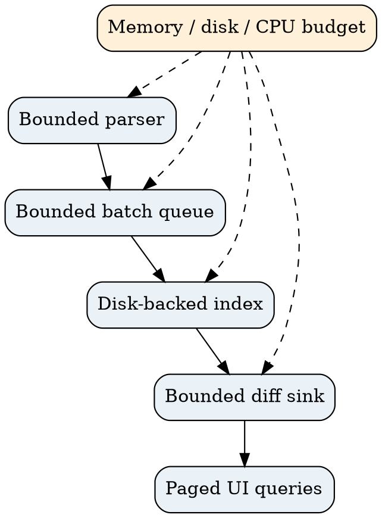

### 11.1. Ngân sách được cấu hình (không phải cam kết)

```yaml
resourceBudget:
  maxCompressedBytes: device_profile_defined
  maxExpandedBytes: device_profile_defined
  maxZipEntries: device_profile_defined
  maxSharedStringBytes: device_profile_defined
  maxXmlDepth: device_profile_defined
  maxCellsPerRegion: device_profile_defined
  maxBufferedBatches: device_profile_defined
  maxDpCells: device_profile_defined
  maxDiskSpoolBytes: available_disk_aware
  maxWorkerCount: adaptive
  hardTimeout: measured_profile_defined
```

### 11.2. Bảng xử lý lỗi

| Lỗi | Kết quả | Recovery |
|---|---|---|
| ZIP invalid/encrypted | UNSUPPORTED/FAILED | bỏ qua file, thông báo |
| ZIP bomb threshold | RESOURCE_LIMIT | dừng đọc, cleanup |
| Shared strings exhausted | PARTIAL/FAILED | spool/index hoặc từ chối có giải thích |
| Sheet mapping ambiguous | NEEDS_REVIEW | người dùng xác nhận |
| DP budget exceeded | AMBIGUOUS for region | bounded fallback/manual |
| Storage full | PARTIAL/FAILED | rollback, dọn temp |
| Cancel | CANCELLED | cleanup/checkpoint |
| OS process death | INTERRUPTED on recovery | resume nếu fingerprints đúng |
| Formula cache missing | warning/UNDETERMINED | so formula text hoặc review |


## 12. Sequence diagrams — luồng chuẩn và luồng lỗi

**Hình 13. Chuỗi xử lý nhập, xác nhận, đối chiếu, và xử lý lỗi**

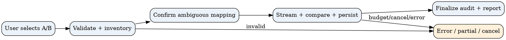

**Luồng chuẩn:** (1) UI nhận 2 nguồn → (2) inspect manifest và sheet inventory → (3) mapping/axis/key được chốt → (4) job chạy batch, ghi checkpoint và events → (5) audit invariants → (6) finalize state COMPLETE → (7) UI query pagination. **Luồng review:** inspector/matcher báo ambiguous, worker pause hoặc checkpoint, UI thu xác nhận, emit policy override event, chạy lại affected region. **Luồng cancel:** UI gửi CANCEL, worker đóng stream, hoàn tất transaction boundary hoặc rollback, trả ACK, state CANCELLED. **Luồng lỗi tài nguyên:** chỉ báo PARTIAL nếu đã có kết quả hữu ích và được đánh dấu missing scope; nếu không đảm bảo audit, FAILED.

### 12.1. Pseudocode workflow

```dart
Future<SessionResult> runComparison(SessionRequest req, WorkerPort port) async {
  final job = await repository.createSession(req);
  final manifestA = await reader.inspect(req.sourceA, req.budget);
  final manifestB = await reader.inspect(req.sourceB, req.budget);
  final sheetPairs = await sheetMatcher.resolve(manifestA, manifestB, req.policy);
  if (sheetPairs.hasAmbiguity) return job.needsReview(sheetPairs.ambiguous);
  for (final sheetPair in sheetPairs.confirmed) {
    req.cancel.throwIfRequested();
    final regions = await regionMatcher.resolve(sheetPair, req.policy);
    for (final regionPair in regions.confirmed) {
      final mode = strategyResolver.choose(regionPair, req.policy);
      final plan = await matcher.match(regionPair, mode, req.budget);
      await repository.transaction(() async {
        await diffEngine.compareToSink(plan, req.policy, repository.diffSink);
        await audit.assertRecordConservation(plan);
        await repository.checkpoint(job.id, regionPair.id);
      });
      port.progress(job.id, regionPair.id);
    }
  }
  return repository.finalizeWithAudit(job.id);
}
```

Đây là pseudocode định hướng triển khai. `reader`, `matcher`, `repository` chưa được chứng minh tồn tại trong repository. Khi làm thật, streaming, cursor và transaction boundaries cần được hiện thực theo DB adapter đã chọn.


## 13. Complexity và năng lực xử lý file lớn

Ký hiệu: `N` tổng cells cần đọc, `S` số sheets, `R` tổng records, `D` trung bình fields/record, `Q` số matched pairs, `G` merged ranges, `K_i` số candidate trong fuzzy block, `L_i` độ dài token của ô dài.

| Phần | Thời gian | RAM phụ trợ | Rủi ro |
|---|---|---|---|
| Workbook inventory | O(S + metadata) | O(S+metadata) | names/rels styles |
| XLSX parse | O(expanded XML size) | O(batch + parser state + shared-string strategy) | ZIP inflation |
| Canonicalize/hash | O(N) theo bytes thực xử lý | O(batch) với disk spool | serialization |
| Keyed matching | O(R) kỳ vọng hash + verification, hoặc indexed DB I/O | O(batch/index cache) | duplicates |
| Multiset | O(R) kỳ vọng với index | O(batch/index cache) | identical duplicates |
| Ordered LCS toàn phần | O(R_A R_B) | O(min(R_A,R_B)) chỉ để tính score | path reconstruction |
| Bounded ordered DP | O(Σ_i segmentArea_i), bị chặn `maxDpCells` | O(band/segment) | bad anchors |
| Typed diff | O(Q×D + textDiffCost) | O(batch) nếu persisted | large text |
| Multi-sheet | Σ cost(sheet pair) + scheduling | ≤ bounded active sheets | shared data |

**Không có số throughput mặc định đáng tin cậy** nếu chưa đo trên cấu hình mục tiêu. `Isolate.run` tránh block UI isolate nhưng không loại bỏ CPU contention, GC, disk I/O hay thermal throttling. File `.xlsx` 50 MB không có nghĩa RAM 50 MB: XML, shared strings và object graph có thể nở rất lớn. Dữ liệu cực rộng và nhiều ô text dài tạo workload khó hơn số lượng dòng đơn thuần.

### 13.1. Ma trận quy mô đánh giá (đây là *test tiers*)

| Tier | Fixture | Ý nghĩa | Kỳ vọng kiểm thử |
|---|---|---|---|
| T0 | 1k×10, 1 sheet | correctness baseline | chạy đủ + audit |
| T1 | 10k×20, 5 sheets | normal multi-sheet | đo p50/p95, memory |
| T2 | 100k×20, 10 sheets | large | streaming + disk index |
| T3 | 500k×30, 12 sheets | stress | no silent corruption; bounded failure |
| T4 | 1M×20, nhiều sheets | extreme | có thể reject an toàn nếu device không đủ |
| T5 | 100k×200, mixed formulas | wide/complex | stress parser + compare |
| T6 | highly compressed, huge XML | malicious/adversarial | fail fast bounded |

Không khẳng định đạt T2–T4 cho đến khi benchmark có thiết bị, profile và logs. Excel giới hạn mỗi worksheet 1.048.576 dòng × 16.384 cột nhưng Dytava không cam kết đọc đầy đủ hình chữ nhật tối đa.


## 14. Quality assurance và benchmark có ground truth

**Hình 14. Tháp kiểm thử và cổng phát hành**

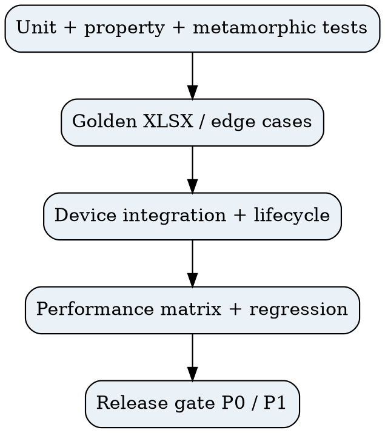

### 14.1. Danh sách fixture tối thiểu

| ID | Input transformation | Expected result |
|---|---|---|
| F01 | A = B bytes | no diff |
| F02 | reorder rows keyed | no value change, optional move |
| F03 | insert/delete mid-table | exactly 1 insert/delete |
| F04 | edit one cell in keyed record | one MODIFIED, not DELETE+INSERT |
| F05 | duplicate/null key | unresolved or policy-defined bucket |
| F06 | text `00123` vs numeric `123` | not silently equal |
| F07 | same numeric different display | equivalent if value-only |
| F08 | formula expression same/cache different | formula-mode result |
| F09 | 1900/1904 serial dates | date-aware results |
| F10 | merged header/group labels | correct anchor and provenance |
| F11 | timeline horizontal | orientation detection/review |
| F12 | multiple tables in same sheet | separate region mapping |
| F13 | renamed/moved worksheet | sheet candidate/review |
| F14 | hidden sheets, styles and empty trailing rows | policy-specific |
| F15 | 2 distinct records same hash (mock collision) | full compare detects difference |
| F16 | repeated equal lines in ordered input | no arbitrary pairing |
| F17 | XML invalid / ZIP bomb / traversal | bounded failure, no crash |
| F18 | cancel during parse/DP/export | CANCELLED and cleanup |
| F19 | Unicode NFC/NFD, Vietnamese marks, emoji | policy-faithful compare |
| F20 | 500k rows with no anchors | bounded fallback, never unbounded DP |
| F21 | disk full / process killed | partial/recovery, integrity |
| F22 | >20 sheets with rename collisions | no false sheet match |
| F23 | cached formula absent | warning or UNDETERMINED |
| F24 | nested rows and wide sparse sheet | bounded memory |

### 14.2. Metrics và đo lường

- **Match quality:** TP/FP/FN trên record pairs, Precision = TP/(TP+FP), Recall = TP/(TP+FN), F1; đánh giá separately inserted/deleted/modified/moved; coverage và abstention.
- **Cell quality:** precision/recall trên changed cells; loại thay đổi; wrong-type equivalence; coordinates correctness.
- **Performance:** cold/warm parse time, matching time, total wall time p50/p95, peak RSS/PSS, heap, temporary disk, bytes/s, CPU, energy/thermal trend, UI frame jank, cancel latency.
- **Reliability:** crash-free fixture runs, determinism, checksum input-before/after, error classification, transaction consistency.

**Protocol:** ít nhất device RAM thấp và trung bình; Android version, chipset, memory, free disk, build flavor/release, input hashes, runs≥5 cho mỗi ca sau warm-up, battery/thermal, isolate count và concurrency được ghi vào benchmark CSV. Ground truth tạo bằng seeded fixture generator + mutation log; mẫu phức tạp review thủ công. Không chọn ngưỡng từ chính tập test dùng để công bố.

### 14.3. Release gates đề xuất

- **P0 correctness:** tất cả F01–F10 và F15 pass; không kết luận nhầm bằng fuzzy score; invariant 100% pass trong test suite.
- **P0 safety:** F17/F18/F21 pass với lỗi rõ ràng, input không đổi, không crash khi file invalid.
- **P0 workflow:** multi-sheet F12/F13/F22; report complete/partial rõ, pagination và audit.
- **P1 capacity:** chọn numeric budgets dựa benchmark T0–T6 trên device matrix; không đặt ngưỡng 150 MB hay 60 FPS khi chưa đo.
- **P2 OCR:** bắt đầu một test plan riêng, không trộn vào baseline XLSX.


## 15. Hợp đồng kết quả và UI review

### 15.1. Export JSON v3 sample

```json
{
  "schemaVersion":"3.0", "engineVersion":"3.0.0-spec",
  "sessionId":"s-001", "status":"COMPLETE", "incomplete":false,
  "inputFingerprints":{"A":"sha256:...","B":"sha256:..."},
  "policy":{"id":"standard-v3","version":"3.0","fingerprint":"sha256:..."},
  "sheetMappings":[{"a":"NhanVien","b":"NhanVien","status":"CONFIRMED"}],
  "summary":{"sheetPairs":1,"matchedRecords":2,"modifiedRecords":1,"insertedRecords":0,"deletedRecords":0,"ambiguousRecords":0},
  "events":[{
    "id":"e-0001","scope":"CELL","kind":"VALUE_CHANGED","recordKey":"SV001",
    "sourceA":{"sheet":"NhanVien","cell":"C2"},
    "sourceB":{"sheet":"NhanVien","cell":"C2"},
    "before":{"type":"number","raw":"8.5"},"after":{"type":"number","raw":"8.7"},
    "rationale":"exact numeric comparison; 8.5 != 8.7"
  }], "warnings":[],"unresolvedRegions":[],"metrics":{"measured":false}
}
```

Tóm tắt chỉ chứa region đã nghiệm thu hoặc ghi rõ scope không hoàn tất. `schemaVersion` và `engineVersion` cần tách; `status=PARTIAL` phải có `unresolvedRegions`/`warnings`. Event IDs ổn định ít nhất trong session; không phụ thuộc thứ tự result pagination. Dữ liệu nhạy cảm có thể redacted theo export policy.

### 15.2. UX screens

1. Select workbook A/B → inventory summary. 2. Choose sheet mappings (auto accept/review). 3. Choose table regions, axis, key columns. 4. Review comparison policy with inferred types. 5. Progress per sheet/phase with cancel. 6. Summary dashboard + filters. 7. Virtualized diff grid detail with A/B sources. 8. Ambiguity resolution queue. 9. Export and comparison history. **Không hiển thị kết quả partial như complete**; mọi thao tác manual override ghi audit trail.


## 16. Hướng dẫn triển khai theo modules, tickets và Definition of Done

```text
lib/
  features/comparison/presentation/{screens,widgets,state}/
  features/comparison/application/{session_controller,scheduler,workers}/
  features/comparison/domain/{models,policy,normalization,matching,diff,audit}/
  features/comparison/data/{xlsx_reader,csv_reader,sqlite_repo,export}/
  core/platform/{file_access,background_lifecycle}/
test/{unit,property,golden,integration,performance}/
```

| Sprint/Stage | Output bắt buộc | Exit criterion |
|---|---|---|
| M0 Contract | model/policy/schema/state protocol | review schema & fixtures |
| M1 Core P0 | typed comparator, keyed matcher, invariants | F01–F09/F15 pass |
| M2 Ingestion | bounded XLSX parser, provenance, sharedStrings | F10/F17/F23 pass |
| M3 Workbooks | sheet/region matching, mapping UI | F12/F13/F22 pass |
| M4 Runtime | isolate protocol, SQLite, cancel, checkpoint | F18/F21 pass |
| M5 Ordered | bounded DP, ambiguous fallback, axis | F11/F16/F20 pass |
| M6 UX/Report | virtualized diff, JSON/CSV, history | audit/export/review pass |
| M7 Benchmark | device matrix, regression budgets | release sign-off |

**Definition of Done từng ticket:** tests + known limits + error handling + cancellation points + provenance + no raw workbook copying + updated architecture diagram/contract. Ưu tiên triển khai P0 trước P1/P2, không gắn nhãn production-ready chỉ bằng unit test.

## 17. Các quyết định mở và rủi ro còn lại

| Quyết định | Khuyến nghị | Ai chốt / chứng cứ cần |
|---|---|---|
| Parser XLSX streaming | POC với malformed+large fixtures | dev, memory test |
| SQLite adapter và transaction boundary | chọn một adapter phù hợp isolate | dev, integration test |
| Default policy khi không có key | NEEDS_REVIEW hoặc multiset only | PO + labeled cases |
| Duplicate key semantics | bucket ambiguity mặc định | product owner |
| Sheet rename matching | confidence + user accept | UX test |
| Shared strings strategy | memory-index/spool fallback | benchmark |
| Limits RAM/disk/DP | thiết bị-based calibrated budgets | device results |
| Formula/cache stale | cảnh báo; không auto recalc | product owner |
| iOS background constraints | kiểm thử riêng sau Android | iOS device evidence |
| OCR | pipeline độc lập, P2 | riêng OCR suite |

## 18. Tài liệu tham khảo và tính xác minh

- [1] Flutter, *Concurrency and isolates*, https://docs.flutter.dev/perf/isolates (truy cập 13/11/2026). Mô tả isolate ownership, messaging, long-lived workers, UI isolation.
- [2] Dart/Flutter API, *Isolate.run*, https://api.flutter.dev/flutter/dart-isolate/Isolate/run.html (truy cập 13/11/2026).
- [3] Microsoft Learn, *Structure of a SpreadsheetML document*, https://learn.microsoft.com/en-us/office/open-xml/spreadsheet/structure-of-a-spreadsheetml-document (truy cập 13/11/2026).
- [4] SQLite, *Write-Ahead Logging*, https://www.sqlite.org/wal.html (truy cập 13/11/2026).
- [5] Dytava, *Unified Data Geometry & Comparison Engine v2.0*, tài liệu dự án người dùng cung cấp, 13/11/2026.
- [6] Dytava, *Mô hình Hình học Dữ liệu Thống nhất v1*, văn bản người dùng cung cấp.

**Tuyên bố kiểm chứng:** Tài liệu v3 này là đặc tả thiết kế nâng cao, không phải chứng cứ rằng parser streaming, SQLite engine, state controller hoặc matcher đã tồn tại trong codebase. Bản này không có benchmark thực tế hoặc API dependency lock. Mọi mục tiêu năng lực file lớn chỉ được công bố sau khi đo. Mọi sơ đồ là thiết kế đề xuất, không phải kiến trúc đã được xác minh từ repo.

---

**Phụ lục — danh sách diagram:** 01 Context; 02 Components; 03 Pipeline; 04 XLSX reader; 05 Multi-sheet; 06 Matching decision; 07 Cell comparator; 08 Worker; 09 ERD; 10 State machine; 11 Resource; 12 Process sequence; 13 Provenance; 14 Test pyramid. Diagram nguồn `.dot` và bản PNG lưu trong thư mục `assets/` để thay đổi về sau.

