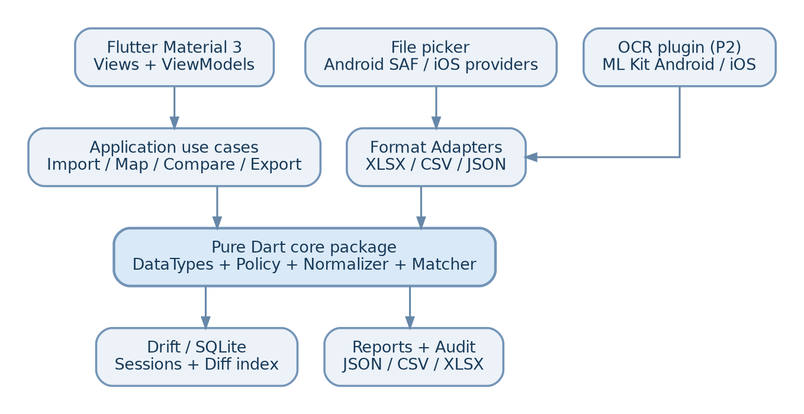

<!-- ExcelCompare Flutter/Dart master; content updated for Android P0 + iOS P1 -->

> Cập nhật tách Input ngày 11/11/2026: bản Markdown này giữ kiến trúc/Core và liên kết sang Input DRAFT; Markdown là nguồn tài liệu hiện hành. Policy v2 chuẩn để biên soạn tiếp: [project/comparison_policy.v2.example.json](../comparison_policy.v2.example.json). Các defaults Input chưa chốt được quản lý ở decision register; đề xuất cũ trong Master không tự phê duyệt chúng.

<!-- 2.2-FLUTTER-ANDROID-IOS-DESIGN; not a production-qualified implementation -->

# EXCELCOMPARE — BỘ TÀI LIỆU SẢN PHẨM & KỸ THUẬT

*PRD • SRS • Kiến trúc • Data Types • OCR • Security • QA • DevOps • Operations*

Bản thiết kế tham chiếu — Flutter/Dart (Android P0, iPhone/iOS P1)

11 tháng 11 năm 2026

Trạng thái: 2.2-FLUTTER-ANDROID-IOS-DESIGN / Proposed baseline. Tài liệu này là đặc tả hướng production, chưa phải chứng nhận ứng dụng đã được triển khai, kiểm thử hoặc có hạ tầng đang vận hành.

Phân định: Ràng buộc gốc: so sánh 2 file Excel, thống kê giống và khác, chỉ vị trí sai khác, đọc nội dung từ ảnh, đóng gói cài đặt. Tất cả hỗ trợ format mới, chính sách semantic, cloud OCR và vận hành là phần mở rộng được đề xuất.

## DANH MỤC TÀI LIỆU

Product Brief và quyết định phạm vi

PRD - Yêu cầu sản phẩm và hành trình người dùng

SRS - Chức năng và quy tắc nghiệp vụ

Định dạng tệp, MIME, phạm vi adapter và giới hạn

DataType, chuẩn hóa ngữ nghĩa và policy engine

Data contracts, schema và provenance

Thiết kế kiến trúc, module và công nghệ

Đặc tả OCR: API, kiểm soát lỗi và privacy

NFR, hiệu năng, reliability, accessibility

Threat model, bảo mật và quản trị dữ liệu

Test Strategy, test cases và quality gates

Build, CI/CD, phát hành và bảo trì

Runbook vận hành, bảo trì và xử lý sự cố

Lộ trình, nhân sự, chi phí và risk register

Architecture Decision Records và vấn đề còn mở

Nguồn kỹ thuật, thuật ngữ, giới hạn xác minh

Tài liệu đi kèm: ví dụ comparison_policy.example.json, report_example.json, acceptance_cases.json, sơ đồ kiến trúc và README.

# 01. Product Brief và quyết định phạm vi

Mã dự án: EXC; tên làm việc: ExcelCompare; bản tài liệu: 2.2-FLUTTER-ANDROID-IOS-DESIGN; ngày: 11/11/2026; nền tảng mục tiêu: Flutter/Dart (Android P0, iPhone/iOS P1); trạng thái: baseline thiết kế, chưa chứng nhận production.

## 1.1. Tuyên bố vấn đề

Nhiều hệ thống xuất báo cáo dạng bảng tính nhưng cùng dữ liệu có thể khác tên cột, thứ tự hàng, kiểu lưu trữ, cách viết ngày/số, công thức và metadata. So sánh hai tệp bằng cách nhìn trực tiếp hoặc so từng tọa độ ô gây báo sai khác giả và bỏ sót sai khác nghiệp vụ. Ảnh chụp là nguồn đầu vào khó hơn vì chỉ giữ lại biểu diễn trực quan và không thể truy cập các thuộc tính ẩn trong workbook.

## 1.2. Giá trị sản phẩm

Ứng dụng tiếp nhận hai nguồn dạng bảng, ánh xạ schema, xác định định danh hàng, chuẩn hóa theo quy tắc công khai, đưa ra kết luận có thể truy vết (exact / equivalent / different / unresolved), xem chi tiết ô/bản ghi khác biệt và xuất báo cáo kiểm toán. Không thay đổi dữ liệu nguồn.

## 1.3. Người dùng mục tiêu và các trường hợp sử dụng

| Người dùng | Nhu cầu | Ưu tiên |
| --- | --- | --- |
| Sinh viên/kế toán/nhân sự | So danh sách, điểm số, công nợ, kiểm kê giữa hai lần xuất | P0 |
| Nhân viên kiểm thử dữ liệu | So đầu ra của hai hệ thống sau migrate | P0 |
| Quản trị dữ liệu | Ánh xạ schema, audit, quy tắc chuẩn hóa | P1 |
| Người dùng chỉ có ảnh chụp | OCR bảng đơn giản, hiệu chỉnh rồi so | P2 |

## 1.4. In scope / out of scope

P0 - Android MVP: ứng dụng Flutter Android chạy offline;  import XLSX/CSV/TSV/JSON dạng bản ghi theo adapter; xem preview, chọn sheet/table, header row; mapping cột thủ công; xác định key đơn/ghép; chuẩn hóa text/decimal/date/boolean/identifier/percentage; đối chiếu record; xuất CSV/XLSX báo cáo đơn giản an toàn; lưu cấu hình và lịch sử so sánh có kiểm soát.

P1 - iPhone/iOS parity + mở rộng: ứng dụng Flutter iOS với cùng core comparison, import/preview/mapping/compare/export; ký và phân phối qua Apple-approved channels; kiểm chứng iOS file providers, sandbox, sharing, thiết bị thật. XLS legacy theo proof-of-concept, xlsm chỉ đọc dữ liệu và không chạy macro, ODS adapter riêng, metadata/công thức ở chế độ báo cáo, gợi ý mapping an toàn, xử lý dữ liệu lớn streaming, quy tắc tái sử dụng.

P2: OCR ML Kit với xác nhận ô; cloud layout OCR opt-in; XLSB/PDF/XML/HTML/JSONL; tích hợp hệ thống ngoài; sync đa thiết bị.

Không cam kết: mọi công thức Excel tái tính được; suy luận đúng 100% schema/locale; khôi phục macro; ảnh OCR có metadata Excel; tự động sửa file gốc; phát hiện gian lận doanh nghiệp chỉ bằng sự khác biệt.

## 1.5. Chỉ số thành công và ranh giới trách nhiệm

| Nhóm | Chỉ số đề xuất (chưa đo) | Điều kiện nghiệm thu |
| --- | --- | --- |
| An toàn dữ liệu | 0 lần ghi vào nguồn; 0 nội dung ô trong telemetry | kiểm thử có chứng cứ |
| Độ đúng | 100% các quy tắc chuẩn hóa có unit test và golden fixture | không tự tương đương khi ambiguous |
| Truy vết | 100% difference có source coordinate + rule version hoặc lý do missing | review report |
| Ổn định | Không crash/OOM trên bộ stress đã chốt cho thiết bị tham chiếu | benchmark thực nghiệm |
| Định lượng | Có precision, recall, unresolved rate, elapsed time, peak memory | công bố số đo kèm dữ liệu và cấu hình |

Quyết định sản phẩm: ‘production-grade specification’ khác ‘production-qualified product’. Các SLO sẽ chỉ được cam kết sau khi đo trên thiết bị và corpus thực tế.


## 1.6. Ma trận phát hành đa nền tảng (Android ưu tiên)

| Nền tảng | Pha | Artifact | Phân phối | Gate trước khi quảng cáo hỗ trợ |
| --- | --- | --- | --- | --- |
| Android | P0 | APK đã ký để cài trực tiếp; AAB đã ký để đưa lên Play | cài trực tiếp / Google Play (test track và production) | parser XLSX, SAF, compare, export, storage, lifecycle, máy thật |
| iPhone/iOS | P1 | IPA đã ký, build archive xcarchive | TestFlight/App Store, ad-hoc/development khi đủ điều kiện Apple | Files providers/iCloud, sandbox, quyền truy cập, share sheet, keyboard/UI safe areas, thiết bị thật và signing |
| Web/Desktop | Ngoài phạm vi | Không đặt target | Không có | Đánh giá sau khi hai mobile target đạt yêu cầu |

Từ “export app” nghĩa là **biên dịch, ký và đóng gói ứng dụng cài đặt**, không phải tính năng export report JSON/CSV/XLSX trong ứng dụng. Hai loại export được quản lý độc lập. Android P0 hoàn thiện trước khi mở gate phát hành iOS P1; UI và Pure Dart domain dùng chung nhưng tính tương thích của plugins/native adapters phải kiểm chứng riêng.

# 02. PRD - Yêu cầu sản phẩm và hành trình người dùng

## 2.1. Jobs-to-be-done

Khi nhận hai bản báo cáo từ nguồn khác nhau, người dùng muốn thấy bản ghi nào thiếu/thừa/thay đổi, tránh báo sai do định dạng khác nhau, biết căn cứ của kết luận và xuất được biên bản có thể xác minh lại.

## 2.2. User stories (ưu tiên MoSCoW)

| ID | User story / tiêu chí chấp nhận | Mức |
| --- | --- | --- |
| US-01 | Chọn hai tệp qua Flutter file picker (Android SAF khi chạy Android); hiển thị tên, hash, dung lượng, cảnh báo nguồn | Must |
| US-02 | Tự nhận định dạng qua signature/MIME/content, không tin đuôi file | Must |
| US-03 | Preview 50-100 hàng đầu, lọc sheet/table, chọn hàng header | Must |
| US-04 | Mapping cột A:B, xác nhận cột khóa, cảnh báo key duplicate/null | Must |
| US-05 | Phân loại EXACT/EQUIVALENT/DIFFERENT/UNRESOLVED và ghi lý do | Must |
| US-06 | Bật/tắt chuẩn hóa từng field; xem giá trị raw/typed/normalized | Must |
| US-07 | Xem summary + filter + chi tiết tọa độ ô hai phía | Must |
| US-08 | Xuất report có dữ liệu kiểm toán, không làm thay đổi nguồn | Must |
| US-09 | Hủy an toàn và khôi phục session sau lỗi/đứt tác vụ | Should |
| US-10 | So sánh công thức, style, metadata theo tùy chọn | Should |
| US-11 | OCR ảnh bảng → hiệu chỉnh preview → xác nhận rồi so | Could |
| US-12 | Đề xuất map bằng heuristics, nhưng buộc xác nhận khi mơ hồ | Could |

## 2.3. User flow

Dashboard → ‘So sánh mới’. 2. Chọn A, B (SAF). 3. Preflight: file hợp lệ, dung lượng, quyền, bảo vệ bằng mật khẩu. 4. Chọn sheet/table + header. 5. Mapping fields + key + loại so. 6. Chọn policy datatype/locale/tolerance. 7. Review cấu hình. 8. Job tiến độ/phân trang + hủy. 9. Báo cáo 4 trạng thái & structural differences. 10. Export/Share/Delete session.

## 2.4. Các màn hình

| Screen | Dữ liệu/chức năng | Edge UX |
| --- | --- | --- |
| Home | lịch sử gần đây, tạo phiên, quyền riêng tư | empty state |
| Import | 2 nguồn, kiểm tra khả năng đọc, nguồn truy cập | permission revoked/unsupported |
| Sheet Preview | grid ảo hóa, dropdown sheet, header preview | rất nhiều cột/cell merge |
| Mapping | schema A/B, confidence gợi ý, key selector | duplicate, missing, ambiguous |
| Policy | datatype ngữ nghĩa, locale, null, tolerance, alias | chỉ đổi policy có version mới |
| Compare | thanh tiến độ, số bản ghi, cancel, error | app background/process death |
| Results | dashboard summary, tabs rows/fields/values/meta | zero diff vs unresolved |
| Difference Detail | A/B raw typed canonical, location, rule, explanation | OCR thiếu tin cậy |
| Export | CSV/XLSX/JSON, anonymize, location SAF | CSV injection |
| OCR Confirm | hình gốc + overlay bounding boxes + editable grid | mất cột/ô gộp |

## 2.5. Các nguyên tắc UX bắt buộc

Không dùng màu duy nhất để truyền trạng thái; có biểu tượng/chữ.

Hiển thị rõ không thể kết luận khác không khác.

Khi dự đoán mapping hoặc datatype, công bố confidence, cho sửa và xem trước tác động.

Chỉ tệp do người dùng chọn được đọc; không yêu cầu quyền quản lý toàn bộ bộ nhớ.

Không quảng cáo ‘100% chính xác’ cho OCR hay semantic inference.

# 03. SRS - Chức năng và quy tắc nghiệp vụ

## 3.1. Ma trận chức năng

| ID | Requirement | Logic, đầu ra và tiêu chí chấp nhận |
| --- | --- | --- |
| FR-001 | Import & detect format | content sniffing, extension chỉ gợi ý; báo mismatch, không thực thi active content |
| FR-002 | Select source scope | workbook/sheet/range hoặc table; nguồn text 1 bảng mặc định |
| FR-003 | Extract provenance | giá trị nguồn, kiểu, display text, formula, original coordinate |
| FR-004 | Profile fields | null rate, inferred dtype, distinct, sample, collision warning |
| FR-005 | Align schema | mapping 1:1 mặc định, mapping 1:n là biến đổi rõ ràng; ghi config |
| FR-006 | Key match | unique key / composite key; duplicate được đưa vào tập lỗi |
| FR-007 | Compare records | row added/removed/updated, move chỉ là thay đổi vị trí |
| FR-008 | Exact compare | so typed raw theo chính sách; phân biệt blank/null/zero |
| FR-009 | Semantic compare | canonicalize theo field rule; xuất evidence transform |
| FR-010 | Compare formulas | so expression, cached values, annotate stale/unsupported |
| FR-011 | Compare metadata | report metadata tách riêng, không trộn cell similarity |
| FR-012 | OCR import | text + geometry; tái dựng table; bắt buộc manual confirmation |
| FR-013 | Export report | summary, detailed diff, manifest, policy/version, unresolved |
| FR-014 | Re-run | cùng input hash + config + engine version phải cho output deterministic |
| FR-015 | Lifecycle | cancellation, retry theo job state, cleanup temp |

## 3.2. Kế toán số lượng và thống kê

Các trạng thái chính loại trừ nhau ở đơn vị so sánh ‘matched cell pair’: EXACT, EQUIVALENT, DIFFERENT, UNRESOLVED. TYPE_CHANGED, FORMULA_CHANGED, STYLE_CHANGED, OCR_REVIEWED là flags độc lập.

exact_rate = exact_pairs / compared_matched_pairs. semantic_agreement_rate = (exact + equivalent) / compared_matched_pairs; mẫu số gồm unresolved để không làm đẹp chỉ số. Bản ghi và cột unmatched báo độc lập; tổng kết không cộng trộn đơn vị khác nhau (cells + rows + sheets).

## 3.3. Phân loại sai khác và precedence

| Mã | Định nghĩa | Xử lý |
| --- | --- | --- |
| SHEET_ADDED / REMOVED | Sheet chỉ ở một file | structural diff |
| FIELD_ADDED / REMOVED | Cột chưa map | schema diff |
| KEY_DUPLICATE | khóa không duy nhất | unresolved alignment, không gán tùy tiện |
| ROW_ADDED / REMOVED | Không có matched key | record diff |
| VALUE_CHANGED | hai canonical typed values không bằng | substantive diff |
| TYPE_CHANGED | raw storage type thay đổi | flag, có thể semantic match |
| EQUIVALENT_REPRESENTATION | raw khác nhưng canonical bằng | equivalent + rule id |
| NULL_MISMATCH | blank/null/empty/zero khác policy | diff hoặc unresolved |
| FORMULA_CHANGED | biểu thức công thức thay đổi | flag tùy mode |
| METADATA_CHANGED | document metadata khác | metadata report riêng |
| OCR_UNCERTAIN | OCR chưa được xác nhận hoặc vùng tin cậy thấp | unresolved, không tự xác nhận |

## 3.4. Matching modes

POSITION: đồng vị trí hàng/cột; hữu ích khi cấu trúc cố định, không dùng để suy luận ‘row changed’ khi thứ tự đảo.

KEY: join theo khóa đơn/ghép đã canonicalize bằng quy tắc định danh nghiêm ngặt, không dùng approximate string similarity để nối tự động.

MULTISET: không có key; đối chiếu theo multiset của dấu vân tay bản ghi; báo unpaired rows và duplicate counts, không suy diễn record identity.

ORDERED_SEQUENCE: so theo thứ tự để phát hiện chèn/xóa; dùng diff algorithm có giới hạn hiệu năng, không áp dụng mặc định.

## 3.5. Invariants

Không sửa workbook nguồn trong bất kỳ giai đoạn nào.

Kết luận EQUIVALENT phải có rule_id và canonical values, không chỉ là similarity score.

Bất kỳ parse/mapping/locale ambiguity trọng yếu đều trở thành UNRESOLVED hoặc phải được người dùng xác nhận.

Mỗi difference có 2 provenance paths, hoặc null có lý do rõ (row/file missing).

Không so sánh numeric mã định danh chỉ vì trông giống số.

# 04. Input reference và output formats

## 4.1. Input Contract đã tách riêng

Chi tiết phạm vi/nguồn/định dạng/capability/configuration/validation/state và tests nằm tại [Input Specification 0.1.0 DRAFT](../../specs/input/README.md). Android P0 dự kiến XLSX/CSV/TSV/JSON, iOS P1; format mở rộng và OCR theo registry Input. Đây là kế hoạch, không phải bằng chứng adapter đã chạy.

Input bảo toàn raw types/provenance, không canonicalize semantic trong adapter. Nguồn chỉ sẵn sàng khi full validation của snapshot hiện hành hoàn tất; A sẵn sàng chưa đủ nếu B chưa hợp lệ. Các ADR về direction, sheet count, header, limits, parser, OCR học phần và retention còn mở tại [decision register](../../specs/input/README.md#decision-register).

## 4.4. Output formats

report.json: máy đọc, đầy đủ schema, status, provenance, rules, manifest; format chuẩn và có schema_version.

report.csv: bảng diff phẳng, encode UTF-8 BOM tùy cấu hình, bảo vệ formula injection; metadata phức tạp báo sang JSON riêng.

report.xlsx: summary sheet / differences sheet / unresolved sheet / manifest sheet; tất cả dữ liệu chưa tin cậy được ghi như string cell, không ghi formula executable.

report.pdf: human readable tùy chọn khi đã có output template và kiểm thử layout.

## 4.5. Capability reference

Capability được adapter/version/mode khai báo theo [INP-003](../../specs/input/03_file_formats.md); không dùng icon/extension làm bằng chứng support.

# 05. DataType, chuẩn hóa ngữ nghĩa và policy engine (Flutter/Dart)

Bản chuyển đổi Flutter/Dart 2.2.0-FLUTTER-ANDROID-IOS-DESIGN; policy schema v2 giữ tương thích. Đây là đặc tả hướng dẫn; chưa có bằng chứng đã triển khai Flutter hay đạt production.

## 5.1. Mục tiêu, phạm vi và nguyên tắc bất biến

Semantic comparison trả EXACT, EQUIVALENT, DIFFERENT hoặc UNRESOLVED trên từng matched cell pair. Structural differences và unmatched rows được thống kê tách riêng. Không viết vào nguồn, không suy luận locale/đơn vị/mã định danh bất chấp mơ hồ, không coi confidence inference là bằng chứng đồng nhất.

Mỗi EQUIVALENT phải có rule_id, rule_version, canonical(left/right), trace, policy_digest. Parse error hoặc thiếu ngữ cảnh trọng yếu là UNRESOLVED với reason_code; không được fallback về so sánh chuỗi và tuyên bố DIFFERENT nếu đã có yêu cầu semantic cast chưa giải quyết.

## 5.2. Hợp đồng dữ liệu và hệ thống kiểu

| Tầng | Các loại | Bảo toàn / ràng buộc |
| --- | --- | --- |
| Physical | Xem [INP-005](../../specs/input/05_data_types_provenance.md) và SourceCell schema | Input sở hữu raw type, lexeme, null và provenance; Core chỉ nhận evidence đã validate. |
| Logical | TEXT, INTEGER, DECIMAL, BOOLEAN, DATE, LOCAL_DATETIME, OFFSET_DATETIME, INSTANT, ARRAY, OBJECT; NULL-like tagged union | INTEGER dùng BigInt (Dart); DECIMAL Decimal (Dart); không dùng Double để so tiền/decimal; array/object phải có comparator explicit. |
| Semantic | IDENTIFIER, FREE_TEXT, PERSON_NAME, POSTAL_CODE, PHONE, EMAIL, ENUM, MONEY, PERCENTAGE, UNIT_QUANTITY, DATE, DATETIME, BOOLEAN | Chính sách field-specific quyết định semantic_type, parse rule, canonical type và equality. |
| Normalization | unicode, trim, whitespace, case, locale, date patterns, time zone, aliases, currency, units, null mapping, tolerance | Tất cả có version và audit trail; default bảo toàn thông tin, không tự bỏ dấu/leading zero. |

SourceCell wire contract do [INP-005](../../specs/input/05_data_types_provenance.md) sở hữu. Core models cần mapping rõ sang schema đó; không duy trì bản SourceCell rút gọn thứ hai tại Master. Dart DateTime không thay thế date-only hoặc IANA zone ID tự động.

CanonicalValue là tagged union: Text(value), Integer(value), Decimal(value), Boolean(value), Date(ISO), Instant(UTC), LocalDateTime(value, zone_context), Money(amount,currency), Percentage(ratio), Quantity(amount,unit,dimension), Enum(code), NullKind(tag), Complex(canonical_structure). Chỉ so hai canonical values cùng type và cùng dimension/units sau chuyển đổi được phê duyệt.

## 5.3. Quy tắc chuẩn hóa theo semantic dtype

| Type | Canonical | Ràng buộc / đặc điểm |
| --- | --- | --- |
| IDENTIFIER / POSTAL_CODE | NFC string | Giữ zero đầu, không cast numeric, case-sensitive mặc định; numeric source là string từ raw representation đã xác nhận; nếu thiếu leading zeros không được tái tạo. |
| FREE_TEXT / PERSON_NAME | NFC string | Trim/collapse whitespace tùy policy; không bỏ dấu, bỏ punctuation hoặc transliterate mặc định; với tên pháp lý giữ dấu. |
| INTEGER | BigInt (Dart) | Không truncate phần thập phân; grouping/decimal locale rõ; giới hạn độ dài đầu vào. |
| DECIMAL | Decimal (Dart) | Parse strict theo từng nguồn; ignore_scale tùy policy; tolerance_abs không âm; phép toán chính xác. |
| MONEY | (ISO 4217 code, Decimal (Dart)) | Không quy đổi FX mặc định; currency phải xác định; FX chỉ khi rate snapshot/date/source được explicit; tolerance theo cùng currency. |
| PERCENTAGE | Decimal (Dart) ratio | 10% = 0.10 khi percent_sign_is_scale cho phép; 10 trần không được tự hiểu là 10%. |
| BOOLEAN | true/false | Không tự ép 1/0 hoặc Có/Không nếu thiếu alias; alias tránh trùng/ambiguous. |
| DATE | ISO date-only string | Chỉ parse format được khai báo; 2-digit-year cần pivot explicit; Excel serial cần hệ 1900/1904 và xử lý serial 60. |
| DATETIME | Instant hoặc local-with-zone | Chỉ so instants nếu đủ offset/zone; DST overlap/gap không tự chọn; local calendar equality là mode khác. |
| PHONE | E.164 hoặc string tagged | Cần region mặc định khi số thiếu prefix; không cắt zero đầu máy móc; giữ original. |
| EMAIL | local part nguyên dạng + domain IDNA | Domain case-insensitive; không lowercase local part mặc định; không bỏ dấu chấm/plus alias tùy nhà cung cấp. |
| ENUM | stable code | Dictionary phiên bản cố định; map many-to-one phải được người dùng duyệt; alias collision -> invalid policy. |
| UNIT_QUANTITY | (Decimal (Dart), canonical unit, dimension) | Chuyển đổi theo bảng tỷ lệ chính xác, cùng chiều đo; nhiệt độ affine conversion cần rule riêng. |
| NULL-LIKE | MISSING/BLANK/EMPTY_STRING/JSON_NULL/EXCEL_ERROR/TEXT_SENTINEL | Tách 0 và false; chỉ gộp khi null policy explicit; lỗi Excel không phải null mặc định. |

## 5.4. Pipeline canonicalization và trace

Preflight file/provenance → field alignment + key profile → compile/validate policy → classify source raw kind → null-kind resolution → strict parse với source-specific locale/format → semantic transformation → canonical serialization → typed compare → decision/trace → report. Không đổi thứ tự transform tùy runtime.

NormalizedResult = Success(value, steps, effective_rule_ids) | Unresolved(reason_code, evidence, remediation). Trace step = {rule_id, rule_version, operation, before_kind, after_kind, parameters_digest}; trace không ghi dữ liệu nhạy cảm vào telemetry. User-facing report có thể chứa raw/canonical với quyền xuất riêng.

## 5.5. Policy schema, inheritance và precedence

Policy schema_version=2, policy_id, policy_version, defaults, source_profiles, alignment, fields, unresolved_handling. Merge theo thứ tự: engine conservative defaults < policy.defaults < field rule < source-specific field overrides. Overrides chỉ tác động tới parse input; semantic comparison rule của field phải chung và rõ ràng. Không hỗ trợ arbitrary code/scripts hoặc rule tùy ý thực thi trong JSON. Thay đổi framework không tự làm thay đổi schema_version; chỉ thay đổi policy_version nếu semantics hoặc capability thay đổi.

Mandatory validation: schema/version supported; unique logical names; mapping 1:1; keys mapped and of IDENTIFIER-compatible type; no key tolerance/fuzzy matching; source locale/pattern explicit for potentially ambiguous text; tolerance_abs >= 0; alias dictionaries non-conflicting; units/currencies compatible; null mapping legal; unknown fields and unknown operations rejected (fail-closed); no circular aliases; engine capabilities satisfied.

Policy digest = SHA-256 của canonical policy JSON theo một serializer có version, UTF-8, Unicode NFC cho keys do schema định nghĩa, stable ordering và decimal dưới dạng string. Digest tính trên effective resolved policy kèm parser/normalizer dictionary versions; thay đổi input hashes/engine/config_revision/policy digest invalidates comparison cache. generated_at nằm ngoài semantic digest.

## 5.6. Thuật toán quyết định và thứ tự ưu tiên

| Điều kiện | Kết quả | Ghi chú |
| --- | --- | --- |
| Không có matched row/field | STRUCTURAL / RECORD DIFF | Không đếm như matched cell pair. |
| Key duplicate / null / ambiguous | UNRESOLVED alignment | Không first-match; nhóm bucket để review. |
| OCR chưa confirm ở trường trọng yếu | UNRESOLVED | Không dùng confidence để tự hợp thức hóa. |
| Thiếu policy, parse error, unit/zone/currency ambiguity | UNRESOLVED | Lý do mã hóa; không coi là DIFFERENT. |
| Raw stored typed + semantic meaning đúng bằng theo exact policy | EXACT | Exact mode có định nghĩa typed equality và null kind; flags độc lập. |
| Không EXACT; canonical typed bằng theo rule được duyệt | EQUIVALENT | Phải có transformation trace; kể cả tolerance nếu bật. |
| Canonical parsed hợp lệ, nhưng không bằng | DIFFERENT | reason = VALUE_CHANGED hoặc NULL_MISMATCH. |

Precedence: alignment unresolved > parsing/policy unresolved > exact typed comparison > semantic equivalence > substantive difference. Flags TYPE_CHANGED/FORMULA_CHANGED/STYLE_CHANGED/OCR_REVIEWED độc lập; không ép formula flag thay đổi cell semantic status. Tolerance có thể không bắc cầu (a≈b, b≈c nhưng a≉c): không dùng fuzzy/tolerance equality để tạo key hoặc fingerprint multiset.

## 5.7. Matching keys, multiset và scale

KEY: canonical key strict (identifier, tagged tuple có length-prefix) + uniqueness trước join. Duplicate hoặc invalid keys tạo unresolved bucket. POSITION chỉ so theo tọa độ đã align. MULTISET dùng exact canonical typed fingerprints và xác nhận equality khi hash trùng; không dùng tolerance/fuzzy để fingerprint. ORDERED_SEQUENCE yêu cầu memory/time cap. Streaming, indexed SQLite/sort-merge cho dữ liệu lớn; SHA-256 chỉ index, không thay proof equality.

## 5.8. Reason codes và mức độ xử lý

| Reason code | Khi nào xuất hiện | User action |
| --- | --- | --- |
| LOCALE_AMBIGUOUS | 1,234 hoặc ngày hai cách hiểu | Chọn locale/format nguồn. |
| PARSE_FAILED | Không parse được theo rule | Sửa rule hoặc dữ liệu. |
| MISSING_POLICY | Field chưa khai báo semantic dtype | Xác nhận dtype. |
| NULL_KIND_CONFLICT | null/missing/blank không map | Duyệt null mapping. |
| KEY_DUPLICATE | Khóa lặp ở A hoặc B | Chọn key khác / xử lý. |
| KEY_INVALID | Key missing/null/ambiguous | Chỉnh key/field rule. |
| CURRENCY_MISMATCH | Mã tiền khác | Bổ sung FX snapshot nếu cần. |
| UNIT_INCOMPATIBLE | Khác dimension hoặc unit chưa biết | Chọn unit đúng. |
| ZONE_AMBIGUOUS | DST / timezone thiếu | Xác nhận zone, offset. |
| OCR_REVIEW_REQUIRED | OCR chưa xác nhận | Duyệt ô OCR. |
| EXCEL_DATE_SERIAL_60 | Ngày không tồn tại do Excel 1900 | Review hoặc special handling. |

## 5.9. Acceptance, properties và release gate

Golden cases bắt buộc: 00123 vs 123 identifier DIFFERENT; 8.5 vs 8,5 vi-VN decimal EQUIVALENT; 1,234 khi không có locale UNRESOLVED; false vs Không chỉ EQUIVALENT khi alias; 0 vs blank DIFFERENT; 10% vs 0.1 theo percent field EQUIVALENT; Nguyen An vs Nguyễn An DIFFERENT; date serial 1900/1904; timezone equivalence; duplicate keys; OCR review; policy digest reproducibility.

Property tests: determinism với nguồn/policy/engine cố định, idempotent canonicalization (trong miền đã định), symmetry khi đảo A/B và đảo mapping, không silent lossy cast, failure becomes UNRESOLVED. Branch-coverage mục tiêu >=90% cho core critical rules; golden fixtures 100%; benchmark device thực tế; security tests ngăn input injection. Đây là tiêu chí đề xuất, chưa có test evidence.

## 5.10. Pure Dart module contract và bảo vệ dữ liệu

core/model: Dart 3 sealed classes SourceCell, CanonicalValue, NormalizationResult, ComparisonDecision; core/policy: PolicyParser, PolicyValidator, PolicyCompiler, RuleRegistry; core/compare: Canonicalizer, StrictKeyMatcher, SemanticComparator. Pure Dart domain package, không import Flutter UI hoặc plugin; adapters không tự chuẩn hóa; UI chỉ hiển thị policy review/evidence. BigInt + package:decimal; DateTime chỉ dùng cho instant đã có zone context; xử lý cancellation tại job layer. Lõi triển khai dạng package:excelcompare_core (thuần Dart); Flutter UI, platform channels, Drift và OCR là infrastructure riêng. Các dtype chưa hỗ trợ phải trả UNSUPPORTED_SEMANTIC_TYPE; không âm thầm so như string.

Không ghi raw/canonical cell data, email/phone, đường dẫn, OCR content vào telemetry. Original input read-only. Snapshot policy + digest + versions gắn report; export escaped CSV/XLSX text để tránh formula injection.

## 5.11. Lộ trình học Flutter và triển khai từng giai đoạn

G0: Học Dart 3 sealed classes/records, Flutter Material 3, state/navigation, async/await, isolate, unit test; chạy thử package pure Dart. G1: policy compiler + tất cả semantic dtype + golden fixtures. G2: Flutter Android P0 với XLSX/CSV/JSON sau parser PoC, Drift metadata và export an toàn. G3: OCR ML Kit, iOS/desktop theo kiểm thử plugin và capability matrix.

Lưu ý: Flutter không tự mang lại đọc Excel chính xác, streaming hoặc OCR đa nền tảng. Mỗi parser/plugin phải được đánh giá bằng corpus và device benchmark; phiên bản Dart demo không đồng nghĩa triển khai đầy đủ mọi semantic dtype.

# 06. Data contracts, schema và provenance

## 6.1. Entities

| Entity | Các trường trọng yếu | Ý nghĩa / constraint |
| --- | --- | --- |
| ComparisonSession | id, created_at, engine_version, status, policy_digest | lineage và trạng thái |
| InputArtifact | Xem [Input schemas](../../specs/input/README.md#contracts-fixtures-và-kiểm-tra) | Contract chi tiết do Input sở hữu, không phải bảng rút gọn ở Master |
| SourceTable | Xem [Input schemas](../../specs/input/README.md#contracts-fixtures-và-kiểm-tra) | Contract chi tiết do Input sở hữu, không phải bảng rút gọn ở Master |
| SourceCell | Xem [Input schemas](../../specs/input/README.md#contracts-fixtures-và-kiểm-tra) | Contract chi tiết do Input sở hữu, không phải bảng rút gọn ở Master |
| FieldMapping | source_field_a/b, semantic_type, normalization_policy | 1-to-1 mặc định |
| RecordPair | key, row_ref_a, row_ref_b, match_mode, status | unique/reference |
| Difference | id, category, severity, field, refs, raw/normalized, rule_id, reason | audit trail |
| OCRToken | Xem [Input schemas](../../specs/input/README.md#contracts-fixtures-và-kiểm-tra) | Contract chi tiết do Input sở hữu, không phải bảng rút gọn ở Master |
| ReportManifest | schema_version, source_hashes, policy_digest, engine, counts | reproducibility |

## 6.2. Versioning

Dùng SemVer với engine và report schema độc lập (engine=1.0.0, schema=1).

Stable canonical serialization: field order deterministic, UTC timestamps với nguồn timezone, decimal canonical string.

policy_digest = SHA-256(canonical_policy_json); report kết quả phải chứa snapshot policy hoặc reference kèm hash.

source_sha256 chỉ nhằm chứng minh cùng byte tệp, không khẳng định nội dung nghiệp vụ giống nhau.

Drift/SQLite migrations được kiểm thử; forward-only khi phát hành, backup/restore có sơ đồ rõ; không xóa database sản phẩm khi migration thất bại.

## 6.3. Output JSON contract

ComparisonReport có source_a, source_b, mapping, policy, summary, schema_differences, record_differences, cell_differences, unresolved, warnings, generated_at. Cả source_location và comparison_location phải có; tọa độ OCR là pixel polygon thay vì địa chỉ ô Excel gốc.

## 6.4. Referential integrity

Difference tham chiếu tới RecordPair khi có match; source_ref tuân theo [INP-005/source_ref schema](../../specs/input/schemas/source_ref.schema.json). Không giả lập Sheet1!A1 cho dữ liệu vốn là JSON/PDF.

## 6.5. Các trường tuyệt đối không ghi telemetry

Nội dung cell raw/canonical, tên cá nhân, danh sách định danh, full path file, file URI, ảnh OCR gốc, access tokens, ảnh bảng. Cho phép metric tổng hợp như duration_ms, format_type, row_count_bucket, error_code với consent và chống tái nhận diện.

# 07. Thiết kế kiến trúc, module và công nghệ

## 7.1. Kiến trúc baseline

Flutter mobile cross-platform, offline-first; triển khai Android P0 trước, iPhone/iOS P1 sau. Một codebase Flutter và Pure Dart domain; native Android/iOS integration và phát hành kiểm thử độc lập. UI (Flutter Material 3 Views + ViewModels) → Application UseCases → Pure Dart Domain (types, policy, normalizer, comparator) ← Infrastructure (format adapters, file picker, Drift/SQLite). Không đặt business rules vào Widget/ViewModel. Engine thuần Dart có thể unit test độc lập, nhưng adapter/plugin cần xác minh riêng trên từng platform.


Sơ đồ kiến trúc

## 7.2. Module/repository layout

```text
excelcompare/
  apps/mobile/                 # Flutter app: Android P0, iOS P1
    lib/app/                  # Material 3, router, dependency injection
    lib/features/import/      # Views + ViewModels
    lib/features/mapping/
    lib/features/policy/
    lib/features/compare/
    lib/features/results/
    lib/features/ocr/         # P2, platform plugin
    lib/infrastructure/       # adapters, file picker, Drift
  packages/excelcompare_core/ # Pure Dart domain + tests
    lib/src/model/
    lib/src/policy/
    lib/src/normalization/
    lib/src/compare/
    test/
  docs/                       # ADR, policy JSON, gold fixtures
```

## 7.3. Công nghệ và vai trò - dùng Flutter/Dart, khóa version trong pubspec.lock

| Lớp | Công nghệ | Vai trò / quyết định |
| --- | --- | --- |
| Language/Build | Flutter SDK, Dart 3, pubspec.yaml/pubspec.lock | flutter analyze, dart test, flutter test, build release; pin SDK/packages |
| UI | Flutter Widgets, Material 3, go_router (đề xuất) | UI adaptive; View + ViewModel; accessibility |
| Architecture | MVVM + application use cases + Riverpod (đề xuất) | state, async results, dependency injection; no business normalization in UI |
| Local metadata | Drift/SQLite + secure settings storage (PoC) | session metadata/index; encryption & TTL required for sensitive content |
| Import | file_picker + Android SAF / iOS Files Document Picker (file-provider scoped access) | scoped user-selected file access; permission revocation tests |
| XLSX | Dart XLSX adapter/OOXML PoC; native MethodChannel bridge if necessary | strict parsers; ZIP guards; formula/merged/date; real Android benchmarks |
| CSV | Dart CSV parser RFC4180 / streamed I/O | UTF-8/BOM, escaping, delimiter & locale policy |
| JSON | dart:convert / streaming JSON adapter | do not silently convert JSON number to binary float; preserve lexical number |
| OCR | google_mlkit_text_recognition Flutter plugin (P2) | Android/iOS only; manual review + geometry; not web-ready |
| Layout OCR Cloud | Azure Document Intelligence hoặc Google Document AI (P2) | cloud opt-in and backend proxy with cost/privacy gates |
| Imaging | Flutter image package/Platform channels if needed | crop/rotate/deskew with image size caps |
| Security | Platform key storage + local SQLite encryption after PoC | TLS, consent; Drift not encrypted by default |
| Observability | Opt-in aggregate-only telemetry; privacy-safe local logs | no raw cells, paths, OCR text, identifiers |
| QA | package:test, flutter_test, integration_test, benchmarks | domain unit/golden; plugin/device E2E, app lifecycle |
| CI/CD | GitHub Actions + Flutter/Dart analyze/test/build/sign | SBOM/dependency audit and Android signing; iOS later |

Important integration risk: Không chuyển nguyên Apache POI (Java) thành dependency Dart. Cần PoC adapter XLSX trong Flutter: OOXML validation, formula cache, shared strings, merged cells, date system, streaming và ZIP guardrails trên thiết bị Android thật. Nếu package Dart không đáp ứng, cân nhắc native platform adapter có kiểm thử và công bố capability. Không load toàn workbook vào heap.

## 7.4. Dependency rules

Flutter UI -> Application UseCases -> domain abstractions <- infrastructure adapters. Domain package không import flutter/material.dart, dart:ui, Android SDK, OCR SDK hoặc Drift. TableReader contract: sniff(), inspect(), open(scope), Stream<SourceRow> rows(), close(), declared capabilities; hỗ trợ cancellation qua job layer và không mở external links/macros.

## 7.5. Policy update impact

Chỉnh locale/key/mapping có thể làm thay đổi toàn bộ kết quả, do đó phải invalidating diff cache, tăng config_revision, lưu prior report for history nhưng không giả là cùng phiên so sánh.


## 7.6. Cấu hình mục tiêu Android/iOS và nguyên tắc chia sẻ code

Các thư mục `android/` và `ios/` của Flutter phục vụ packaging/signing và liên kết plugin native, không chứa quy tắc so sánh nghiệp vụ. `lib/` điều phối UI và I/O; package Pure Dart định nghĩa dtype, policy compiler, canonicalizer và comparator. Adapter `FileAccessPort` hỗ trợ Android SAF và iOS Files/UIDocumentPicker thông qua plugin/bridge đã kiểm chứng; quyền truy cập không được giả định tồn tại sau khi app khởi động lại. Dữ liệu nguồn phải ở chế độ chỉ đọc ở cả hai nền tảng. OCR plugin được bật riêng theo capability nếu dependency hỗ trợ và test trên OS tương ứng.

# 08. Đặc tả OCR: API, kiểm soát lỗi và privacy

## 8.1. Chế độ OCR

Local default: ML Kit v2 Text Recognition (script Latin, hỗ trợ tiếng Việt), chạy on-device. Trả text + geometry; không đảm bảo table cell structure. ML Kit bundled tránh tải mô hình lúc chạy, APK tăng dung lượng; unbundled giảm APK nhưng phải chuẩn bị download model.

Cloud option: Document AI/Layout APIs trả table structure đối với input hỗ trợ; nhưng vẫn có lỗi OCR, hạn mức/trả phí, yêu cầu internet và vấn đề chuyển dữ liệu cho bên thứ ba. Dùng backend proxy có quota/budget/expiry/auth; KHÔNG nhúng cloud secret trong APK.

## 8.2. OCR workflow

Chọn ảnh → rotate EXIF/crop/perspective/deskew/contrast (giữ original bất biến). 2. OCR text blocks. 3. Tái dựng bảng: line grouping Y; tìm cột bằng geometry + table borders + grid consistency; xử lý merged cell bằng flag uncertainty. 4. Preview editable grid đối chiếu overlay ảnh. 5. Manual confirmation. 6. Infer datatype / mapping; không cho OCR bỏ qua xác nhận ở field khóa hoặc số tiền. 7. Compare và annotate source reference image/page/polygon.

## 8.3. Giới hạn kỹ thuật không được che giấu

Ảnh không chứa workbook metadata, công thức chưa hiển thị, font structural internals, hidden sheet/row, original logical type.

ML Kit không tự xác định merged cells/headers; bảng nghiêng/chồng lớp/không lưới có thể không phục hồi được.

OCR probability/confidence: không phải provider nào cũng trả confidence per cell; không được lấy confidence=1 làm mặc định.

Không tự đưa OCR text qua AI cloud nếu chưa có opt-in và minh bạch nơi lưu trú dữ liệu.

## 8.4. Metrics OCR

CER/WER kiểm thử nhận dạng ký tự/từ; cell_exact_accuracy sau reconstruction; table_structure_F1 khi có ground truth bounding boxes; critical_field_error_rate cho key/money/date; manual_review_time; end_to_end_difference_precision_recall.

Bộ kiểm thử tối thiểu đề xuất: nhiều loại ảnh, ánh sáng, lóa, độ nghiêng, số lượng cột, tiếng Việt, ngày/số, merged cells; giá trị chấp nhận phải suy ra từ pilot không tự tuyên bố trước.

## 8.5. API contract cloud optional

POST /v1/ocr/jobs nhận ảnh encrypted transit, metadata consent/idempotency; trả job_id và TTL. GET /v1/ocr/jobs/{id} trả PENDING/PROCESSING/REVIEW_REQUIRED/FAILED, token coords, table geometry, result schema. DELETE /v1/ocr/jobs/{id} xóa nội dung theo retention. Hạn mức per-user + max page/byte + backoff, timeout, circuit breaker, tenant isolation. Không cung cấp chức năng này trong offline-only build.

# 09. NFR, hiệu năng, reliability, accessibility

## 9.1. NFR catalogue

| ID | Tiêu chí | Mục tiêu ban đầu để thử nghiệm, không phải đo đạt |
| --- | --- | --- |
| NFR-PERF-01 | Preview file vừa | Hiển thị preview đầu tiên ≤ 3s cho corpus nhỏ trên thiết bị benchmark |
| NFR-PERF-02 | So sánh 50.000 record × 15 cột | Không OOM, có progress/cancel; latency xác định sau benchmark |
| NFR-PERF-03 | Memory | Không vượt ngưỡng heap cho thiết bị 4GB/6GB RAM đã chọn; streaming |
| NFR-REL-01 | Crash-free | ≥ 99.5% phiên theo telemetry được đồng ý, sau pilot |
| NFR-REL-02 | Cancel | Không tạo report hoàn tất một phần; cleanup temp idempotent |
| NFR-SEC-01 | Source immutability | 0 write operations to original URIs |
| NFR-SEC-02 | Information disclosure | Không raw cell data trong logs, crash, cloud mặc định |
| NFR-COR-01 | Determinism | Input hashes + engine/policy version giống → report semantic giống |
| NFR-COR-02 | Explainability | 100% semantic equivalence có rule trace |
| NFR-UX-01 | Accessibility | font scaling, screen readers, contrast, non-color indicators |
| NFR-OPS-01 | Offline | core comparison chạy airplane mode |

## 9.2. Các ràng buộc Flutter trên Android và iOS

minSdk/targetSdk chốt khi build sau kiểm tra chính sách Play và thư viện; không tự đoán tại thời điểm đặc tả.

Flutter/Android lifecycle: process death, low-memory, SAF URI permission revoked; tác vụ dài phải có checkpoint/resume hoặc restart an toàn, foreground processing only nếu Android requirements phù hợp.

Job design theo scope: synchronous lightweight preview; long comparison scheduled/cancellable, status persisted; hạn chế giữ bitmaps/workbook trong heap.

Grid ảo hóa + pagination result query tránh render hàng triệu ô bằng Flutter widgets.

## 9.3. Resource guardrails do nhóm đặt rồi benchmark

Giới hạn kích thước file theo tier thiết bị, số sheet/cell, số ZIP entries, decompressed size, số shared strings.

Preflight estimate row/cell count; thông báo khi vượt giới hạn, gợi ý chỉ chọn sheet hoặc sampling.

Quotas cấu hình cục bộ, không được tùy tiện tắt zip-bomb checks để đọc file ‘khó’.

## 9.4. Khả năng mở rộng theo platform

Pure Dart domain engine không lệ thuộc Flutter UI. Khả năng chạy iOS/desktop phụ thuộc file adapters, DB, export và OCR plugin, phải có capability matrix và integration tests; web ngoài phạm vi ban đầu. Backend batch là lựa chọn mở rộng sau.


## 9.5. NFR bổ sung riêng cho iPhone/iOS (P1)

Ứng dụng phải hỗ trợ kích thước màn hình iPhone, safe area, Dynamic Type/VoiceOver, chia sẻ/export qua Files/Share Sheet, quyền tài liệu do người dùng lựa chọn, interruption khi chuyển nền, hạn chế memory và sandbox. Không giả định Android file path/URI truy cập trực tiếp được trên iOS; phải copy tạm một cách có kiểm soát và cleanup theo retention policy. Không lấy benchmark Android làm chứng cứ hiệu năng iOS.

# 10. Threat model, bảo mật và quản trị dữ liệu

## 10.1. Tài sản cần bảo vệ

Bảng điểm/danh sách nhân sự, mã khách hàng, dữ liệu kế toán, ảnh chụp, policy và report, phiên so sánh. Input tệp được xem là untrusted content ngay cả khi người dùng chọn trực tiếp.

## 10.2. Threat model (STRIDE rút gọn)

| Rủi ro | Biện pháp |
| --- | --- |
| Zip bomb/OOXML oversize | giới hạn extract/entry count/compression ratio, parse streaming, fail closed |
| XML entity expansion/XXE | secure parser, disable external DTD/entities, no outbound references |
| Spreadsheet formula injection lúc export | mọi user-controlled raw text viết thành string cell và escape CSV, test bằng Excel/LibreOffice |
| Macro/external link execution | read-only, never run VBA/active content; no external formula resolution |
| Lộ file trên máy | SAF user grant, app-internal private cache, TTL, no world-readable exports |
| Lộ thông tin qua logs/crash | redact by design, telemetry opt-in, aggregate-only metrics |
| API key leak | none in APK, server-side secret manager (nếu bật cloud) |
| Man-in-the-middle | TLS, standard cert validation, no trust-all certificates |
| Cloud vendor disclosure | explicit consent, visible recipient/purpose, retention control, data minimization |
| Report tampering | manifest hash/signature optional; compare hash before audit |
| Stale cache/confusing old report | bind input sha, config revision, engine/report version |
| Local DB sensitive data at rest | Drift/SQLite is not encrypted by default; select an audited encryption strategy or avoid persisting raw data |

## 10.3. Privacy by design

Default không gửi file lên server; không yêu cầu danh bạ, vị trí, quyền quản lý mọi file, không thu thập raw dữ liệu cho phân tích. Xóa tệp tạm sau session hoặc thời gian ngắn được cấu hình; cho người dùng xóa toàn bộ lịch sử. Export public phải do người dùng chủ động chọn nơi lưu.

Chính sách lưu trữ baseline: Original copy tạm xóa khi hoàn tất hoặc 24 giờ nếu người dùng cần tiếp tục; parsed content và report cached lưu chỉ khi opt-in, mặc định tối thiểu; chỉ số tổng hợp có thể giữ 30 ngày. Đây là đề xuất sản phẩm, phải được thực hiện và công bố rõ, không phải một cam kết hiện có.

## 10.4. Security testing gates

SAST/dependency audit, SBOM, malformed workbook fuzzing, zipbomb tests, CSV injection tests, URI lifecycle tests, app backup inspection theo platform, logs inspection, MASVS storage/platform/privacy checks, cloud key exposure tests nếu có cloud.

## 10.5. Tuân thủ và pháp lý

Đánh giá quy định bảo vệ dữ liệu áp dụng theo thị trường triển khai trước khi xử lý tài liệu có dữ liệu cá nhân và trước khi truyền cloud. Không tuyên bố ISO/SOC2/GDPR/VN-law compliance nếu chưa có đánh giá, bằng chứng và quy trình tương ứng.

# 11. Test Strategy, test cases và quality gates

## 11.1. Phương pháp kiểm thử

Unit: policy parser/canonicalizer/compare state, unicode/timezone/locale, duplicate keys.

Property-based: symmetry compare(a,b) tương thích đảo A/B, determinism, idempotent normalization; điều kiện tiên quyết rõ.

Golden fixtures: cùng dataset đã biết mọi diff; so report JSON normalized bỏ timestamps.

Metamorphic: đảo thứ tự hàng không thay đổi semantic results ở key-mode; đổi style không ảnh hưởng content result.

Integration: adapters XLSX/CSV/JSON, file corrupt, password protected, 1900/1904 dates.

Instrumentation: SAF, permissions, process death/restart, storage low, sharing/export.

Performance: corpus nhiều hàng/cột/sharedStrings, timing distributions p50/p95, max RSS/heap, cold/hot run.

Security: Excel injection, zipbomb, XML entity, fuzz corpus, malicious formulas, privacy logs.

OCR: CER, table reconstruction, manual review workflow, same screenshot vs original.

## 11.2. Các test case ưu tiên

| ID | Dữ liệu A | Dữ liệu B | Kỳ vọng |
| --- | --- | --- | --- |
| TC-01 | 8.5 numeric | ‘8,5’ string | EQUIVALENT nếu locale vi-VN và decimal field |
| TC-02 | ‘00123’ | 123 numeric | DIFFERENT khi identifier |
| TC-03 | 0 | blank | DIFFERENT by default |
| TC-04 | false boolean | ‘Không’ | EQUIVALENT chỉ với alias configured |
| TC-05 | ‘01/02/26’ | ‘2026-02-01’ | UNRESOLVED khi format date 2-digit year/locale không rõ |
| TC-06 | 100000.00 | 100000 | EQUIVALENT nếu decimal ignores scale |
| TC-07 | Key duplicated | two records same key | UNRESOLVED alignment, no silent first-match |
| TC-08 | rows reordered | same rows | EXACT/EQUIVALENT no changes in key-mode |
| TC-09 | formula =SUM(A1:A2) | formula =A1+A2 | formula changed; values can match |
| TC-10 | archive 1KB→1GB | no other | rejected with safe error |
| TC-11 | input =HYPERLINK(...) | report CSV/XLSX | exported as safe text not executable formula |
| TC-12 | OCR ‘85’ | source ‘8.5’ | needs review / unresolved until confirmed |
| TC-13 | schema new column | schema old | FIELD_ADDED |
| TC-14 | Excel 1900/1904 date serial | same date | equivalent after date-system decode |
| TC-15 | 10% | 0.1 | equivalent under percent policy only |
| TC-16 | Policy changed between runs | same file hashes | different policy_digest, separate report revision |

## 11.3. Release gates

Gate 0: Flutter/Dart XLSX parser PoC trên Android thật; Gate 1: unit coverage tập trung critical policies >= 90% branch trên core (mục tiêu nội bộ, không đại diện correctness); Gate 2: các golden fixtures đạt 100%; Gate 3: security tests critical pass; Gate 4: performance benchmark thiết bị mục tiêu; Gate 5: smoke test signed release; Gate 6: release approval và rollback test.

## 11.4. Dataset đánh giá

Ít nhất 3 lớp: (a) synthetic controlled, (b) open datasets không chứa PII, (c) dữ liệu thực đã ẩn danh và có quyền sử dụng. Label truth độc lập; không lấy output engine làm ground truth. Công bố confidence interval nếu đánh giá mô hình OCR/heuristics; đừng chỉ nêu ‘độ chính xác 99%’ thiếu mẫu số.

# 12. Build, CI/CD, phát hành và bảo trì

## 12.1. Môi trường

dev (mock/fixtures), qa (signed internal, non-production data), prod (release signed). Mỗi environment có applicationId suffix rõ ràng; OCR cloud feature flag off-by-default, dùng secret backend độc lập.

## 12.2. Pipeline đề xuất

PR -> dart format --output=none --set-exit-if-changed -> flutter analyze -> dart test (pure domain) -> flutter test -> dependency/security review -> Android integration/device PoC -> benchmark -> signed staging APK -> UAT -> signed AAB/APK -> staged rollout -> monitor -> hotfix/feature rollback if required.

Build reproducible: pin Flutter/Dart SDK, commit pubspec.lock (app), khóa native Gradle plugin dependencies, SBOM, checksum và artifact hash.

Signing key tuyệt đối không commit repo; dùng secret manager/secured signing pipeline; key rotation/backup có người chịu trách nhiệm.

Kiểm tra target SDK policy tại thời điểm Play submit, không giữ giả định cố định từ tài liệu.

Bản APK cho học phần có thể phát trực tiếp, Play phát hành dùng AAB theo yêu cầu store tương ứng.

## 12.3. Versioning & migrations

App Semantic Versioning; engine/policy/report schema có version riêng. Thay đổi cách hiểu datatype có thể là breaking semantic change dù UI version chỉ minor; migration report phải có cảnh báo và không rewrite lịch sử silently.

## 12.4. Rollback

Rollback APK/AAB chỉ là một phần: bản cũ có thể không đọc Drift/SQLite schema mới. Migration phải được kiểm thử và có backup/restore phù hợp. Android store không bảo đảm downgrade tự động; chuẩn bị hotfix và feature flags cho cloud nếu có.

## 12.5. Monitoring/KPI dashboard

Các số đo có privacy approval: success_rate, crash_free_sessions, time_to_preview, time_to_compare, OOM_count, format_failure_rate, unresolved_rate, export_failure_rate, OCR_review_rate, cloud_api_cost_per_document (chỉ khi bật). Không đưa bảng nội dung hay full path vào dashboard.


## 12.6. Quy trình build và export Android (P0)

Điều kiện: Flutter/Dart + Android SDK/JDK tương thích đã cài; `flutter doctor -v` không có blocker; Android applicationId xác lập; keystore release có chủ sở hữu; signing config và secrets không commit Git. Chỉ ký release sau khi qua `flutter analyze`, unit/integration tests, parser/security gates và kiểm thử trên máy Android.

```bash
flutter pub get
flutter analyze
flutter test
flutter build apk --release --split-per-abi
flutter build appbundle --release
```

APK output: `build/app/outputs/flutter-apk/app-arm64-v8a-release.apk` (cùng các ABI khác); AAB output: `build/app/outputs/bundle/release/app-release.aab` hoặc tên theo Flutter/Gradle template đang dùng. Nên xuất manifest chứa commit SHA, engine/policy versions, checksums, artifact type, targetSdk/minSdk được kiểm thử. Với phát hành Play, dùng AAB; với phát trực tiếp trong học phần, dùng signed APK. Việc chạy các lệnh build không tự bảo đảm chữ ký đã cấu hình đúng.

## 12.7. Quy trình build và export iPhone/iOS (P1)

Điều kiện: macOS có Xcode, Xcode Command Line Tools, CocoaPods nếu plugins yêu cầu; Flutter iOS toolchain; Bundle Identifier riêng; Apple signing team/certificates/profiles tương ứng; quyết định TestFlight/App Store/ad-hoc/development. Có thể chạy debug bằng Apple ID cá nhân với điều kiện Apple áp dụng; phân phối TestFlight/App Store cần tài khoản và quyền phát hành phù hợp.

```bash
flutter pub get
flutter analyze
flutter test
flutter build ipa --release
```

Kết quả dự kiến: `build/ios/archive/*.xcarchive` và `build/ios/ipa/*.ipa` **khi** hệ thống ký và build iOS được cấu hình đầy đủ. Phải kiểm thử thực tế trên iPhone, bao gồm iCloud Drive/Files providers, nhập XLSX, xuất/chia sẻ tệp, khóa màn hình, chuyển nền, thay đổi quyền và phục hồi phiên. Dùng TestFlight/App Store Connect để phát hành kiểm thử hoặc đưa lên App Store; IPA không phải gói có thể cài lên bất kỳ iPhone nào nếu thiếu ký/provisioning hợp lệ.

## 12.8. Release gates, CI/CD và trách nhiệm phân phối

1. **Shared gate:** Dart policy golden tests, deterministic report, audit provenance, không ghi nguồn, bảo mật import/export, giới hạn kích thước tệp, tests về locale/identifier.
2. **Android gate P0:** Android physical-device matrix (API/ABI), APK sign verify, Play AAB internal track, file picker SAF, background/low memory.
3. **iOS gate P1:** macOS CI runner, Xcode signing, iOS physical-device matrix, Files/iCloud provider, sandbox/permissions, app lifecycle, TestFlight feedback.
4. **Platform parity:** một tập golden fixtures cho cả hai; so report semantic (bỏ trường volatile) phải bằng nhau. Dữ liệu nguồn và cache được cô lập theo app sandbox, không sync cloud mặc định.
5. **Release management:** tag riêng cho Android và iOS, changelog, checksums, rollback/hotfix, ký an toàn; không ghi là đã phát hành khi chưa có binary ký và test bằng chứng.

# 13. Runbook vận hành, bảo trì và xử lý sự cố

## 13.1. Runbook thông thường

| Sự cố | Triệu chứng | Xác minh | Xử lý |
| --- | --- | --- | --- |
| SAF_REVOKED | không đọc được file cũ | URI grant còn hiệu lực? | cho chọn lại; không ghi đè |
| PARSER_UNSUPPORTED | file nhận sai format | inspect magic/MIME | hiển thị hỗ trợ, yêu cầu export phù hợp |
| ZIP_BOMB_DETECTED | fail trong parser | compression/limits | cách ly/từ chối; không tắt guardrails |
| OOM_RISK | tiến độ chậm, crash | memory baseline, file characteristics | giảm sheet/range, streaming, cap file |
| DUPLICATE_KEY | nhiều dòng cùng key | xem key profile | user chọn khóa ghép/chế độ multiset |
| AMBIGUOUS_LOCALE | ‘1,234’ parse khó | locale profile | bắt buộc xác nhận policy |
| OCR_LOW_QUALITY | lệch cột/cell | overlay vs original | crop/rotate/chụp lại/manual edit |
| DIFF_UNEXPECTED | kết quả lạ sau update | hash+policy+engine version | replay golden fixture / rollback engine logic |
| EXPORT_FAILED | xuất không thành công | free storage/SAF grant | retry idempotent, temp cleanup |
| CLOUD_COST_SPIKE | OCR tăng phí | usage dashboard | throttle/disable cloud via feature flag |

## 13.2. Nhóm severity và response

SEV-1: lộ dữ liệu hoặc xóa nguồn; dừng phát hành/kích hoạt chế độ an toàn, điều tra, xử lý thông báo tuân thủ. SEV-2: diff sai hệ thống trên tập dữ liệu hợp lệ; rollback/hotfix, đánh dấu báo cáo bị ảnh hưởng. SEV-3: lỗi import một format ít phổ biến, workaround manual export. Các thời hạn phản ứng cần xác định theo nhân lực thực tế thay vì tùy tiện cam kết SLA 24/7.

## 13.3. Incident playbook

Triage error code + app/engine/policy version (không copy input nhạy cảm vào ticket). 2. Xin phép dùng anonymized reproduction. 3. Reproduce bằng fixtures. 4. Root cause, severity, affected versions. 5. Fix + regression tests. 6. Roll forward có versioned release note. 7. Nếu logic diff sai, đánh dấu invalid reports và hỗ trợ chạy lại.

## 13.4. Retention & disaster recovery

Tệp gốc giữ nguyên tại nơi người dùng chọn. Session local chỉ giữ manifest/hash/config nếu có thể; cache sensitive TTL và xóa có thể kiểm chứng. Export report là bản sao do người dùng quản lý, không thể thu hồi tự động sau khi chia sẻ. Khôi phục config từ backup có versioning; tính toán lại báo cáo khi source vẫn còn quyền truy cập.

## 13.5. Lịch bảo trì

Hàng tuần: dependency vulnerabilities, crash trend, parse error spikes. Hàng tháng: Android/iOS OS compatibility (Android P0 trước, iOS P1 theo release matrix), SDK licensing/version checks, golden fixtures. Mỗi release: signing, schema migration, performance, privacy review. Khi đổi OCR API: cập nhật model/version và chạy lại đánh giá corpus.

# 14. Lộ trình, nhân sự, chi phí và risk register

## 14.1. Lộ trình theo exit criteria (tham khảo nhóm 1-2 người, không phải lịch cam kết)

| Sprint | Phạm vi | Exit criteria |
| --- | --- | --- |
| 0 (1 tuần) | Nền tảng học Dart/Flutter + XLSX adapter PoC trên Android thật | Dart tests chạy được; đánh giá XLSX support có bằng chứng |
| 1 (1-2 tuần) | Flutter import/preview + immutable canonical contracts | import 2 nguồn, golden sample đúng |
| 2 (2 tuần) | Pure Dart policy compiler/key matcher/normalizer | core test matrix pass |
| 3 (1-2 tuần) | Flutter difference details + report export + manifest | replay deterministic, export safe |
| 4 (1-2 tuần) | error handling, file guardrails, retention, benchmark | no critical failures in defined corpus |
| 5 (1-2 tuần) | Flutter ML Kit OCR plugin + manual review (optional) | OCR evaluation and clear limitation |
| 6 (tùy) | additional file adapters + cloud OCR | riêng security/cost gates |

## 14.2. Chi phí nền tảng

| Mục | Offline MVP | Cloud extension |
| --- | --- | --- |
| Flutter SDK/Dart/Material 3/Drift | 0 license fee | 0 license fee |
| Phần mềm OCR ML Kit bundled | không có phí theo request | 0 khi dùng local |
| GitHub-hosted CI | phụ thuộc hạn mức plan, không giả định luôn miễn phí | tương tự |
| Backend/cloud OCR | không cần | usage based + hosting + logging + egress |
| QA thiết bị | dùng thiết bị có sẵn, opportunity cost | thêm device matrix |
| Phát hành store | phí tài khoản/phân phối tùy kênh | tương tự |

TCO: development hours × internal rate + testing/device cost + CI/build + API calls × unit cost + storage + support + security/compliance. Không gộp chi phí lao động thành 0 chỉ vì sinh viên tự làm. Thiết lập budget alert nếu kích hoạt cloud OCR; giá thực tế phải xác nhận tại lúc triển khai và theo region.

## 14.3. Risk register

| ID | Rủi ro | Probability / Impact (ước lượng) | Mitigation |
| --- | --- | --- | --- |
| R-01 | Flutter XLSX adapter chưa đạt parsing/streaming semantics | High / High | PoC Android, fallback native adapter có kiểm chứng hoặc giảm capability |
| R-02 | false semantic equivalence | Medium / Critical | field policy, ambiguous unresolved, gold tests |
| R-03 | large workbook OOM | High / High | streaming, page/chunk, quota |
| R-04 | OCR bad table structure | High / High | manual verification, data-quality gates |
| R-05 | XLSM active content/CSV injection | Medium / Critical | no macro execution, escape output |
| R-06 | exposing PII to cloud/log | Medium / Critical | local default, consent, minimum telemetry |
| R-07 | key duplicates/missing | High / Medium | profile, block auto-match |
| R-08 | unsupported formats overpromised | High / High | capability levels, explicit phase gates |
| R-09 | rule drift after updates | Medium / High | versioned manifest and golden corpus |
| R-10 | lack of ownership/maintenance | Medium / High | named roles, runbook, release cadence |

## 14.4. RACI gợi ý

Product owner/giảng viên chốt yêu cầu và policy nghiệp vụ; Flutter developer chịu UI/integration; data engineer chịu canonical model và matching; QA reviewer xác định gold truth; security reviewer phê duyệt cloud/retention trước go-live. Nếu một người kiêm nhiều vai trò, vẫn cần kiểm tra chéo độc lập cho kết luận dữ liệu quan trọng.


## 14.5. Kế hoạch ưu tiên release Android trước iPhone

Android P0 kết thúc khi hai file đầu vào XLSX/CSV được so sánh an toàn, policy engine cho các dtype P0 đạt golden tests, diff report có provenance, APK ký cài được trên thiết bị tham chiếu và AAB kiểm thử qua Google Play internal track nếu chọn kênh Play. iOS P1 chỉ bắt đầu release gate khi shared domain đã ổn định; yêu cầu thử nghiệm file_picker/iCloud, iOS share/export, signing, TestFlight và parity report trên iPhone thật. Thêm lỗi trên một nền tảng không được giải quyết bằng cách giảm semantics của domain chung.

# 15. Architecture Decision Records và vấn đề còn mở

## ADR-001: Offline-first core

Status: Proposed/Accepted for design baseline. Context: Dữ liệu bảng có thể nhạy cảm, sinh viên muốn tránh chi phí API, cần offline. Decision: so sánh và normalize local; cloud không bắt buộc. Trade-off: performance/format limits theo thiết bị, thiếu remote management.

## ADR-002: Canonical Table Model thay vì so sánh Excel raw trực tiếp

Decision: mọi adapter trả Table + Field + Row + Cell + Provenance, nguồn excel giữ metadata cụ thể trong extension. Consequence: dễ hỗ trợ CSV/JSON/OCR; phải nêu rõ mất tính năng đặc thù Excel khi nguồn không chứa chúng.

## ADR-003: Policy-based semantic equivalence

Decision: không ép kiểu toàn cục; chỉ normalize qua field policy; ambiguous unresolved. Consequence: nhiều bước UI hơn, đổi lại audit được.

## ADR-004: File adapters là plugin nội bộ

Decision: version capability per adapter, read-only. XLS/XLSB/ODS/PDF chưa được ghi ‘supported’ trước khi test. Consequence: có thể triển khai từng pha không làm hỏng core.

## ADR-005: OCR là nguồn không đáng tin cậy cho bảng

Decision: manual confirm before compare, retain polygon provenance; on-device primary, cloud opt-in. Consequence: không so formula/meta từ ảnh, không hứa tự động 100%.

## ADR-006: Không ghi lại file nguồn

Decision: treat source immutable, export artifact mới qua SAF. Consequence: tránh mất dữ liệu và đơn giản hóa rollback.

## ADR-007: Tách same-value khỏi same-formula

Decision: formula-level compare là mode riêng với cached/evaluated caveat. Consequence: giống số nhưng khác logic vẫn hiển thị.

## ADR-008: Không coi bản thiết kế là chứng cứ đã QA production

Decision: mọi chỉ tiêu latency/accuracy phải có measurement report khi nghiệm thu; số ở tài liệu là targets. Consequence: giảm claims thiếu dữ kiện.

## Câu hỏi cần quyết định trước production

Mục tiêu khách hàng chính (học phần vs người dùng doanh nghiệp) là ai? 2. Thiết bị thấp nhất và giới hạn file lớn nhất? 3. Dữ liệu có thông tin cá nhân nhạy cảm hay không? 4. Định nghĩa ‘giống nhau’ theo mode mặc định? 5. Kịch bản xls/xlsb/ods bắt buộc hay chỉ mở rộng? 6. Có cần backend multiuser, audit immutable log, SSO không? 7. OCR có bắt buộc cloud hoặc được phép gửi dữ liệu không? 8. Báo cáo tương đương cần pháp lý/kiểm toán cấp nào? 9. Có yêu cầu giữ lịch sử nhiều năm hay chỉ local temporary? 10. Ai sở hữu quy tắc semantic và approval khi cập nhật?

# 16. Nguồn kỹ thuật, thuật ngữ, giới hạn xác minh

## 16.1. Nguồn tài liệu kỹ thuật chính thức (kiểm tra ngày 11/11/2026)

[R1] Flutter architecture guide, https://docs.flutter.dev/app-architecture/guide . Views/ViewModels, repository/data, optional domain layer.

[R2] Android Storage Access Framework, https://developer.android.com/guide/topics/providers/document-provider . User-selected document access and persistable URI permissions.

[R3] Dart decimal package, https://pub.dev/packages/decimal . Exact decimal arithmetic, no binary float equality.

[R4] Flutter isolates and concurrency, https://docs.flutter.dev/perf/isolates . CPU parsing off UI isolate; web limitations.

[R5] Flutter file picker, https://pub.dev/packages/file_picker . File chooser and platform access.

[R6] Drift for Dart/Flutter, https://pub.dev/packages/drift . SQLite persistence, migrations, typed queries.

[R7] Flutter ML Kit Text Recognition plugin, https://pub.dev/packages/google_mlkit_text_recognition . Android/iOS plugin; not web.

[R8] ML Kit supported languages, https://developers.google.com/ml-kit/vision/text-recognition/v2/languages . Tiếng Việt Latin.

[R9] Microsoft Azure Document Intelligence Layout, https://learn.microsoft.com/azure/ai-services/document-intelligence/prebuilt/layout . Table extraction, file and size constraints.

[R10] Google Document AI Layout Parser, https://docs.cloud.google.com/document-ai/docs/layout-parse-chunk . Layout and supported formats; cloud feature is optional.

[R11] OWASP MASVS, https://mas.owasp.org/MASVS/ . Security controls for mobile apps.

[R12] OWASP CSV injection, https://owasp.org/www-community/attacks/CSV_Injection . Protection of spreadsheet export.

[R13] Drift migrations, https://drift.simonbinder.eu/migrations/ . Schema updates and tests; not automatic encryption.

[R14] RFC 4180, https://www.rfc-editor.org/rfc/rfc4180 . CSV formats / MIME type.


[R13] Flutter — Build and release an Android app, https://docs.flutter.dev/deployment/android . Build APK/AAB, signing và Play distribution.

[R14] Flutter — Build and release an iOS app, https://docs.flutter.dev/deployment/ios . Build IPA, archive, App Store Connect.

[R15] Flutter — Set up iOS development, https://docs.flutter.dev/platform-integration/ios/setup . macOS, Xcode, device signing và iOS tooling.

## 16.2. Thuật ngữ

Workbook: tệp bảng tính; Worksheet: sheet; Schema: cột và các thuộc tính; Field: trường/cột logic; Record: bản ghi/hàng logic; Physical dtype: kiểu lưu trữ; Semantic dtype: loại ý nghĩa nghiệp vụ; Canonicalization: quy về biểu diễn có quy tắc; Provenance: truy nguồn chính xác; Unresolved: không đủ căn cứ để kết luận; OCR: nhận dạng chữ trong ảnh; Layout parsing: xác định cấu trúc tài liệu; PoC: thử nghiệm khả thi kỹ thuật; SLO: mục tiêu mức độ dịch vụ; RACI: phân vai chịu trách nhiệm/phê duyệt/tham vấn/nhận tin.

## 16.3. Căn cứ và giả định

Nguồn ban đầu là yêu cầu đề tài số 3 do người dùng cung cấp: so sánh hai file Excel, thống kê giống/khác, chỉ rõ sai khác, đọc ảnh chụp, đóng gói file cài đặt. Các chức năng mở rộng dtype, chuẩn hóa ngữ nghĩa, kiến trúc và vận hành là đề xuất thiết kế của tài liệu này, không phải yêu cầu đã được khách hàng/giảng viên duyệt. Không phải tất cả công nghệ đề cập đã được POC, đo hiệu năng, xác nhận giá dịch vụ hay tích hợp thực tế.
