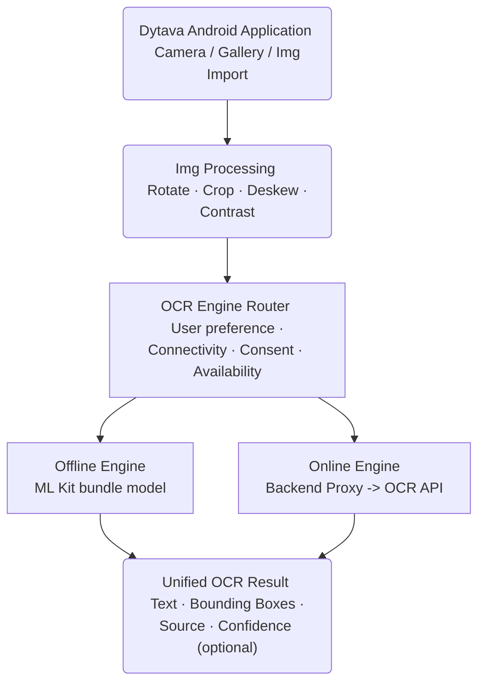

> **Tham chiếu nghiên cứu OCR:** phạm vi hiện hành ở [PRD](../product/PRD.md), [Input OCR](../specs/input/10_ocr_image_input.md) và [scope mở rộng](../decisions/ADR_SCOPE_EXPANSION_2026-11-12.md). Trần source 1 GB không bỏ pixel/review guards; PDF output không đồng nghĩa nhập PDF. Luồng cloud/router bên dưới là nghiên cứu ngoài P0, không là runtime đã có.

# Tổng quan vấn đề

# So sánh hai file Excel

| Hạng mục         | Giới hạn và khó khăn                                                                                | Phương án khả thi                                   |
| ---------------- | --------------------------------------------------------------------------------------------------- | --------------------------------------------------- |
| Định dạng file   | `.xls` và `.xlsx` sử dụng cấu trúc khác nhau; file chứa macro, công thức phức tạp khó hỗ trợ đầy đủ | Ưu tiên `.xlsx`                                     |
| Cấu trúc dữ liệu | Hai file có thể khác thứ tự hàng/cột, tên cột hoặc số lượng sheet                                   | Cho phép chọn sheet, cột khóa để đối chiếu          |
| So sánh nội dung | `100` (kiểu số) và `"100"` (kiểu chuỗi) có thể bị xác định là khác nhau                             | Chuẩn hóa kiểu dữ liệu theo quy tắc                 |
| Đối chiếu hàng   | Chỉ so sánh cùng tọa độ ô sẽ gây sai lệch khi dữ liệu bị sắp xếp lại                                | Đối chiếu theo mã định danh duy nhất                |
| Dữ liệu lớn      | File có nhiều hàng, cột và công thức có thể gây tiêu thụ RAM cao                                    | Xử lý từng phần, giới hạn kích thước file trong MVP |
| Đọc ảnh chụp     | OCR có thể nhầm ký tự, mất cấu trúc bảng hoặc nhận sai số thập phân                                 | ML Kit OCR, cho phép kiểm tra và chỉnh sửa kết quả  |
| Xuất kết quả     | Giữ nguyên định dạng Excel phức tạp khó hơn xuất bảng dữ liệu đơn giản                              | Xuất báo cáo `.csv` hoặc `.xlsx` đơn giản           |

# So sánh:

- So sánh cấu trúc fields, 
- So sánh nội dung:
- So sánh metadata (mở rộng)

|      | xlsx | csv | ảnh |     |     |
| ---- | ---- | --- | --- | --- | --- |
| xlsx |      |     |     |     |     |
| csv  |      |     |     |     |     |
| ảnh  |      |     |     |     |     |

## Thiết kế hai luồng xử lý

| Tiêu chí                | Offline OCR (bundled)   | Cloud OCR (unbundled)      |
| ----------------------- | -------------------------- | ----------------------------- |
| Engine                  | ML Kit Text Recognition v2 | Document AI / OCR API         |
| Internet                | Không cần                  | Bắt buộc                      |
| Xử lý                   | Trên Andoid (Device)       | Trên server nhà cung cấp      |
| Nhận dạng văn bản       | Có                         | Có                            |
| Nhận dạng cấu trúc bảng | Phải tự xây dựng           | Tuỳ API, có thể hỗ trợ        |
| API Key                 | Không cần                  | QUản lý tại backend           |
| Chi phí theo lượt       | Không                      | Tuỳ nhà cung cấp              |
| Quyền riêng tư          | Dữ liệu trên máy           | Phải có cơ chế đồng ý         |
| Đóng gói `.apk` độc lập | Có                         | Không thể tự vận hành độc lập |

>[!Note]More References
>- Offline OCR: [Nhận dạng văn bản trong hình ảnh bằng Bộ công cụ học máy trên Android  |  ML Kit  |  Google for Developers](https://developers.google.com/ml-kit/vision/text-recognition/v2/android?utm_source=chatgpt.com&hl=vi)
>- Online OCR: [Đường dẫn cài đặt mô hình Bộ công cụ học máy trên Android  |  ML Kit  |  Google for Developers](https://developers.google.com/ml-kit/tips/installation-paths?utm_source=chatgpt.com&hl=vi#key_differences_between_installation_options)

## Yêu cầu nghiệm thu

| ID     | Yêu cầu                                        | Mức    |
| ------ | ---------------------------------------------- | ------ |
| OCR-01 | OCR ảnh bảng hoàn toàn offline                 | Must   |
| OCR-02 | Bundled model trong APK                        | Must   |
| OCR-03 | Tái dựng dữ liệu dạng hàng/cột                 | Must   |
| OCR-04 | Cho phép hiệu chỉnh kết quả OCR                | Must   |
| OCR-05 | Đầu ra tương thích **Comparison Engine**       | Must   |
| OCR-06 | OCR Cloud API                                  | Should |
| OCR-07 | Chuyển online/offline theo cấu hình            | Should |
| OCR-08 | Ghi nhận engine/version và trạng thái xác nhận | Must   |

## Testing

- [ ] Cài APK trên thiết bị chưa tải model và bật chế độ máy bay
- [ ] Nhận dạng bảng có mã định danh, dấu tiếng Việt và số thập phân;
- [ ] So sánh dữ liệu ảnh với Excel sau khi người dùng xác nhận bảng.