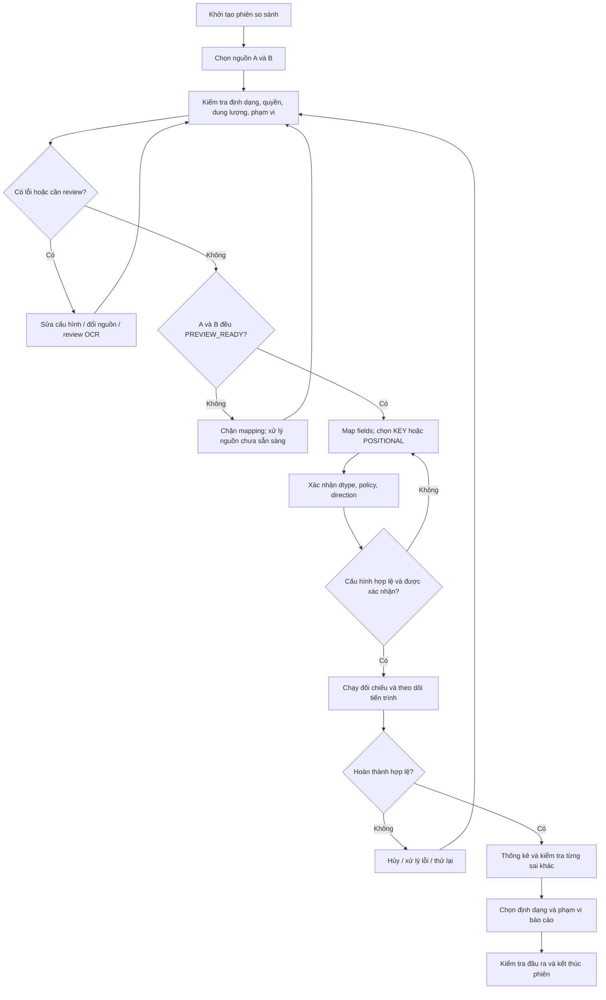

# Dytava — Business Requirements & Business Workflow Specification

> **Vai trò của tài liệu:** diễn giải nhu cầu, quy trình ra quyết định của người sử dụng, ngoại lệ và tiêu chí nghiệm thu từ góc độ nghiệp vụ. Đây là **tài liệu bổ trợ**, không tái định nghĩa Product Scope (`PRD`), Functional Requirements (`SRS`), Input/Core semantics, NFR hoặc Report contract. Những mã `BIZ-*` bên dưới là **điểm kiểm soát nghiệp vụ để truy vết**, không phải một bộ `FR` độc lập.
>
> **Trạng thái:** đặc tả **DRAFT / PROPOSED**. Mobile Flutter hiện chỉ có PoC so sánh hai giá trị. Không có bằng chứng các luồng nghiệp vụ trong tài liệu này đã chạy trên thiết bị Android.

## 1. Căn cứ, mục đích và ranh giới

**Nguồn chuẩn trong repo:**
- [Product Requirements](../product/PRD.md): persona, US-01..US-15 và phân pha.
- [Software Requirements](SRS.md): FR-001..FR-018 và hành vi hệ thống.
- [Non-Functional Requirements](NFR.md): chất lượng, bảo mật, offline, resources và release gates.
- [Input Specification](../specs/input/README.md): cấu trúc nguồn, trạng thái nhập, OCR, validation và provenance.
- [Core semantic specification](../project/EXCELCOMPARE_Android_iPhone_Flutter_Package_2026-11-11/DATATYPE_POLICY_ENGINE_ANDROID_IOS_SPEC.md): tương đương ngữ nghĩa, key và phân loại kết quả.
- [Report Export Specification](../specs/report/README.md): CSV/JSON và hai loại PDF, template, xuất và chia sẻ.
- [ADR P0](../decisions/ADR_REGISTER_P0_2026-11-11.md) và [ADR mở rộng](../decisions/ADR_SCOPE_EXPANSION_2026-11-12.md): quyết định phạm vi có hiệu lực.

### 1.1. Bài toán nghiệp vụ

Hai bảng dữ liệu do hệ thống hoặc người dùng xuất ra có thể **trùng tên tệp** nhưng khác nội dung; khác thứ tự bản ghi; khác cấu trúc cột; khác cách biểu diễn số, chuỗi, dấu phân cách hoặc dữ liệu thiếu. So sánh thủ công dễ phát sinh nhầm lẫn giữa **khác biệt biểu diễn**, **khác biệt giá trị**, **khác biệt cấu trúc** và **thiếu bằng chứng để kết luận**. Người dùng cần một quy trình có thể giải thích, đối chiếu, xác minh và xuất báo cáo mà không làm thay đổi dữ liệu gốc.

### 1.2. Kết quả nghiệp vụ mong đợi

1. Người dùng chọn rõ **hai nguồn A/B độc lập**; không sử dụng tên tệp làm danh tính duy nhất.
2. Người dùng nhìn thấy phạm vi, chất lượng nguồn và các cấu hình ảnh hưởng đến kết luận **trước khi chạy**.
3. Hệ thống thể hiện chính xác các cặp tương ứng, các trường hợp không ghép được và các trường hợp chưa đủ căn cứ.
4. Kết quả cho phép truy vết **giá trị A, giá trị B, nguồn/vị trí, chính sách và lý do**.
5. Báo cáo được tạo từ cùng snapshot kết quả; không sửa dữ liệu nguồn, không lặng lẽ lược bỏ dữ liệu hoặc kết luận chưa xác định.

### 1.3. Đối tượng sử dụng / quyền hạn

| Nhóm người dùng | Nhiệm vụ điển hình | Quyền/giới hạn P0 |
| --- | --- | --- |
| Sinh viên/nhân viên hành chính | Đối chiếu hai danh sách, bảng điểm, bảng kiểm kê | Chọn dữ liệu trong quyền thiết bị, kiểm tra diff và tự quản lý đầu ra |
| Kế toán/nhân viên dữ liệu | So sánh bản trích xuất trước/sau điều chỉnh | Xác nhận mapping/khóa/quy tắc, kiểm tra dữ liệu số và mã định danh |
| Người có bảng từ ảnh chụp | Trích dữ liệu ảnh và so với bảng khác | Phải kiểm tra/chỉnh sửa OCR trước khi chạy; không mặc định OCR đúng |
| Người kiểm thử/đối soát | Xác minh phiên kết quả với dữ liệu chuẩn | Kiểm tra SourceRef/Rule/Manifest và các trường hợp `UNRESOLVED` |

P0 **không mặc định có tài khoản, đăng nhập, vai trò quản trị, đồng bộ hoặc quyền duyệt báo cáo**. Các vai trò ở trên là ngữ cảnh sử dụng, không phải RBAC hệ thống.

## 2. Phạm vi nghiệp vụ và giới hạn

| Hạng mục | Android P0 mở rộng | Ngoài phạm vi P0 |
| --- | --- | --- |
| Nguồn đầu vào | Hai slot A/B; XLSX, CSV, TSV; tối đa **một** ảnh PNG/JPG/JPEG ở một phía | Ảnh–ảnh, JSON/JSONL, PDF input, XLS/XLSM/ODS, nhiều ảnh |
| Phạm vi bảng | Mỗi bên chọn **một** table/scope; XLSX chọn một worksheet và range | So sánh tất cả sheets/batch |
| So khớp | `POSITIONAL` hoặc `KEY` xác nhận; mapping 1:1 | MULTISET/ORDERED_SEQUENCE, tự động đoán khóa không cần xác nhận |
| Kết luận ô | `EXACT`, `EQUIVALENT`, `DIFFERENT`, `UNRESOLVED` | So công thức/style/metadata như mode riêng (P1+) |
| OCR | Nhận dạng trên máy, một bảng/ảnh, review mọi selected cell | Cloud OCR, chữ viết tay, bảng phức tạp chưa review |
| Dung lượng | Tối đa **1.000.000.000 byte cho mỗi nguồn**, với resource guardrails độc lập | Cam kết mọi thiết bị xử lý được trước benchmark |
| Đầu ra | CSV diff, JSON report, merged diff PDF và Dytava template PDF | XLSX export, biên bản ký số, PDF/A/PDF/UA chứng nhận |
| Khai thác | Offline-first, không upload ngầm, không sửa source | Cloud workspace, chia sẻ tự động, lịch sử giữ raw lâu dài |

**Lưu ý quan trọng:** phạm vi được quyết định ≠ năng lực runtime đã được xác minh. Mọi hạng mục P0 ở đây còn cần adapter, UI, các bài kiểm thử, thiết bị tham chiếu và bằng chứng phát hành.

## 3. Quy trình nghiệp vụ chính (end-to-end)

### 3.1. Hoạt động, trách nhiệm và điều kiện bàn giao

| Bước | Đầu vào | Người dùng quyết định | Điều kiện chuyển bước | Ngoại lệ/khôi phục |
| --- | --- | --- | --- | --- |
| 1. Chọn nguồn | Nguồn A/B do người dùng chỉ định | Chọn/đổi nguồn; chọn ảnh ở tối đa một bên | Hai slot có artifact hợp lệ để preflight | Tệp không tồn tại, mất quyền, cùng tên nhưng khác nội dung |
| 2. Preflight | Bytes, type, size, parser capability | Chọn sheet/range/header; dialect/encoding khi cần | Mỗi nguồn parse tới EOF, hash và validate đầy đủ | Vượt resource budget, format giả, permission bị thu hồi |
| 3. OCR review (nếu có) | Ảnh, text/geometry nhận dạng | Sửa crop/layout/text; xác nhận toàn bộ ô đã chọn | Review receipt hợp lệ với đúng revision của ảnh/scope | OCR cấu trúc không tin cậy, layout đổi làm mất hiệu lực review |
| 4. Mapping & mode | Hai snapshots hiện hành | Map Field ID 1:1; chọn KEY/POSITIONAL | Mapping hợp lệ, KEY được kiểm tra null/duplicate | Duplicate, null key, schema không khớp |
| 5. Policy & direction | Cấu hình comparison | Xác nhận kiểu ngữ nghĩa, quy tắc, hướng A→B/B→A | Không còn blocker; phiên bản config/policy xác định | Inference chỉ là gợi ý; ambiguity không được tự kết luận |
| 6. Comparison | Snapshots + config đã đóng băng | Chạy, theo dõi, hủy nếu cần | Result `COMPLETED` và đúng revision | Cancel, OOM/disk pressure, source invalidation |
| 7. Review result | Diff + stats + refs | Lọc, xem bằng chứng, phân biệt unmatched và unresolved | Người dùng hiểu phạm vi kết quả | Không có cặp matched: tỷ lệ = N/A |
| 8. Export | Kết quả immutable | Chọn CSV/JSON/PDF và scope báo cáo | Kiểm tra đầy đủ artifact, hoàn tất ghi tệp | Disk full, quyền ghi bị thu hồi, stale result; không publish partial |

## 4. Điểm kiểm soát và quy tắc quyết định nghiệp vụ

> `BIZ-*` là mã **điểm kiểm soát/diễn giải** để nhóm BA–UX–QA cùng kiểm tra. Semantics bắt buộc vẫn lấy tại ADR/SRS/Input/Core/Report được tham chiếu ở cột nguồn.

| ID | Điểm kiểm soát cần thể hiện với người dùng | Nguồn chuẩn | Gợi ý cách xác minh |
| --- | --- | --- | --- |
| BIZ-01 | A và B là hai nguồn độc lập kể cả trùng tên; không ghi đè nguồn cũ khi chọn tệp mới | FR-001, INP-REQ-001/002 | Hai file trùng tên, khác hash vẫn có identity riêng |
| BIZ-02 | A=baseline/B=candidate là nhãn gợi ý; người dùng xác nhận direction; đổi direction đảo ADDED/REMOVED | ADR-001, FR-007 | Kết quả thay đổi nhãn đúng hướng, không đổi bytes nguồn |
| BIZ-03 | Chỉ một selected table/scope mỗi phía; đổi scope/header làm stale snapshot và mapping | ADR-003/005, FR-002 | Chọn worksheet/range khác, chặn run cho tới revalidation |
| BIZ-04 | Sample preview không chứng minh đã parse đủ; chỉ `PREVIEW_READY` sau full validation | INP-008, FR-001/002 | A preview xong, B lỗi → chặn mapping |
| BIZ-05 | OCR phải hiển thị ảnh gốc/geometry và được review từng selected cell | ADR-002, FR-012 | OCR chưa confirm → không được so sánh |
| BIZ-06 | Đổi crop/rotation/layout/ảnh phải hủy xác nhận OCR trước đó | INP-010, FR-012 | Thay crop sau confirm → phải review lại |
| BIZ-07 | Manual 1:1 mapping, KEY/POSITIONAL, dtype/policy/direction phải được xác nhận trước compare | ADR-008, FR-005/006/009 | Thiếu một confirm → nút chạy bị chặn và nêu lý do |
| BIZ-08 | Duplicate/null key không được ghép tùy tiện; reorder trong POSITIONAL không suy thành added/removed | Core, SRS §4.2 | Key duplicate và reordered dataset có kết quả kiểm chứng |
| BIZ-09 | Không gộp missing, blank, empty string, null, zero; không giả tạo số 0 đầu mã định danh | ADR-006, FR-008 | `00123` text ≠ `123` text; XLSX numeric mất lexical evidence → review/UNRESOLVED |
| BIZ-10 | `EQUIVALENT` chỉ khi policy giải thích được; `UNRESOLVED` không phải lỗi hệ thống | Core, FR-009 | Kết luận gồm raw, canonical, rule/reason và SourceRef |
| BIZ-11 | Thống kê ô phải có mẫu số rõ; structural events là nhóm riêng; mẫu số 0 → N/A | SRS §4.4, FR-013 | Tổng 4 cell verdicts = compared matched pairs |
| BIZ-12 | Chỉ export `COMPLETED` result còn hiện hành; không export partial/cancelled | FR-013/015/017/018, Report spec | Đổi policy/scope/direction sau run → export bị khóa |
| BIZ-13 | CSV/JSON/hai PDF dùng chung result; merged PDF là **một tệp A/B**; Dytava PDF theo template có version | EXP-ADR-002, FR-017/018 | Reconcile counts / refs giữa các output |
| BIZ-14 | Mọi hoạt động source read-only và offline; không tự upload; không giữ raw dài hạn mặc định | NFR-SEC-01/02, NFR-PRIV-01, ADR-009 | Kiểm thử hash trước/sau và lưu trữ ứng dụng |
| BIZ-15 | Giới hạn nguồn **1 GB = 10^9 bytes/source**; giới hạn RAM/scratch/ZIP/OCR độc lập, lỗi cần giải thích | EXP-ADR-001, FR-016, NFR §3 | Tệp đúng biên, vượt 1 byte, thiếu bộ nhớ/đĩa |
| BIZ-16 | Lỗi/cancel/process death không để lại phiên READY giả, file xuất dở hoặc dữ liệu tạm mồ côi | FR-015, INP-008, NFR-REL-02/03 | Kill/restart, stale callbacks, permission revoke |

## 5. Business use cases và các nhánh ngoại lệ

### BUC-01 — Đối chiếu hai tệp bảng tính

- **Actor chính:** người dùng sở hữu hai nguồn dữ liệu.
- **Tiền điều kiện:** ứng dụng có quyền truy cập scoped theo hành động chọn tệp.
- **Trigger:** chọn **So sánh mới**.
- **Luồng chính:** chọn A/B → preflight → chọn table/header → xác nhận mapping, mode, policy, direction → so sánh → xem kết quả → export.
- **Hậu điều kiện thành công:** result có trạng thái COMPLETED, audit refs và một hoặc nhiều artifact do người dùng chọn xuất; tệp A/B không thay đổi.
- **Luồng thay thế:** A đã READY, B FAIL thì cho sửa B mà không buộc bỏ A còn hợp lệ.
- **Ngoại lệ:** cùng tên tệp; source permission revoke; source changed; thiếu profile thiết bị; mapping stale → chặn run và chỉ rõ phương án khắc phục.
- **Refs:** US-01..09, US-13..15; FR-001..09, FR-013..18.

### BUC-02 — Đối chiếu ảnh bảng với tệp

- **Tiền điều kiện:** một phía là PNG/JPEG, phía kia là XLSX/CSV/TSV; không cho hai ảnh P0.
- **Luồng chính:** chọn ảnh → định hướng/crop → OCR tại thiết bị → hiển thị vùng nhận dạng, text và cấu trúc bảng nháp → người dùng sửa/confirm tất cả selected cells → handoff để mapping với bảng còn lại.
- **Luồng thay thế:** ảnh không dựng được bảng đáng tin cậy → yêu cầu chia lại hàng/cột và chỉnh ô, không tự gán tọa độ kiểu Excel.
- **Ngoại lệ:** đổi ảnh/crop/rotation/layout xóa review cũ; thiếu receipt → chặn compare.
- **Refs:** US-11, FR-003/012, INP-010, NFR-OCR-01.

### BUC-03 — Kiểm tra kết quả chưa xác định

- **Trigger:** kết quả có `UNRESOLVED` hoặc key ambiguity.
- **Luồng:** xem danh sách unresolved → mở chi tiết → đọc raw/canonical/SourceRef/rule hoặc missing reason → quay lại cấu hình hoặc xuất báo cáo ghi rõ unresolved.
- **Quy tắc:** không cho người dùng đổi trực tiếp verdict đã tính thành EXACT/EQUIVALENT nếu không có cấu hình, bằng chứng và một lần chạy mới; không coi unresolved là 0 hay bỏ khỏi mẫu số.
- **Refs:** US-05..07, FR-007..09/013, Core.

### BUC-04 — Hủy, thử lại, khôi phục sau gián đoạn

- **Luồng:** user cancel → xác nhận trạng thái đã hủy → cleanup → thử lại với quyền/config hợp lệ.
- **Sau process death:** chỉ khôi phục tham chiếu an toàn, chuyển về SELECTED hoặc UNSELECTED; bắt buộc revalidate access/hash; không khôi phục READY/running một cách giả tạo.
- **Ngoại lệ:** disk full, quyền nguồn mất, nguồn thay bytes, callback đã lỗi thời → bỏ output cũ, ghi lỗi không chứa raw data.
- **Refs:** US-09, FR-015/016, INP-008, NFR-REL.

### BUC-05 — Xuất và quản lý kết quả chia sẻ

- **Luồng:** từ result COMPLETED → chọn một trong bốn loại xuất → chọn FULL / DIFFERENCES_ONLY / FILTERED nếu được hỗ trợ → xem tổng bản ghi được xuất so với tổng phiên → chọn nơi lưu/chia sẻ → xác nhận đã hoàn thành.
- **Quy tắc:** PDF diff hợp nhất A/B không làm mất biểu diễn A/B; report template Dytava có nguồn, method/policy, warnings, statistics và audit; PDF chia sẻ có thể chứa dữ liệu nhạy cảm nên báo trước khi đưa ra ngoài app.
- **Ngoại lệ:** stale snapshot, pending OCR, cancel, lỗi renderer, disk full → không công bố output partial.
- **Refs:** US-08/14/15, FR-013/017/018, Report spec.

## 6. Định nghĩa hoàn thành theo nghiệp vụ / acceptance scenarios

| ID | Given | When | Then | Ref & test nguồn | Trạng thái |
| --- | --- | --- | --- | --- | --- |
| BAC-01 | Hai file cùng tên, nội dung khác | Chọn A/B | Hệ thống giữ 2 identities và không overwrite | FR-001, INP-TC-001 | PLANNED |
| BAC-02 | A PREVIEW_READY, B FAILED | Chọn cấu hình so sánh | Không cho chạy; chỉ rõ blocker ở B | INP-TC-036 | PLANNED |
| BAC-03 | XLSX nhiều sheets | Mở scope | Chọn đúng một sheet/range, không ghép tất cả | FR-002, INP-TC-017..020 | PLANNED |
| BAC-04 | OCR đã confirm, crop thay đổi | Tiếp tục mapping | Receipt cũ không hợp lệ, bắt review lại | INP-TC-039/040 | PLANNED |
| BAC-05 | KEY có bản ghi trùng | Chạy đối chiếu | Không tự chọn một bản ghi ghép tùy tiện | E2E-04 | PLANNED |
| BAC-06 | Dữ liệu có EXACT/EQUIVALENT/DIFFERENT/UNRESOLVED | Xem tổng hợp | Tổng 4 nhóm đúng bằng số matched cell pairs | SRS §4.4 | PLANNED |
| BAC-07 | Chỉ có unmatched rows, không có matched cell | Xem tỷ lệ | Hiển thị N/A thay vì 0%/100% tự suy | SRS §4.4 | PLANNED |
| BAC-08 | Đã có result, đổi hướng | Mở export | Result cũ invalid, yêu cầu compare lại | ADR-001, REP-TC-008 | PLANNED |
| BAC-09 | File 1.000.000.000 bytes hợp lệ, profile phù hợp | Import→compare→export | Chạy đầy đủ EOF/đúng kết quả, có metric tài nguyên | LARGE-TC-* | PLANNED |
| BAC-10 | Có result COMPLETED, đủ bốn trạng thái | Xuất merged diff PDF | Một PDF có đầy đủ union A/B, legend, references | REP-TC-001..005 | PLANNED |
| BAC-11 | Có result COMPLETED và template | Xuất Dytava PDF | Báo cáo có đúng statistics/methodology/notes, font tiếng Việt đọc được | REP-TC-006/007/012 | PLANNED |
| BAC-12 | Đang export, storage bị thu hồi | Ghi file | Không publish báo cáo partial; cleanup an toàn | REP-TC-010 | PLANNED |

**Chính sách chứng cứ:** `PLANNED` không tương đương PASS. Mỗi bài kiểm thử cần commit SHA, device/build, fixture hash, expected/oracle, actual output, kết quả và liên kết evidence theo [Traceability Matrix](TRACEABILITY_MATRIX.md).

## 7. Phạm vi dữ liệu và trách nhiệm giải thích

**Đầu vào:** metadata tệp, bytes hợp lệ, vị trí nguồn và lựa chọn của user. **Dữ liệu trung gian:** raw/parsed source snapshots, field mapping, input configuration, policy digest, provenance, review receipt OCR. **Đầu ra:** result snapshot và report có manifest.

Không sử dụng nhãn tệp, display format, inference dtype hoặc OCR confidence làm **nguồn sự thật nghiệp vụ**. Kết quả `EQUIVALENT` là **tương đương theo quy tắc đã xác nhận**, không khẳng định hai bản ghi giống byte. `UNRESOLVED` phản ánh giới hạn bằng chứng, không nhất thiết là lỗi phần mềm. Added/Removed phụ thuộc direction được xác nhận.

## 8. Các quyết định vẫn cần xác nhận, không tự điền

| Mã | Vấn đề còn mở | Quyết định cần đưa ra | Tác động |
| --- | --- | --- | --- |
| OPEN-B01 | Mức OCR tối thiểu theo giảng viên | Bộ ảnh/bảng mẫu, ngôn ngữ, tiêu chí nghiệm thu | Phạm vi kiểm thử học phần, FR-012 |
| OPEN-B02 | Thiết bị Android tham chiếu cho 1 GB | Model/RAM/API + nguồn lưu trữ, benchmark corpus | Release gate FR-016, NFR-PERF |
| OPEN-B03 | Ngưỡng chất lượng OCR | CER/WER/cell accuracy/structure F1 theo dataset được duyệt | Không suy đoán accuracy |
| OPEN-B04 | Mục tiêu trải nghiệm và khảo sát người dùng | Thời gian hoàn thành tác vụ, lỗi thao tác, nghiên cứu usability | UX metrics mới chỉ PROPOSED |
| OPEN-B05 | Owner/reviewer nghiệp vụ | Người duyệt PRD/BRD/SRS, cơ chế phê duyệt thay đổi | Chưa thể đánh dấu APPROVED |

## 9. Quy tắc thay đổi tài liệu

- Đổi bài toán, user stories, phase → sửa **PRD** trước; BRD cập nhật workflow và impact.
- Đổi hành vi máy phải thực hiện → sửa **SRS**; không dùng BRD tạo một FR song song.
- Đổi token/raw/SourceRef/import/OCR → sửa **Input spec** và schema/version liên quan.
- Đổi equivalence/key/matching → sửa **Core/UDG3.1** cùng golden oracle.
- Đổi ngân sách 1 GB/accessibility/offline/security → sửa **NFR/RP-1**.
- Đổi PDF layout/manifest → sửa **Report spec**.
- Đổi hành vi hiển thị và tương tác → sửa [UI/UX Spec](../design/UI_UX_SPEC.md), kiểm tra screen-to-FR mapping.

Không nâng trạng thái từ DRAFT/PLANNED thành APPROVED/PASS chỉ vì viết xong tài liệu.
