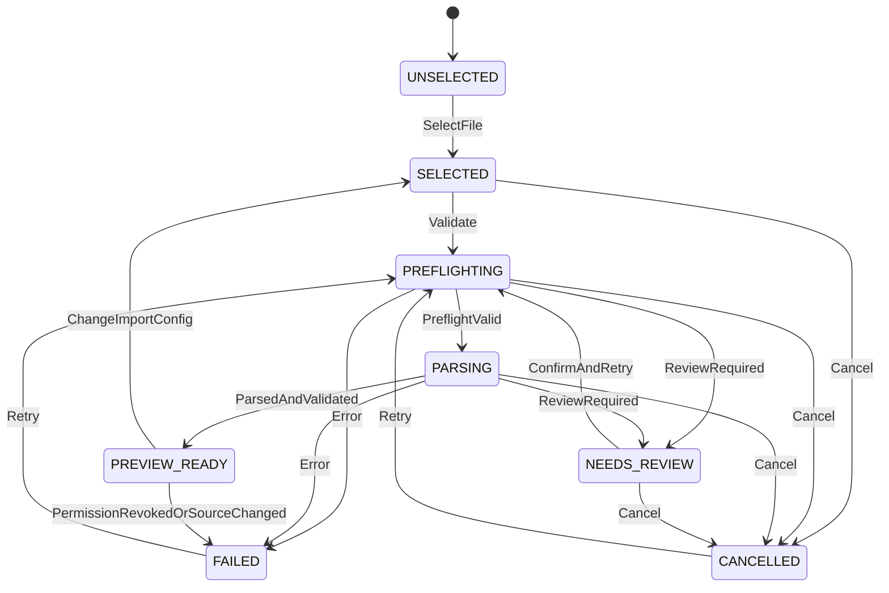

# State machine nhập dữ liệu A/B

> **ADR status 11/11/2026:** [INP-ADR-001..009 đã chốt](../../decisions/ADR_REGISTER_P0_2026-11-11.md) cho Android P0, gồm OCR có review. Các câu “OPEN”, “OCR P2” hoặc “chưa quyết định” của baseline 0.1.0 khi xung đột là lịch sử; schema và test implementation vẫn DRAFT/PLANNED.

Document ID: INP-008\
Version: 0.1.1 (documentation; wire schemas vẫn 0.1.0)\
Status: DRAFT\
Platform: Flutter/Dart — Android P0 / iOS P1\
Owner: TBD\
Updated: 12/11/2026

## 1. Mục đích và phạm vi

State machine riêng cho từng source_side, không thay Comparison Job state machine. Tên PREVIEW_READY nghĩa preview thuộc một snapshot đã full-validate; preview lấy mẫu trong lúc parse không cấp trạng thái này.

## 2. Thuật ngữ và định nghĩa

attempt_id định danh một lượt async đọc; generation tăng khi replace/reset; config_revision định danh effective config. Snapshot chỉ công bố nguyên tử sau EOF, hash và validation. Mỗi callback phải mang artifact_id, attempt_id, generation và config_revision để loại kết quả cũ.

## 3. Các thành phần dữ liệu

| State | Invariant |
| --- | --- |
| UNSELECTED | Không artifact/handle/snapshot hiệu lực |
| SELECTED | Có artifact tham chiếu; chưa tin bytes/config |
| PREFLIGHTING | Một attempt kiểm tra access/format/limits/config |
| PARSING | Preflight hợp lệ; đọc raw rows, chưa cấp snapshot |
| NEEDS_REVIEW | Có REVIEW blocker; có thể có preview tạm, chưa cho mapping |
| PREVIEW_READY | EOF validated, hash đủ, config resolved, không ERROR/REVIEW; snapshot hiện hành |
| FAILED | Attempt thất bại; giữ safe diagnostics, không snapshot dùng được |
| CANCELLED | Tác vụ đã dừng; handles đóng, không snapshot dùng được |

PREFLIGHTING/PARSING có cancellation token, progress và resource scope. large-input-v1 theo NFR dùng bounded stream/private disk spill; không áp total watchdog 60s của profile nhỏ. Handles/temp thuộc attempt phải được đóng hoặc bàn giao ownership tường minh vào validated snapshot; snapshot row/index store còn sống khi UI/Core/export cần, cleanup khi consumers release/session close. Error/cancel/startup sweep không được giữ orphan scratch. State runtime lưu riêng, không trộn vào raw_kind hay SourceArtifact schema.

## 4. Quy tắc và ràng buộc

- **INP-RULE-033:** Chỉ callback đúng generation/attempt/revision mới được commit state hoặc snapshot. Thay file/config hủy attempt cũ trước khi chạy mới.
- **INP-RULE-034:** PREVIEW_READY yêu cầu full validation, không chỉ sample preview; revocation/source change invalidate snapshot và mapping liên quan.
- **INP-RULE-035:** Mapping gate = A.PREVIEW_READY && B.PREVIEW_READY && cả hai snapshot còn hiệu lực. Comparison gate còn cần mapping/key/policy/direction được xác nhận.
- **INP-RULE-036:** Process death không restore trạng thái running/ready từ journal như thể đã kiểm tra lại. Restore chỉ metadata tối thiểu; recheck access/hash/config rồi restart an toàn.

Diagram thể hiện đường chính; bảng transition dưới đây định nghĩa thêm replace/reset/recovery áp dụng toàn cục.

## 5. Input / Output Contract

| Event | Payload tối thiểu | Guard → effect / next state |
| --- | --- | --- |
| SelectFile / ReplaceFile | side, access_ref, provider_metadata | Từ mọi state; invalidate snapshot/mapping, generation++, close cũ, tạo artifact mới → SELECTED |
| Validate | artifact_id, config_revision | SELECTED, access ref hiện hành → new attempt → PREFLIGHTING |
| PreflightValid | attempt tuple, detected_format, resolved_config | Đúng tuple, access/limits/profile OK, không blocker → PARSING |
| ParsedAndValidated | attempt tuple, sha256, byte_count, tables, ValidationResult | Đúng tuple, EOF, resolved scope/header, no blockers → commit snapshot → PREVIEW_READY |
| ReviewRequired | attempt tuple, issues[], preview? | PREFLIGHTING/PARSING với REVIEW → đóng stream → NEEDS_REVIEW |
| ConfirmAndRetry | artifact_id, expected_revision, resolution, review_receipt | NEEDS_REVIEW, resolution đủ, không stale → resolve config/revision, new attempt → PREFLIGHTING |
| Error | attempt tuple, issues[] | Running state, ERROR → invalidate + cleanup → FAILED |
| Cancel | side, generation | SELECTED/running/NEEDS_REVIEW/PREVIEW_READY → cancel token, cleanup, invalidate → CANCELLED |
| Retry | artifact_id, expected_revision | FAILED/CANCELLED, ref còn tồn tại, lỗi có thể giải quyết → new attempt/recheck → PREFLIGHTING |
| ChangeImportConfig | side, expected_revision, config | Mọi state có artifact; invalidate, cancel cũ, revision++ → SELECTED |
| PermissionRevoked / SourceChanged | artifact_id, generation, evidence | Mọi state có artifact, tuple hiện hành → invalidate, cleanup, 006/015 → FAILED |
| Reset | side | Mọi state → generation++, cancel/cleanup, clear source → UNSELECTED |
| Restore | minimal journal | Có ref → SELECTED + issue 018, revalidate trước khi ready; không còn ref → UNSELECTED |

Event bất hợp lệ không đổi state; UI nhận safe diagnostic. Không retry vòng lặp vô hạn. Hash được tính trên đúng bytes cung cấp cho parser; nếu cần đọc lại phải xác minh cùng hash hoặc parse bản scratch đã kiểm soát. Không commit hash của lượt đọc khác với parsed rows.

## 6. Luồng xử lý

A và B chạy độc lập. Khi A READY nhưng B FAILED, có thể sửa/retry B mà không parse lại A nếu A snapshot vẫn hợp lệ. Thay A chỉ invalidate derived mapping/comparison và A snapshot; giữ B nếu không phụ thuộc config chung đã đổi. Đổi policy riêng chỉ invalidate comparison, không đổi Import state. App kill giữa parse: không dùng prefix rows làm bảng đầy đủ; chọn restart từ preflight. Không cam kết resume byte offset ở draft này.

## 7. Edge Cases và Error Handling

Late Parsed callback sau Cancel/Replace bỏ qua tuple cũ. Review receipts gắn artifact hash + revision + scope; bytes mới không tái dùng review cũ. Permission mất sau READY chặn hành động mới; comparison đang chạy phải cancel/invalidate khi phụ thuộc source/snapshot bị thu hồi theo app contract. Không report kết quả mới từ snapshot đã invalidated.

## 8. Security & Privacy

Journal không ghi raw rows/full URI trong logs; token nội bộ phải lưu theo platform secure/private storage. Tạm dừng nền và restore không được tự kích hoạt cloud. Dọn scratch theo retention policy đã chốt, không hứa mốc 24 giờ chỉ vì Master từng đề xuất.

## 9. Acceptance Criteria

INP-TC-034 chuyển state chuẩn và guard; INP-TC-035 race cancel/replace; INP-TC-036 A READY/B chưa READY; INP-TC-037 permission/source change sau READY; INP-TC-038 process death/restart. Registry nêu expected transitions.

## 10. Open Questions

INP-ADR-009 về scratch/retention. Recovery strategy ở đây đề xuất restart an toàn, không hứa checkpoint/resume. Cần UX background handling và device lifecycle tests trước APPROVED.

## 11. References

[INP-001](01_input_scope.md), [INP-006](06_input_configuration.md), [INP-007](07_validation_errors.md), [tests](09_acceptance_tests.md).
